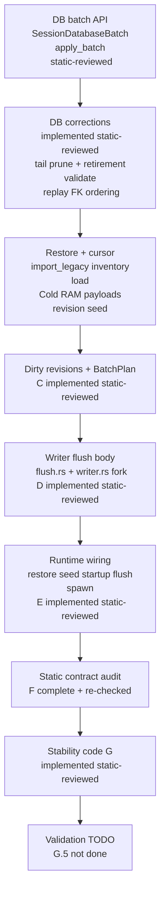

# Workflow Session SQLite fusion — Phase 2 interface and progress

> **历史记录（2026-11-25 标记）：** 原 Phase-2 任务接续契约已被 2026-11-24 官方 SQLite 融合方向替代，不再作为当前开发任务书或当前历史保留规则。现行融合决策与验收边界见 [融合进度记录](upstream-main-fusion-progress-2026-11-24.md)。以下保留原始设计、恢复安全审查、未验证事项及历史 Run 证据，仅供追溯，不据此重启旧任务或认定当前行为。


Durable implementation record for the Fork’s incremental SQLite Workflow Session
persistence. Phase 1 adds a crate-private DB backend; Phase 2 wires it into
`SessionStore`, `LedgerWriterGuard`, and runtime startup without replacing Fork
retention, writer scheduling, or close/barrier semantics.

**Historical coordination contract for parallel Agent work at the original Phase-2 baseline; superseded for current development.** It does not authorize commits, builds, tests, or deployment.

Related Fork docs: [`session-project-identity-1386.md`](session-project-identity-1386.md),
[`session-store-access-and-write-scheduling.md`](session-store-access-and-write-scheduling.md),
[`session-active-residency.md`](session-active-residency.md).

Authoritative domain sources: [`session-model.md`](../agent/session-model.md)
(bounded ledger tail, lifecycle, retention tombstones),
[`session-active-residency.md`](session-active-residency.md) (Hot/Cold RAM semantics).

---

Latest continuation: [K.2c / K.2d safety continuation, 2026-11-16](#k2c--k2d-safety-continuation-2026-11-16).
Earlier snapshots below describe their original runs, not current validation.

## Verification snapshot (historical Phase-2 run)

| Fact | Value |
|------|--------|
| Branch | `main` (local) |
| HEAD | `e34d69fa281d3029bcdb6d164c934ba4c3904df1` |
| Working tree | **109 paths** (92 modified + 17 untracked); **0 staged**; includes unrelated OAuth/runner/tunnel/desktop setup artifacts, `%SystemDrive%/`, and other feature edits — **must not be cleaned, overwritten, or broadly committed** as part of Phase-2 work |
| Snapshot read | **2026-11-11** — `get_git_status` equivalent (branch/HEAD/worktree counts); on-disk **`store/writer.rs` + this doc** re-read this Run; no remote fetch, push, commit, or `cargo` |
| Untracked Phase-1/2 sources | `persistence/database.rs`, `persistence/legacy_import.rs`, `store/batch_plan.rs`, `store/dirty.rs`, `store/writer/flush.rs`; **this progress document** is untracked |
| Validation in this Run | **Doc-only sync** — §**G.7** counter-audit dispute (`6so7j6…` observe completed; main-session static limits); §**G.5** counter-audit row; Stage **H** candidate (**not implemented**); **no** `cargo`, build/test/fmt, benchmark, runtime/soak, crash/restart injection, DB contention stress, join-hang reproduction, or deployment. §**G.6** unchanged. Stage **G** / §G.5 acceptance **not** claimed |
| Read-only audit Agents | **A**–**D** (coordination/read-only passes) — **complete** for this Phase-2 track |
| Encoding Agents | Cursor ACP (Runner default composer-2.5; `set_config_option` not used — exact model identity **not independently verifiable** in this Run); see **Stage G Agent execution record** |
| Phase-2 Stage **C** sources | `crates/webcodex-workflow-session/src/store/dirty.rs`, `crates/webcodex-workflow-session/src/store/batch_plan.rs` |
| Phase-2 Stage **D** sources | `crates/webcodex-workflow-session/src/store/writer/flush.rs`; `store/writer.rs` (shell unchanged; durable body branches SQLite vs JSON); `store.rs` (`durable_write_uses_sqlite`, sync `persist_after_mutation_with`, `SessionPersistence::database` / `durable_db_path` / `cost_observation_path`) |
| Phase-2 Stage **E** sources | `store.rs` `with_persistence_database` / `with_persistence_database_limits`, `flush_startup_sqlite_retention`; `src/tool_runtime/runtime.rs` `ToolRuntime::with_session_database`; `src/lib.rs` — `.with_session_database(config.db_path(), config.session_ledger_path())?` after existing `Database::open` + `ServerInstanceGuard::acquire` order (unchanged) |
| Phase-2 Stage **F** sources (audit complete) | `store/dirty.rs`, `store/batch_plan.rs`, `store/residency.rs`, `store.rs` (Cold `push_event` `repository_edit_observed`, `try_insert_session` dirty rollback, `enforce_historical_retention_bound` mandatory tombstone, `persistence_health_after_barrier` poison fail-closed, `OccupiedHot` retained); `persistence/legacy_import.rs` (NotFound deferral) |
| Phase-2 Stage **G** sources (static-reviewed) | `store/writer/flush.rs`, `store/writer.rs`, `store.rs` (`persistence_fatal`, `shutdown_persistence`, admission, sync-fallback gate, `SessionDurability`, `record_permission_decision` → `bool`), `store/dirty.rs` (`ensure_revision_capacity`), `persistence/database.rs` (`apply_batch_for_flush`, `ApplyBatchError::TransientStep`, source-chain transient), `messages.rs` (no-op resolve), `src/lib.rs` (listener join-before-persistence), `src/server_shutdown.rs` (QUIC stop watch), `src/runner_quic.rs`, `src/runner_session.rs` (`TaskAbortOnDrop`), `src/runtime_console_http` + `tests/session_collaboration.rs` (assertions only), `src/tool_runtime/dispatch/governance.rs`, `src/tool_runtime/kernel/recording.rs`, `src/tool_runtime/specialized.rs`, `src/tool_runtime/coding_task/startup.rs`, `src/tool_runtime/session_context.rs` |
| Prior Agent runs | Prior completed runs reported in handoff; **their tests are not claimed as executed in this Run** |

### Upstream reference commits (not on local recent history)

Local `main`’s recent ~100 commits **do not contain** these merge commits (per
handoff; not re-fetched in this Run):

| PR | Merge commit (upstream) | Role |
|----|-------------------------|------|
| #1322 | `a130605db08f401d096c1e8340f09e9257de38ba` | Official Store/Writer SQLite incremental persistence — **capability source, not wholesale port** |
| #1386 | `8553da96e05dc70a3f188f0bdbaa2ffd792beee7` | Session project identity fencing — partially adapted on Fork (`session-project-identity-1386.md`) |
| #1400 | `81271a7270bedf0b8b53d7ad9b78da03d4d11af8` | Upstream capability reference |
| #1411 | `6d50934b451c9a524cf9077dbc67656c2a8e5129` | Upstream capability reference |

---

## Authoritative contracts Phase 2 must honor

Per [`session-model.md`](../agent/session-model.md), each Workflow Session keeps a
**bounded per-Session ledger tail**, not an unbounded archive:
`DEFAULT_MAX_EVENTS_PER_SESSION` (2,000 events) and
`DEFAULT_MAX_MESSAGES_PER_SESSION` (200 messages). Phase-2 SQLite writes must
**prune** durable `workflow_session_events`, `workflow_session_messages`, and
dependent `workflow_session_message_delivery_replays` rows down to the same
retained tail the in-memory store already enforces, while preserving cumulative
`events_observed` and per-message **observation revision / floor** metadata in
`workflow_session_state` (`state_json` + column mirrors). Load paths may cap
reads; incremental commit paths must delete evicted tail rows explicitly.

Per [`session-active-residency.md`](session-active-residency.md), **Cold** means
canonical JSON **serialized payload retained in RAM** (`Arc<RawValue>`), not
disk-backed demand paging or lazy DB paging. SQLite startup must load each
Session’s **bounded** durable payload, sanitize once (trust boundary), and
construct the existing in-RAM Cold raw representation (`cold_session_from_persisted`
/ parity helpers). Do **not** describe Active Cold rows as evicted from RAM or
as DB-backed lazy-paged sessions. Hot/Cold residency, `hot_session_capacity_target`,
and compaction semantics stay store-owned.

**Historical Closed retention** (`historical_session_retention_limit`) removes old
Closed rows from durable storage and emits `SessionDatabaseRetirement` entries
with a concrete **`SessionRetentionTombstone`** — eviction **requires** tombstone
materialization; missing tombstone **blocks** eviction and preserves Session/LRU
(`store.rs` retention loop; `retirement_from_stored_session` takes non-optional
tombstone; DB wire type may remain `Option` for compatibility, but the production
retention path is **mandatory**). That policy is unrelated to Active hot→cold
compaction; compaction never evicts identities from RAM authority.

---

## Implementation status (static review only)

| Layer | Static-reviewed in sources | Implemented (unverified) | Not done / not verified |
|-------|---------------------------|-------------------------|-------------------------|
| DB schema + `apply_batch` | Yes | `SessionDatabaseBatch`, retirements, tombstone upsert/delete, delivery-replay delete, one `IMMEDIATE` txn | Production path: **D** `flush_sqlite_batch` when **E** ctor installed DB + seeded dirty state (**static-reviewed, unverified**) |
| DB incremental write (**A1**) | Yes | CAS revision, delta events, message upsert watermark, compact `state_json`; **`prune_retained_event_tail`** (ordinal + `events_observed`); **message tail prune** with **delivery-replay rows deleted before evicted message rows** (replay FK has no `ON DELETE CASCADE`); **`validate_retirement_evidence`** + **`assert_retirement_identity_matches`** durable state; shared **`validate_project_identity`** (`legacy_import` delegates) | **`cargo test` / compile not run** |
| DB tests | Present in `database.rs` | `open_test_db` retains **`tempfile::TempDir`**; `upsert_message_row` regression; `batch_tests`; message-tail tests including **`message_prune_deletes_delivery_replays_before_evicted_message_rows`** | **`cargo test` not run** (regression sources present only) |
| Store `BatchPlan` / dirty revisions (**C**) | Yes | `DatabasePersistenceQueue` + `SessionDirtyState` on `SessionStoreInner`; `BatchPlan::from_inner`, `into_batch`, `mark_planned_writes_in_flight`, `abandon_in_flight_writes`, `acknowledge_batch` (`store/dirty.rs`, `store/batch_plan.rs`) | no `cargo test` / compile |
| Writer flush body (**D**) | Yes | `flush.rs`: `BatchPlan` → `mark_planned_writes_in_flight` → unlock → `apply_batch` → ack/abandon; sync fallback same branch; JSON path unchanged when no DB handle | Active on production **E** path; **`cargo test` / compile not run** |
| Startup restore (**B**) | Yes | **`restore_session_database`** + **`RestoredSessionDatabase`** in `persistence.rs`: open SQLite, one-time `import_legacy`, inventory (`ORDER BY updated_at ASC, session_id ASC` — JSON restore LRU parity), bounded load + single sanitize, Cold RAM via `cold_from_sanitized_persisted` (Active unfenced completions from sanitized messages + fence fingerprints), per-session `committed_revisions`, `durable_revision_high_water`, `accept_restored_tombstones`; fail-closed `Err` (no partial ledger) | **Wired via E** `with_persistence_database_limits`; JSON `with_persistence_limits` / in-memory ctors unchanged; **not build/test verified** |
| Runtime **E** wire | Yes | `ToolRuntime::with_session_database` → `with_persistence_database_limits`; `lib.rs` passes `config.db_path()` + `config.session_ledger_path()` (legacy import source only) | **Static-reviewed, unverified** — no `cargo` build/test or live production proof |
| **F** contract review + event/retention corrections | **Yes** (static contract audit complete; re-checked this Run) | Incremental upserts, permission/shell paths, mandatory tombstone retention, Cold `repository_edit_observed` parity, `try_insert_session` dirty registration + rollback, legacy NotFound deferral, poisoned-mutex barrier fail-closed; `OccupiedHot` false positive excluded (see Stage **F** section) | **No** `cargo` build/test / production verification |
| **G** stability / lifecycle (**implementation**) | **Yes** (static-reviewed this Run + prior **G** pass) | Prior **G.2** writer fatal/transient/shutdown; fail-closed mutation admission; §**G.6** Session-aware dispatch gates + permission-evidence `bool` + unavailable/reobserve contract; **this Run** §**G.7** writer poison shutdown/health wake + four-path `signal_persistence_fatal` (source re-read); sync-fallback shutdown gate, Unavailable-vs-Uncertain mapping, SQLite `TransientStep`, QUIC shutdown, Runner **AbortOnDrop** | **No** compile/test; **G.5** crash/restart, contention stress, long-run WAL/queue, backup/checkpoint policy, join-hang runtime proof, cargo proof **not done**; static audits **do not** substitute for runtime acceptance |

Nothing in the table above constitutes a build, test, production deployment, or
acceptance claim for this Run.

---

## Production authority today (**E** implemented in sources; static review only — unverified)

The **production** Adaptive Runtime path (`src/lib.rs`) builds `ToolRuntime` with
**`with_session_database(config.db_path(), config.session_ledger_path())?`** — not
`with_session_ledger`. Shared `Database::open(&config.db_path())` and
`ServerInstanceGuard::acquire(&db)` still run **before** session store construction;
session durability uses the same `db_path()` file via `SessionStore::with_persistence_database_limits`.

**`SessionStore::with_persistence_database[_limits]`** startup order (fail-closed; no
partial `SessionStore` on restore, seed, or startup retention flush failure):

1. **`restore_session_database(db_path, legacy_ledger_path, max_events_per_session)`** — open `SessionDatabase`, one-time `import_legacy`, inventory load, Cold RAM payloads, revision maps, tombstones (`Err` → ctor returns, store not published).
2. Build `SessionStoreInner` with `SessionPersistence.database` + `durable_db_path` already installed (no separate post-hoc `attach_session_database` on this path).
3. **`seed_database_persistence_state`** from restore maps (`Err` → ctor `Err`).
4. **`enforce_historical_retention_bound`** + **`enforce_tombstone_bound`** — queues startup retirement/tombstone deltas in `database_persistence` (RAM bounds same as JSON ctor).
5. Publish `Arc<Mutex<SessionStoreInner>>` + `persistence_write_mutex`.
6. **`flush_startup_sqlite_retention`** — when pending work exists, same lock order as writer (`persistence_write_mutex` then store): **`flush_sqlite_batch`** → `apply_batch` for queued retirements/tombstones **before** background writer is published (`Err` or allocation error → ctor `Err`, no store returned).
7. **`LedgerWriterGuard::spawn`** — if OS thread spawn fails (`None`), steady-state mutations use **SQLite sync fallback** via `persist_after_mutation_with` → `flush_sqlite_batch` (same as JSON path’s sync fallback when writer absent).

**Unchanged non-production paths:**

- `SessionStore::with_persistence` / `with_persistence_limits` — JSON `load_persisted_ledger` at startup; no DB handle; tests and legacy fixtures.
- In-memory / test constructors — unchanged.
- `ToolRuntime::with_session_ledger` — retained for tests and fixtures; not the `lib.rs` production builder path.

**Steady-state durability on the production path:**

- `LedgerWriterGuard` (`store/writer.rs`) **retains** the original single-thread scheduling shell (cost-aware coalescing, `flush_generation` / `writes_completed`, shutdown drain, `persistence_write_mutex`, `mark_dirty` + condition variable). When `durable_write_uses_sqlite`, the loop calls `flush_sqlite_batch`; otherwise JSON `flush_json_ledger`.
- Synchronous `persist_after_mutation_with` uses the same backend split — SQLite path does **not** build or write a JSON snapshot.
- `config.session_ledger_path()` is **legacy migration input only** after marker import; durable writes target SQLite in `config.db_path()` (`webcodex.db`).

**Data path layout (by design, not a confirmed mismatch):** when `WEBCODEX_DATA` is
**relative**, SQLite uses `./data/webcodex.db` while the legacy `sessions.json`
path remains under **`runtime_state_dir()`** (preexisting JSON location). When
`data_dir` is **absolute**, both SQLite and legacy ledger resolve under that
`data_dir`. Do not “fix” this as accidental drift — it preserves compatibility
semantics for relative installs.

**Production SQLite writers (connection-scoped `synchronous`):** main
`webcodex-store::Database` opens with **WAL**, **`synchronous=NORMAL`**, **FK ON**,
**5s busy timeout**; Workflow Session **`SessionDatabase`** opens the **same**
configured DB path with **WAL**, **`synchronous=FULL`**, **FK ON**, **5s busy
timeout**. `optional_projection` reuses the main connection; history reader is
read-only. The **NORMAL / FULL** split is an **observed connection-scoped
durability-policy** split between store domains — not by itself proof of corruption.
No explicit production SQLite **checkpoint** or **backup** API was found in
static search this Run (module comment in `persistence/database.rs` documents WAL
sidecars only). Safe backup requires SQLite **backup API** or coordinated copy
after shutdown including **DB + WAL/SHM** sidecars — **open research item**; do
not implement ad-hoc file copy in Phase-2 progress alone.

No build, test, or live deployment verification is claimed for this wiring.

---

## Phase 1 backend inventory (verified in sources)

Files: `persistence/database.rs`, `persistence/legacy_import.rs` (wired from
`persistence.rs` as `pub(crate) mod database` + private `legacy_import`).

### Schema and durability foundation

- Marker table `workflow_session_storage` (`schema_version = 1`, `legacy_imported`).
- Strict preflight: unsupported version or partial schema without marker → fail closed.
- **`SessionDatabase` connection:** WAL, `synchronous=FULL`, `foreign_keys=ON`, `busy_timeout=5000` (same DB **file** as main `webcodex-store::Database`, which uses `synchronous=NORMAL` on its connection — see Production authority §).
- Tables: `workflow_session_state` (compact JSON + revision CAS columns),
  `workflow_session_events`, `workflow_session_messages`,
  `workflow_session_message_delivery_replays`,
  `workflow_session_retention_tombstones` (stable incarnation fingerprints).

### Read path

- `SessionDatabase::inventory` — non-tombstoned session locators.
- `SessionDatabase::load` — loads at most the retained event tail (`max_events_per_session`) and 200-message cap with observation revisions and delivery replays; sanitize via `sanitize_loaded_record` (does not substitute for commit-time tail pruning).
- `SessionDatabase::tombstones` — retention tombstone rows.

### Write path (DB layer — **D** calls `apply_batch` on the **E** production path when DB handle is installed)

- `SessionDatabaseWrite` — `revision`, `expected_revision` (CAS), `previous_message_revision`, `PersistedSessionRecord`, `appended_events`.
- `SessionDatabaseBatch` — writes, `SessionDatabaseRetirement`, tombstone upserts/deletes, `SessionDatabaseDeliveryReplayDeletion` (types and planner hooks live in `database.rs`).
- `SessionDatabase::apply_batch` — **one** `IMMEDIATE` transaction; order:
  tombstone deletes → delivery-replay deletes → retirements → writes → tombstone upserts.
- Legacy `write_batch(writes, tombstones)` delegates to `apply_batch` with upserts only.
- `apply_write` — CAS on `workflow_session_state.revision`; `sync_events` → `prune_retained_event_tail`; `sync_messages` → `prune_messages_not_retained` (replay rows for evicted `message_id`s first); `sync_delivery_replays` reconciles stale scope keys; compact `state_json` strips inline events/messages/replays.

### One-time migration

- `legacy_import::import_legacy` — streaming JSON v2 parse; aborts whole transaction on any malformed row; idempotent via `legacy_imported` marker; **`NotFound`** does **not** set `legacy_imported` — commits the no-op transaction, logs the exact path, defers retry to **next startup** (prevents a missing file on first boot from permanently skipping a later-arriving ledger); marker set **only** after successful full parse/insert + commit; **`validate_project_identity`** via shared `database` helper (structural checks; valid legacy path-only rows preserved).

### Startup restore primitive (**B** — static-reviewed, unverified; production via **E**)

`persistence.rs` defines **`RestoredSessionDatabase`** (`database: Arc<SessionDatabase>`,
`ledger: RestoredSessionLedger`, `committed_revisions`, **`committed_message_revisions`**
(seeded from inventory `previous_message_revision` per live row), `durable_revision_high_water`)
and **`restore_session_database(db_path, legacy_ledger_path, max_events_per_session)`**.
The function opens existing SQLite, runs one-time **`import_legacy`**, reads inventory and
tombstones, loads and sanitizes each session once, converts each to **`ColdSessionRecord`**
(`cold_from_sanitized_persisted` / `cold_session_from_persisted`), seeds per-session
revisions and global high-water, applies **`accept_restored_tombstones`**, and returns
**fail-closed `Err`** on any failure without publishing partial state. It does **not**
mutate the JSON ledger. **Production** callers use it only via **`with_persistence_database_limits`** (**E**); JSON `with_persistence_limits` unchanged.

### Known gaps after **A1** / **B** primitive (static-reviewed; wiring + verification still open)

| Gap | Detail |
|-----|--------|
| **F** contract review | **Implementation + static contract audit complete** (2026-11-11); re-verified this Run. |
| **G** stability code | **Implemented + static-reviewed** (2026-11-11 + **G.6** session); §G.5 partial static audits for session-id/shutdown/QUIC/BUSY — validation/build/**DB contention stress**/crash/WAL policy **not done** (see Stage **G** §G.5). |
| Build / test proof | **E** production wire static-reviewed; **`cargo test` / compile not run**; focused CAS/restart/import/coalescing tests still open. |
| Writer → SQLite flush (**D**) | **Implemented (static-reviewed, unverified)** in `store/writer/flush.rs` + `writer.rs` loop / sync fallback; **active** on **`with_persistence_database_limits`** path. |
| Batch `delivery_replay_deletions` | **`BatchPlan::from_inner` leaves `delivery_replay_deletions` empty** (`Vec::new()`). DB **`sync_delivery_replays`** reconciles stale scopes on full replay-map commits; message tail prune deletes dependent replay rows before evicted messages (**A1**). No redundant store-side delta tracking planned for replay-map scope eviction. |
| **A1 execution proof** | Focused regressions (`upsert_message_row_advances_observation_revision_on_update`, `batch_tests`, `message_prune_deletes_delivery_replays_before_evicted_message_rows`, other message-tail tests) — **present in source, not executed in this or prior claimed Runs**. |
| Build status | Dirty tree; **no compile verification** claimed. |

---

## Fork invariants vs official #1322 (do not copy wholesale)

Official #1322’s Store/Writer refactor is a **selective capability source**. That
PR **removes Fork’s historical Closed-session retention** and changes Writer
scheduling/coalescing assumptions. Do **not** wholesale-transplant upstream
store behavior. The Fork **must preserve**:

- Hot/Cold residency and `hot_session_capacity_target` — RAM-serialized Cold payloads per [`session-active-residency.md`](session-active-residency.md), not upstream disk paging.
- `historical_session_retention_limit` for **Closed** session history and row-local `retention_tombstone` semantics (removed on the official path merged as #1322).
- Stable-ID retention tombstones, expiry ordinals, and bounded tombstone table.
- Dedicated **writer thread**, cost-aware coalescing, backpressure via snapshot cost, persistence admission, durable mutation barriers.
- Event **cumulative** `events_observed`, message observation revision, assignment history floors, completion assignment fence fingerprints.
- `SessionStore::await_persistence_barrier` / close durability coupling (`session-project-identity-1386.md`).

Replace **only** the writer body: full JSON snapshot → incremental `SessionDatabase::apply_batch`.

---

## Phase 2 agreed interface contract

### 1. Durable batch types (DB API — **A0** + **A1** in tree; static-reviewed, unverified)

Phase 2 producers assemble a `SessionDatabaseBatch`:

```text
SessionDatabaseBatch
├── writes: Vec<SessionDatabaseWrite>
│     revision, expected_revision (CAS), previous_message_revision
│     record (compact state), appended_events (delta only)
├── retirements: Vec<SessionDatabaseRetirement>
│     identity evidence + optional expected_revision CAS + retention_tombstone
│     (serde/DB wire may use `Option`; production retention eviction supplies `Some`)
├── tombstone_upserts: Vec<SessionRetentionTombstone>
├── tombstone_deletes: Vec<SessionDatabaseTombstoneDelete>
└── delivery_replay_deletions: Vec<SessionDatabaseDeliveryReplayDeletion>
```

**Rules (enforced in `validate_batch` + transaction):**

- No duplicate session IDs within each vec; no retire + live write same session in one batch.
- Tombstone upsert cannot coexist with live state row for that session (unless tombstone delete cleared it first in same batch).
- Retirement tombstone incarnation must match `workflow_session_incarnation_fingerprint` of retired identity evidence.
- **Retirement evidence (`validate_retirement_evidence`)**: session id, owner fingerprint, structural `SessionProjectIdentity` when present (via shared **`validate_project_identity`**); **`assert_retirement_identity_matches`** compares retirement payload to durable `workflow_session_state` (including optional `project_identity` equality — valid legacy representations preserved; **strong ProjectIdentity is not required** for every retirement).

### 2. Session dirty revisions vs writer notification generations

Two counters, must not be conflated:

| Counter | Owner | Purpose |
|---------|--------|---------|
| **Writer `dirty_generation`** | `LedgerWriterGuard` | Coalescing, `flush_through(generation)`, barrier release — **unchanged semantics** |
| **Per-session `durable_revision` + global high-water** | `SessionStoreInner` (new) | SQLite CAS `expected_revision`; monotonic per session |

**Implemented fields (Stage C — `SessionStoreInner`, static-reviewed, unverified):**

- **`DatabasePersistenceQueue`** on `SessionStoreInner`: global `next_revision`, `revision_exhausted`, `revision_allocation_failed_sessions`, `seeded`, tombstone durable keys, `pending_retirements`, `pending_tombstone_upserts`, `pending_tombstone_deletes`.
- Per live Session id in **`session_dirty: HashMap<String, SessionDirtyState>`**:
  - `committed_revision`, `committed_message_revision`
  - `dirty_revision` (`None` = clean)
  - `in_flight_revision` (planned write not yet acked)
  - `committed_event_ordinal` (last durably acked `events_observed` snapshot — **not** the incremental upsert selection threshold)
  - `pending_event_upserts: Vec<PendingEventUpsert { ordinal, event, dirty_revision }>` — append **and** in-place retained-event updates share one queue; **per ordinal** keeps the latest event snapshot; registration **`prune_pending_event_upserts`** drops ordinals **< `retained_event_start`** (`events_observed` + retained tail length; empty tail → `events_observed + 1`). **`max_events = 0`** append still calls **`mark_session_state_dirty`** so session-row deltas (including Cold rewrite) are not dropped when no tail events are materialized.
- **Revision capacity admission (Stage G)** — production mutation paths call **`DatabasePersistenceQueue::ensure_revision_capacity`** / **`ensure_new_session_revision_capacity`** (`store/dirty.rs`) **before** applying canonical state changes (`store/residency.rs` **`prepare_active_session`**, Cold rewrite in `store.rs`, `try_insert_session`). Admission failure calls **`note_revision_admission_failure`** and **returns without** allocating a new dirty revision or mutating session payload — the failed mutation is not applied.
- **`ensure_session_dirty`** (after successful admission): allocates a **new** store-monotonic `dirty_revision`, even when the session is already dirty; on success does **not** overwrite `in_flight_revision`, committed watermarks, or pending upserts. A session listed in `revision_allocation_failed_sessions` from a **later** failed admission does **not** lose an **earlier** allocated `dirty_revision` awaiting flush — **`BatchPlan::from_inner`** still materializes `SessionWritePlan` for dirty sessions (`store/batch_plan.rs` module docs); allocation failure surfaces as **per-session durable health** via `revision_allocation_persist_error_from_inner` / `last_persist_error`, **not** by discarding pending snapshots.
- Seeding: **`seed_database_persistence_state`** from restore maps + `durable_revision_high_water` (empty inventory → high water zero → first allocation revision `1` with `expected_revision=None`; documented safe in `dirty.rs`).

**Restore seeding (required):**

On DB restore (**B**) + store wire (**E**), call **`seed_database_persistence_state`**
with `committed_revisions`, `committed_message_revisions` (from inventory
`previous_message_revision`), and `durable_revision_high_water`. Per-session
`committed_revision` / `committed_message_revision` seed `SessionDirtyState`;
global `next_revision` tracks high water. **Never** reset committed revisions to
zero after restart — prevents rollback and stale CAS acceptance.

Dirty marks bump `dirty_revision` only; `mark_dirty()` on the writer still
bumps `dirty_generation` only.

### 3. `BatchPlan` — pure snapshot under store lock (**C** implemented, unverified; **D** consumes)

**Types** in `store/batch_plan.rs` + `store/dirty.rs`: immutable snapshot taken **while holding `SessionStoreInner` mutex**, with **no SQLite I/O**. Stage **D** `flush_sqlite_batch` is the first persistence consumer.

```text
BatchPlan
├── session_writes: BTreeMap<session_id, SessionWritePlan>
│     revision (allocated dirty_revision), expected_revision (CAS),
│     previous_message_revision, compact PersistedSessionRecord,
│     appended_events (DB API name — **retained event upserts** for this plan), dirty_revision
├── retirements ← database_persistence.pending_retirements (clone)
├── tombstone_upserts ← pending upserts (dedupe by session_id max expiry_ordinal;
│     filter superseded by deletes; omit ids already covered by retirement tombstone)
├── tombstone_deletes ← deduped pending_tombstone_deletes
├── delivery_replay_deletions ← empty (see gaps table; DB reconcile + prune suffice)
├── revision_allocation_failed_sessions, revision_allocation_failed
└── BatchPlanError: NotSeeded | RevisionExhausted | SessionRecordMaterializationFailed
```

`BatchPlan::from_inner` walks **`database_persistence.dirty_session_ids()`** only (`dirty_revision.is_some()`); it **does not** skip sessions merely because they appear in `revision_allocation_failed_sessions` (that set records **latest admission failure** since last successful `ensure_session_dirty`, while prior dirty generations may still flush). Materializes Hot/Cold via `materialized_record_pair` / **`event_upserts_for_plan`**. **`event_upserts_for_plan`** selects upserts with `dirty_revision <= plan_dirty_revision`, requires ordinal ∈ retained tail and **`event_ordinal_for_id`** exact match, and keeps the **latest** upsert per ordinal — **not** “ordinal > `committed_event_ordinal`” alone. Output feeds `SessionWritePlan.appended_events` (retained-event upsert payloads). **`ack_session_write`** clears upserts with `dirty_revision <= ack revision` only, preserving concurrent newer generations. Historical **Closed** eviction queues **`SessionDatabaseRetirement`** via `queue_session_retirement` (CAS `expected_revision` from last `committed_revision`; **in-flight Closed retirement**: if `in_flight_revision` is set at eviction, clear dirty payload but retain dirty row until write completes; **`advance_pending_retirement_expected_revision`** updates retirement CAS after session write ack). Active Hot/Cold compaction does not retire.

**Tombstone / retention deltas (Stage C):**

- **`reconcile_tombstone_durable_ack`** after durable upsert ack: record durable key, drop matching pending upserts, enqueue delete when RAM no longer admits identity and no re-upsert queued.
- Store **`compact_expiry_ordinals`** on ordinal exhaustion renumbers tombstones and **`queue_all_tombstones_dirty`**.
- **`session_id_occupied`** treats **`pending_retirements`** session ids as occupied (parity with live sessions + tombstone id map).

**Lock rule:** `BatchPlan::from_inner` → **`mark_planned_writes_in_flight`** (must run under the same store lock, before unlock) → release lock → `into_batch()` → `apply_batch` (Stage **D**).

### 4. Writer flush body contract (Stage **D** — implemented in `flush.rs`, static-reviewed, unverified)

Writer thread sequence (replaces JSON body only when SQLite backend is active; **matches** `batch_plan.rs` module docs and `flush_sqlite_batch`):

1. Acquire `persistence_write_mutex` (unchanged ordering vs sync path).
2. Lock store → `BatchPlan::from_inner(&inner)`.
3. After plan capture: read `plan.revision_allocation_failed_sessions` / `plan.revision_allocation_failed` and post-ack **`revision_allocation_persist_error_from_inner`** — surface per-session admission/allocator health **without** dropping unrelated valid writes or prior dirty snapshots queued before admission failure.
4. If `plan.is_empty()` (no session rows, retirements, or tombstone deltas), skip SQLite; complete the writer cycle but still report allocation health when `revision_allocation_failed_sessions` is non-empty (`flush_sqlite_batch` returns `Success` with `allocation_error`).
5. **`mark_planned_writes_in_flight(&mut inner, &plan)`** — under store lock, immediately after plan capture.
6. Release store lock.
7. `SessionDatabase::apply_batch(batch)` — **`plan.clone().into_batch()`** so the same `BatchPlan` remains for ack/abandon; **no store lock held** during `apply_batch`.
8. On **Ok**: re-lock store → **`acknowledge_batch(&mut inner, &plan)`** → unlock (`ack_session_write`: CAS match on `expected_revision` + `in_flight_revision`; advance `committed_revision` / `committed_message_revision` / `committed_event_ordinal`; prune `pending_event_upserts` with `dirty_revision <=` ack generation only; clear dirty when generation matches; retirement ack + tombstone reconcile; drop orphan `session_dirty` when session evicted and clean).
9. On **Err**: re-lock store → **`abandon_in_flight_writes(&mut inner, &plan)`** → unlock; set `last_persist_error` (unchanged authority); **retain dirty payload** for retry; barrier/coalesce rules unchanged (attempted cycle, not success).
10. **`revision_allocation_persist_error_from_inner`** — after ack/abandon, read **current** `database_persistence` allocation-failure queue (not the stale plan snapshot); surface via `record_persist_outcome` when the flush otherwise succeeded.

Never acknowledge partial commits. **JSON fallback:** when `database` is unset or dirty state is not seeded, `flush_json_ledger` still uses `to_persisted_ledger()` + `write_ledger_atomic_measured` (sync path uses caller-supplied writer or `write_ledger_atomic`).

**Stage D corrections (static-reviewed):**

| Issue | Fix |
|-------|-----|
| `BatchPlan` move vs ack | `plan.clone().into_batch()` for DB I/O; retain `plan` for `acknowledge_batch` / `abandon_in_flight_writes` |
| Cost / ledger byte observation | SQLite: `WriteAttemptObservation.written_bytes = None`; cost-aware coalescing uses `std::fs::metadata(cost_observation_path())` on **`durable_db_path`**, not legacy JSON path |
| JSON cost regression | JSON branch still reports measured atomic-write bytes in `written_bytes` and coalescing |
| Stale allocation error reporting | Re-query allocation failures from inner store **after** ack/abandon, not from the captured plan alone |
| Observation revision hashing | `messages.rs` revision fingerprint uses fixed **`to_be_bytes`** encoding (revision-as-bytes consistency) |

**Stage G flush disposition (static-reviewed; unverified):**

- `PersistFlushDisposition` (`store/writer/flush.rs`): **`Success`**, **`TransientRetry`** (SQLite BUSY/LOCKED + explicit transient I/O via `rusqlite_error_is_transient_lock` / `database.rs` **`apply_batch_for_flush`**), **`PermanentHealth`** (`BatchPlanError::RevisionExhausted` — writer stops retrying as transient DB failure), **`CommittedButUnacked`** (SQLite committed; store mutex poison before ack — **no abandon/replay**), **`WriterFatal`** (non-transient DB/JSON I/O, connection mutex poison, materialization/NotSeeded, post-failure poison on abandon).
- **`record_persist_outcome`** maps dispositions to `last_persist_error`; returns **`StoreMutexPoisoned`** to caller (writer signals `persistence_fatal`).
- Post-commit poison: **`committed_but_unacked_outcome`** — durable SQLite is authoritative; safe recovery boundary is **process restart from DB**, not in-process ack replay (**implemented**; **not** crash-tested).
- Writer **bounded retry**: transient failures requeue via `dirty_since` + exponential backoff (`writer.rs` **`schedule_transient_retry`**, **`TRANSIENT_BACKOFF_BASE`** 50 ms, **`TRANSIENT_BACKOFF_MAX`** 2 s, shift capped at 6). Ordinary operation: **`MAX_CONSECUTIVE_TRANSIENT_FAILURES` = 6** — after six consecutive transient flush failures (each attempt can block up to **`SessionDatabase` `busy_timeout` = 5 s** on SQLite lock wait, plus backoff between attempts), the writer enters **`WriterFatal`** via `enter_writer_fatal` (no infinite retry). Six × ~5 s lock wait ≈ **~30 s** worst-case SQLite busy wait alongside capped exponential backoff. Successful flush calls **`clear_transient_retry_state`** — consecutive counter **resets to zero**. **`PermanentHealth`** clears retry state without entering **`WriterFatal`**. Shutdown (`Drop` / `request_shutdown`) arms **`SHUTDOWN_TRANSIENT_RETRY_BUDGET` = 2** — **independent** of the ordinary six-attempt cap: shutdown transient retries decrement only **`shutdown_transient_retries_remaining`** and **do not** advance **`consecutive_transient_failures`**; immediate retry (no backoff) until budget exhausted, then `dirty_since` cleared; **`join_after_shutdown`** returns flush **error** when shutdown completes with a failed last attempt or **`writer_fatal`**. `writes_completed` remains **attempted-generation**, not durable-success proof.
- Stage **E** startup order unchanged — restore, seed, retention bounds, **`flush_startup_sqlite_retention`**, writer spawn — all fail-closed on fatal dispositions (`flush_sqlite_batch` + `PersistFlushDisposition` checks in `with_persistence_database_limits`).

### 5. Writer loop — scheduling shell (**D** preserves; body forked)

Unchanged from pre–Stage D `store/writer.rs` (verified in static review):

- Writer thread name, `dirty_since` / cost-aware coalescing (`ORDINARY_COALESCE`, `LARGE_LEDGER_BYTES`, `MAX_COST_COALESCE`).
- `flush_generation` vs `writes_completed`, shutdown bounded transient retry drain on `Drop` (see Stage **D** risks).
- `mark_dirty` → `notify_all` on shared condition variable.
- Shared `persistence_write_mutex` with synchronous fallback paths.

**Replace** inner body when SQLite is active: `ledger_writer_loop` calls `flush_sqlite_batch` instead of `flush_json_ledger`. Cost estimation on the SQLite branch uses **`durable_db_path` file size** via `cost_observation_path()`; estimated batch bytes remain a possible follow-up.

### 6. Startup and runtime wiring (**E** — implemented in sources, static-reviewed, unverified)

**Production startup (`SessionStore::with_persistence_database[_limits]` — **E**):**

1. **`restore_session_database`** at `db_path` with `legacy_ledger_path` for one-time `import_legacy` when marker unset (inside restore).
2. Load inventory + tombstones; bounded `load` → sanitize → **Cold RAM** (`cold_session_from_persisted`); no DB-backed lazy Active paging.
3. Install `SessionPersistence` with `database` + `durable_db_path`; **`seed_database_persistence_state`** (see §2).
4. **`enforce_historical_retention_bound`** + **`enforce_tombstone_bound`** — startup retention queues.
5. **`flush_startup_sqlite_retention`** — synchronous `flush_sqlite_batch` / `apply_batch` for queued retirement/tombstone work **before** writer spawn; fail-closed `Err`.
6. **`LedgerWriterGuard::spawn`**; spawn failure → `writer: None` → SQLite **sync fallback** on mutations (`persist_after_mutation_with`).

**JSON / test startup (`with_persistence_limits`)** — unchanged: `load_persisted_ledger`, no DB handle, optional writer with JSON flush body.

**Runtime (`src/lib.rs` / `ToolRuntime`):**

- **`ToolRuntime::with_session_database(db_path, legacy_ledger_path)`** → `with_persistence_database_limits` with default Fork retention/capacity limits.
- Production builder: **`config.db_path()`** + **`config.session_ledger_path()`** (precise legacy path for import only).
- `Database::open` + `ServerInstanceGuard` order **before** `with_session_database` — unchanged from pre-**E** layout.

**Shutdown (Stage G wiring — static-reviewed, unverified):**

- `SessionStore::shutdown_persistence` (`store.rs`): normal and fatal paths drain via **`spawn_blocking`**; lock order **`fallback_admission` → `persistence_write_mutex`**; pre/post ordinary write-lock fatal/shutdown checks; admitted durable sync-fallback and final flush use explicit allow-shutdown modes; fatal branch **drains only** — **no** sync-fallback replay or final flush after terminal failure.
- `src/lib.rs`: after `serve_until_termination`, awaits QUIC-related listener **`JoinHandle`** (bounded join) **before** **`tool_runtime.sessions.shutdown_persistence()`**; flush error logged and propagated.
- `persistence_fatal_receiver` watcher in `src/lib.rs` logs and calls **`server_shutdown::ShutdownCoordinator::request_shutdown(PersistenceFailure)`** — closes HTTP admission (`server_shutdown.rs` **`close_admission`**) while draining tunnels/HTTP per existing graceful shutdown.
- **`ShutdownCoordinator`** (`server_shutdown.rs`): background-services stop watch; **all** shutdown reasons signal QUIC stop; QUIC endpoint close; connection tasks in **`JoinSet`** with accept-loop **`join_next()`** reaping (prevents completed-entry accumulation under long connection churn); bounded **15 s** connection drain + abort, outer listener join **20 s**. Forced hard-abort may **skip** in-memory disconnect reconcile; nested pump/writer tasks use **`TaskAbortOnDrop`** in `runner_session.rs` — **do not** claim forced-abort paths still run full reconcile (registry lease is process-local; discarded on server exit).

On the production path, JSON ledger is **not** rewritten in steady state; durable authority is SQLite in `webcodex.db`.

---

## Stage F findings and corrections (**implementation and static contract audit complete**)

Stage **F** corrections remain **in tree** and were **re-checked** against on-disk sources
this Run (same contracts as 2026-11-11 audit). Still **source-only / static-reviewed** —
no `cargo` test/check/build, benchmark, production deployment, restart/crash injection, or
real-device validation (**not acceptance**).

### Retained-event upsert delta (replaces append-only pending queue)

- **`SessionDirtyState.pending_event_upserts`** tags each retained-tail delta with the **`dirty_revision`** that produced it; append and update of an existing retained event share one queue.
- **`register_pending_event_upsert`** replaces the prior snapshot for the same ordinal; ordinals below **`retained_event_start`** are pruned before insert.
- **`mark_session_state_dirty`** covers session-row-only deltas when the retained tail is empty (`max_events = 0` after append still advances dirty state for Cold rewrite safety).
- **`BatchPlan::event_upserts_for_plan`** + **`ack_session_write`** implement revision-bounded, per-ordinal-latest, stale-safe acknowledgement (see §2–§3).

### Permission and persistent-shell update paths

- **`set_event_permission`** and **`set_session_close_persistent_shell_evidence`** route through **`update_retained_record`** (`store/residency.rs`): validate event ordinal via callback, mutate canonical record, then register the final **`SessionEvent`** snapshot only after Hot path success or Cold CAS success (`rewrite_cold_record` → `ColdRewriteOutcome::EventUpsert`).
- Hot: **`mark_session_event_upsert`** under store lock after in-memory update. Cold: upsert registration runs from the CAS success path, not before durable evidence is proven.

### Historical retention evidence fail-closed

- **`enforce_historical_retention_bound`** requires a concrete **`SessionRetentionTombstone`** before eviction (`tombstone_from_closed_session`); missing tombstone → **`warn`** + **`break`** (Session + LRU preserved).
- Builds **`SessionDatabaseRetirement`** via **`retirement_from_stored_session`** (non-optional tombstone → `Some` in DB retirement) **before** RAM/LRU removal (`store.rs` ~4278–4324; `dirty.rs` ~776–797).
- When retirement evidence or Cold materialization fails (`retirement_from_stored_session` → `None`): **`tracing::warn!`**, **`break`** — **no** unproven delete that could **resurrect** on restart.
- Successful evidence → remove session (in-flight dirty row rules), **`queue_session_retirement`**, **`insert_tombstone`**.

### Cold `push_event` / `repository_edit_observed` parity

- Cold rewrite in **`push_event`** sets **`repository_edit_observed`** in the Cold path exactly as Hot does before **`append_event`** (`store.rs` ~2337–2342).

### New Session first dirty revision (`try_insert_session`)

- **`mark_session_created_dirty`** returns success/failure; called immediately after insert/touch and **before** retention/compaction.
- Failure rolls back only new Session/LRU/dirty entry, records error, returns **`Err`** (`store.rs` ~3181–3192; `dirty.rs` ~308–360).
- **`max_events = 0`** still leaves a **row-only** dirty Session (no pending event upserts).

### Legacy import `NotFound` deferral

- See §Phase 1 **`import_legacy`** — NotFound does not set **`legacy_imported`** (`legacy_import.rs` ~35–63).

### Barrier health vs poisoned Store mutex

- **`persistence_health_after_barrier`** returns **`Err`** on poisoned Store mutex (no panic); does **not** recover or clear poison (`store.rs` ~2567–2582).
- Production store locks (`lock_inner`, `try_lock_inner`) and writer paths now **`signal_persistence_fatal`** on poison (Stage **G** — see below). Post-DB-commit poison uses **`CommittedButUnacked`** (no replay); supervisor restart from SQLite is the safe boundary (**implemented in sources; unverified**).

### `ColdRewriteCas::OccupiedHot` (defensive, not a confirmed current bug)

- Retained as fail-closed behavior. Production Cold rewrite callers invoke **`prepare_active_session`** first (Active Cold promotes before branch; Closed Cold does not). **`rewrite_cold_record`** writes Cold(next); `touch=true` updates LRU only — **do not** claim current mutation loss on this branch.

### Retention/compaction vs new-session dirty hardening

- Proposed preflight invalidation by historical retention/compaction was **not confirmed** (`try_insert_session` holds Store mutex; retention/compaction do not allocate a competing dirty revision). Explicit mark failure + rollback was added as **hardening** anyway.

### Hot mutation dirty-mark return values

- **`prepare_active_session`** (`store/residency.rs`) preflights **`ensure_revision_capacity`** under the same Store mutex before dirty marks; failure → **`note_revision_admission_failure`** and mutation abort (Stage **G**). Intervening callbacks do not allocate another revision without passing admission again.

### Startup / writer pending-work visibility

- **`DatabasePersistenceQueue::has_pending_work`** includes **`revision_allocation_failed_sessions`** so allocator-failure sessions keep persistence work visible (e.g. startup retention flush, writer cycles) even without a dirty revision bump.

---

## Stage G — stability and lifecycle (**implemented + static-reviewed; substantive progress, not acceptance**)

Stage **G** **source work** is present on disk and static-reviewed (prior pass + §G.6 session
+ **this Run** §G.7 poison shutdown/health wake), including **ordinary-operation transient retry
attempt cap** (`MAX_CONSECUTIVE_TRANSIENT_FAILURES` = 6) and **shutdown-only** retry budget
(`SHUTDOWN_TRANSIENT_RETRY_BUDGET` = 2). §G.6 added SessionStore fail-closed mutation admission
and Session-aware dispatch gates; **this Run** re-read `writer.rs` and documented §G.7 poison
notify/fatal paths plus deep-audit **A**–**C** evidence in §G.5. Status remains **static-reviewed
only** — **not** “全部完成”, **not** production verification, and **not**
build/test/**runtime stress or DB contention**/crash/join-hang **acceptance**. Encoding Agents did
**not** run `cargo` in those runs.

### G.1 — Revision admission vs `BatchPlan` flush (correction)

- **Before Stage G doc fix:** stale text claimed allocation failure **`BatchPlan` omits** the session.
- **On disk now:** mutation entry **`ensure_revision_capacity`** / **`ensure_new_session_revision_capacity`** (`store/dirty.rs`) blocks **new** mutations when exhausted; **`note_revision_admission_failure`** surfaces health. **`BatchPlan::from_inner`** (`store/batch_plan.rs`) still flushes **prior** `dirty_revision` snapshots; `revision_allocation_failed_sessions` is metadata for **`revision_allocation_persist_error_from_inner`** (`store/writer/flush.rs`), not a snapshot drop.

### G.2 — Writer terminal / fatal / transient classification

| Area | Path | Symbols (indicative) |
|------|------|----------------------|
| Flush dispositions + SQLite apply | `store/writer/flush.rs` | `PersistFlushDisposition`, `flush_sqlite_batch`, `record_persist_outcome`, `apply_batch_error_outcome`, `committed_but_unacked_outcome`, `batch_plan_flush_outcome` (`RevisionExhausted` → `PermanentHealth`) |
| Writer loop + fatal entry | `store/writer.rs` | `enter_writer_fatal`, `ledger_writer_loop`, `catch_unwind` + panic → fatal, `join_writer_thread_after_poison_aware_take`, **`MAX_CONSECUTIVE_TRANSIENT_FAILURES`** (6), **`schedule_transient_retry`**, **`clear_transient_retry_state`**, **`SHUTDOWN_TRANSIENT_RETRY_BUDGET`** (2), `flush_through` fails when `writer_fatal` |
| BUSY/LOCKED + error taxonomy | `persistence/database.rs` | `ApplyBatchError`, `ApplyBatchError::TransientStep`, rusqlite errors retained as `io::Error` source, `map_durable_step` source-chain (≤8) → `rusqlite_error_is_transient_lock`, `apply_batch_for_flush`, `classify_rusqlite_error` |
| Fail-closed mutation admission | `store.rs`, `store/writer.rs`, `store/residency.rs` | `LedgerWriterGuard::mark_dirty` → `Result`, `persist_after_mutation`, `prepare_durable_mutation`, `SessionDurability` atomic admission close |
| Outcome / console mapping | `messages.rs`, `store.rs`, `src/runtime_console_http` | pre-mutation `PersistenceUnavailable`; post-mutation `PersistenceUncertain`; `start_session_with_options` uncertain string + session_id; Runtime Console **503** `persistence_unavailable` |
| QUIC + Runner teardown | `src/server_shutdown.rs`, `src/runner_quic.rs`, `src/lib.rs`, `src/runner_session.rs` | QUIC stop watch, endpoint close, JoinSet reap, listener join-before-persistence; `TaskAbortOnDrop` on nested pump/writer |
| Store fatal channel + locks | `store.rs` | `persistence_fatal`, `persistence_fatal_receiver`, `signal_persistence_fatal_sender`, `lock_inner` / `try_lock_inner` poison → fatal, `flush_startup_sqlite_retention` fatal disposition handling |
| Sync fallback shutdown flush | `store.rs` | `shutdown_persistence`, `shutdown_sync_fallback_final_flush`, `uses_sync_fallback_persistence`, `spawn_blocking` join / terminalize |
| Message observation locks | `crates/webcodex-workflow-session/src/messages.rs` | `to_be_bytes` observation token / revision fingerprint encoding (Stage D/G lock coverage) |
| Runtime watcher + shutdown | `src/lib.rs` | `persistence_fatal_receiver` task → `ShutdownReason::PersistenceFailure`; post-serve `shutdown_persistence` |
| HTTP/tunnel graceful drain | `src/server_shutdown.rs` | `request_shutdown` → `close_admission`; `serve_until_termination` drain ordering |
| Residency admission | `store/residency.rs` | `prepare_active_session` → `ensure_revision_capacity` |
| Cold rewrite admission | `store.rs` | `rewrite_cold_record` admission + dirty marks |

**Commit-success-but-ack-failure:** `CommittedButUnacked` — **no** `abandon_in_flight_writes` replay after durable commit (`flush_sqlite_batch` Ok branch + poisoned re-lock).

**Mutex poison fail-closed:** store inner, `persistence_write_mutex`, writer shared state, DB connection mutex, writer **join** mutex — signal fatal once; no silent continue.

**Ordinary-operation transient retry cap (static-reviewed; unverified under contention):**

- After each **`PersistFlushDisposition::TransientRetry`**, **`schedule_transient_retry`** increments **`consecutive_transient_failures`** (unless **`shutdown`** — see below).
- When **`consecutive_transient_failures` ≥ `MAX_CONSECUTIVE_TRANSIENT_FAILURES` (6)** after increment, the loop enters **`WriterFatal`** with a “transient retry budget exhausted” summary — **not** unbounded retry.
- **`SessionDatabase`** opens with **`PRAGMA busy_timeout = 5000`** (`persistence/database.rs`); each failed attempt may wait up to **5 s** on lock contention, so six consecutive transient failures bound worst-case SQLite lock wait to **~30 s** in addition to **50 ms**-based exponential backoff capped at **2 s** (`transient_backoff`).
- **`PersistFlushDisposition::Success`** (and **`PermanentHealth`**) call **`clear_transient_retry_state`** — consecutive counter and backoff deadline reset.

**Shutdown transient retry budget (independent of ordinary cap):**

- **`request_shutdown`** sets **`shutdown_transient_retries_remaining = max(existing, SHUTDOWN_TRANSIENT_RETRY_BUDGET)`** (2).
- During **`shutdown`**, **`schedule_transient_retry`** does **not** increment **`consecutive_transient_failures`**; it decrements **`shutdown_transient_retries_remaining`** and requeues immediately (**`retry_not_before = None`**). When the budget is **0**, **`dirty_since`** is cleared (no further shutdown retries).
- **`join_after_shutdown`** surfaces **`Err`** when shutdown finishes with **`writer_fatal`** or a failed **`last_attempt`** (“shutdown completed with flush failure”) — e.g. transient failures after shutdown budget exhaustion without a successful final flush.

### G.3 — Legacy import, paths, SQLite pragmas (unchanged facts, re-verified)

- **`legacy_import::import_legacy`** — full-transaction JSON v2 import; **`legacy_imported` marker only after successful commit**; **`NotFound`** → no marker, defer retry (`persistence/legacy_import.rs`).
- **Data paths** — relative `WEBCODEX_DATA`: SQLite `./data/webcodex.db` vs legacy ledger under **`runtime_state_dir()`**; absolute `data_dir`: both under same dir (by design).
- **Connections** — main `webcodex-store::Database`: WAL + **`synchronous=NORMAL`**; **`SessionDatabase`**: WAL + **`synchronous=FULL`**, **FK ON**, **`busy_timeout=5000`** — connection-scoped split is **policy**, not corruption evidence.

### G.4 — WAL checkpoint / backup (research — not implemented)

**Observed `SessionDatabase` pragmas (static):** WAL, **`synchronous=FULL`**, **`foreign_keys=ON`**, **`busy_timeout=5000`**, **`cache_size=-2048`** (KiB units). SQLite’s default **`wal_autocheckpoint`** (typically **1000** pages) applies — **not** disabled in sources; there is **no** explicit `PRAGMA wal_autocheckpoint` override, **no** explicit checkpoint API, and **no** Online Backup API in the production path. Long-lived readers can **delay** checkpoint progress; online backup / coordinated checkpoint policy remains **TODO** (§G.5). Do **not** equate “no explicit checkpoint caller” with “no automatic checkpoint.”

Static search found **no** production caller of SQLite checkpoint/backup APIs beyond defaults
(workspace **checkpoints** feature is unrelated session/workspace machinery).

### G.5 — Stage G validation checklist

| Item | Status | Notes |
|------|--------|-------|
| **`cargo test` / `cargo check` / `cargo build` / `cargo fmt`** | **Not done** | No compile/fmt proof this session or prior **G** encoding runs. |
| **SQLite crash / restart** | **Not done** | Revision seed, tombstone batches, `NotFound` deferral, post-fatal supervisor restart — no injection/restart run. |
| **WAL backup / checkpoint policy** | **Not done** | Explicit backup API / coordinated sidecar copy / checkpoint policy still open (§G.4). |
| **Long-run WAL / queue stress** | **Not done** | Event/message tail (2 000 / 200), tombstone/queue growth under sustained load — no long-run harness. |
| **Multi-writer Busy/Locked contention stress** | **Not done** | Static `TransientStep` + 6-attempt writer cap only; no real contention benchmark. |
| **Session ID reuse / old-request isolation** | **静态审计完成** | Resource/identity static audit: bounded event/message tails; session-id occupancy includes live rows, pending retirements, retention tombstones; no reachable cross-incarnation pollution found in review; revision-allocation failure stickiness and pending retirement/dirty work called out for ongoing health observation — **no** runtime/build/test proof. |
| **Shutdown background producer** | **静态审计完成** | HTTP/tunnel drain ordering preserved; QUIC now on unified background ingress stop/join; listener join-before-`shutdown_persistence`; forced hard-abort may skip reconcile (§G.6) — **no** runtime soak with jobs open. |
| **QUIC listener lifecycle** | **静态审计完成** | Stop watch, endpoint close, JoinSet reap, bounded connection drain/listener join — final read-only review **PASS**; **no** runtime churn test. |
| **SQLite statement BUSY/LOCKED classification** | **静态审计完成** | `TransientStep`, source-chain hardening, flush → `TransientRetry` within existing 6-attempt budget; txn rollback / batch order / revision CAS unchanged in review — **not compiled**; source-chain runtime behavior **not tested**. |
| **Session start-event dispatch admission** | **静态审计完成** | Session-aware fail-closed gates (`dispatch/governance.rs` normal path, `kernel/recording.rs` `PreparedInvocation`, `specialized.rs` permit path); `record_permission_decision` → `bool`; unified `session_persistence_unavailable` + `reobserve_required` model output — final read-only dispatch review **PASS** (no Session `Some` + start `None` production bypass to external dispatch); **no** runtime/test/build verification. |
| Writer poison shutdown / health wake (**G.7**) | **静态审计完成** | On-disk `writer.rs` re-read this Run: `request_shutdown` poison → `signal_persistence_fatal` + `cvar.notify_all` + `flush_notify.notify_waiters`; `refuses_new_dirty_marks` / `writer_thread_joined` / `flush_through` post-join `state.lock()` poison → fatal (not silent `true` only); idle-writer `condvar.wait` + shutdown **join** unblock theory — **no** hang/join runtime test |
| Deep audit **A**–**C** (WAL·multi-connection·backup / Writer·barrier·shutdown / dirty·tombstone·identity·queue) | **静态审计完成** (read-only) | **A:** explicit WAL checkpoint/Online Backup API **not implemented**; `wal_autocheckpoint` default still applies (§G.4); multi-connection same-file writes + **5 s** `busy_timeout` / BUSY→transient cap — **no** contention stress; hot **`.db`** copy **not** accepted backup policy. **B:** writer flush/barrier/shutdown paths static-reviewed (overlaps §G.7 poison wake). **C:** dirty/revision/tombstone/session-id/queue static pass; Agent **C** candidate anomalies **unresolved** in §G.7 — **not** confirmed production defects; counter-audit **UCw3s…** failed; **`6so7j6…`** completed but **disputed** (§G.7) |
| Counter-audit Agent (independent) | **Partial — disputed** | `wc_agent_run_UCw3sGoI2SWXPcSaF0cNxrkD5yatdG4WbhAKVs8JRxM` — **failed** (ACP timeout). `wc_agent_run_6so7j6ouKek_O_2xnaQOMJtjSb5Z_HAc4ub7n6GuKSg` — observe **completed** (read-only); Agent report labels **confirmed** / **refuted** — **main-session static cross-check disputes** elevating any item to confirmed production defect (§G.7); all candidates remain **unresolved / needs-call-chain-proof** — **not** audit-closed, **not** runtime-tested |

Nothing in the “静态审计完成” rows substitutes for **G.5** acceptance. Do **not** mark Stage **G** or §G.5 as fully complete.

### G.6 — Incremental durability, errors, ingress shutdown, Session-aware dispatch (2026-11-11 session; **implementation + progress-doc sync**; validation static only — **not** production test pass, **not** full Phase 2 acceptance)

**SessionStore fail-closed mutation admission**

- `LedgerWriterGuard::mark_dirty()` returns **`Result`** and rejects writer fatal/shutdown; `persist_after_mutation()` propagates failure; `prepare_durable_mutation()` checks **before** mutation; `SessionDurability` provides atomic admission close.
- **Poison-aware durable probe order** — mis-ordering fatal vs durable probes could admit mutations when the store mutex is poisoned but SQLite is configured (probe via `try_lock_inner()` returns false, not “in-memory only”):
  - **`ensure_mutation_persistence_admitted()`** — **`fatal-before → durable probe → fatal-after`**. A poison during `durable_persistence_configured()` must not yield `Ok` admission as if persistence were absent.
  - **`persist_after_mutation()`** — **admission first**, then durable probe; if the probe returns false, **second fatal check** so poison arising during the probe is not classified as “no persistence.” Normal writer scheduling and sync-fallback paths unchanged.
- Encoding: `wc_agent_run_EzG9hxwPDkEYcoyryQRcVD2bh3N8hsOmV6rHQL3dZg4` (`ensure_mutation_persistence_admitted` ordering), `wc_agent_run_MNqRJa8PJLPTlMsdpK4je8RN-REmbaBwwcukzPwlpK4` (`persist_after_mutation` ordering).
- **Caveat (ignored `persist_after_mutation` return)** — repo-wide static search leaves
  **`SessionStore::record_session_close_persistent_shell_evidence()`** (`store.rs` ~2101) as the
  **only** remaining call that discards `persist_after_mutation()`’s `Result` (`let _ = …`). Call
  sites are in **`src/tool_runtime/session_shell.rs`**, invoked **after** Runner persistent-shell
  **close**, **lost**, or **result** observation (`close_record` / `mark_lost` / normalized result
  handling) to append **best-effort** supplemental Session evidence onto the `session_closed`
  system event. It is **neither** the persistent-shell close operation itself **nor** Workflow
  Session **`close_session()`**’s durable barrier. It does **not** enqueue or start new external
  tool or Runner shell operations afterward, so it is **outside** ordinary dispatch admission
  scope and does **not** constitute a dispatch admission bypass. Do **not** claim repo-wide
  **zero** ignored `persist_after_mutation` calls.

**Sync-fallback shutdown gate**

- Normal and fatal shutdown both drain through **`spawn_blocking`**; unified lock order **`fallback_admission` → `persistence_write_mutex`**; ordinary write lock checks fatal/shutdown before and after; already-admitted durable sync-fallback and final flush use explicit allow-shutdown modes; fatal branch **drains only** — no replay / no final flush.

**Error semantics (Unavailable vs Uncertain)**

- Pre-mutation failures → **`PersistenceUnavailable`**; post-mutation durability ambiguity → **`PersistenceUncertain`**; `start_session_with_options` uncertain messaging includes **`session_id`** for upper-layer parsing; generic uncertain recovery **`NoAction` / reobserve_required**; close retains idempotent **`RetrySame`**; delivery retains delivery-id **`RetrySame`**.

**Message resolve no-op**

- `resolve_message` with **`changed=false`**: no `updated_at` / revision / dirty bump; `resolve_message` and `resolve_message_from_wrapper` skip persist/notify when unchanged; **`changed=true`** post-persist failure surfaces **`PersistenceUncertain`**.

**Runtime Console**

- `RuntimeConsoleError::PersistenceUnavailable` mapped to HTTP **503**, `failure_kind=persistence_unavailable`, `state_changed=false`; `session_collaboration` test assertions updated — **not executed**.

**SQLite batch statement errors**

- `database.rs` preserves rusqlite errors as **`io::Error` source**; **`ApplyBatchError::TransientStep`**; `map_durable_step` walks source chain (max **8**) to classify BUSY/LOCKED; `flush.rs` maps to **`TransientRetry`** within existing **`MAX_CONSECUTIVE_TRANSIENT_FAILURES` = 6** budget; permanent errors and CAS conflicts remain **fatal**.

**QUIC shutdown + JoinSet reaping**

- `ShutdownCoordinator` background-services stop watch; all shutdown reasons stop QUIC; endpoint close; connection tasks in **`JoinSet`**; accept loop **`join_next()`** reaps completed tasks; bounded **15 s** connection drain + abort, **20 s** outer listener join; `lib.rs` retains listener **`JoinHandle`** and awaits it before **`shutdown_persistence`**.

**Runner nested task cancellation**

- `runner_session.rs`: **`TaskAbortOnDrop`** guards — parent QUIC connection task forced abort/drop aborts nested pump/writer; normal teardown disarms then still awaits **`reconcile_disconnect_for_connection`**. Forced hard-abort **may skip** reconcile; do **not** document forced-abort as executing reconcile.

**Session-aware tool dispatch fail-closed**

- **`SessionStore::record_permission_decision()`** returns **`bool`**: **`true`** only when admission, retained-event update, and persist all succeed; otherwise **`false`** without claiming durable permission evidence.
- **Specialized consequential allowed dispatch** requires **`true`** from `record_permission_decision`; on failure returns **`session_persistence_unavailable`**, **`dispatch_certainty=not_started`**, **`state_changed=false`**, **`reobserve_required=true`**, and **best-effort** close of the start event (same authority boundary as other pre-dispatch persistence failures).
- **Three Session-aware dispatch gates** (explicit **`session_id`**, start event **`None`** — fail closed **before** external dispatch; **no `session_id`** paths unchanged):
  1. **`src/tool_runtime/dispatch/governance.rs`** (normal path) — after auth/scope/permission denial handling, **before** dispatch: reject when session ID is explicit but the dispatch start event was not recorded.
  2. **`src/tool_runtime/kernel/recording.rs`** (`PreparedInvocation`) — after scope denial, typed parse, message resolution, and provenance checks, **before** returning `PreparedInvocation`: same start-event gate.
  3. **`src/tool_runtime/specialized.rs`** — after lifecycle/guard/permission denial handling, **before** permit return: gate sits **outside** the full consequential/non-consequential permission expression (both effect classes covered); ordering verified in static review.
- **Denial-only / mismatch call sites** already return denial and never reach dispatch — not separate bypass surfaces.
- **`session_persistence_unavailable_result()`** — all model-facing **`failure_kind=persistence_unavailable`** payloads include **`reobserve_required=true`** via the shared helper.
- **Manual JSON parity** — Runtime Console and Coding Session startup hand-built unavailable responses include **`reobserve_required=true`**; existing Runtime Console test adds an assertion (**present in source, not executed** this Run).
- **Static dispatch review (this Run)** — **PASS**: no production path found where Session **`Some`** + start **`None`** still enters external dispatch; all **`persistence_unavailable`** model outputs carry **`reobserve_required`**; specialized consequential/non-consequential gate ordering correct.
- **Residual (intentional)** — when start event is **`None`** but lifecycle/guard/permission denial fires **before** the start-event gate, the caller receives the **original denial**, not **`persistence_unavailable`**; **still no dispatch**. Error-priority preserved over collapsing denials into persistence-unavailable.

**G.6 status (this Run)** — Session-aware dispatch fail-closed is **documented + static-reviewed only**. **No** `cargo test` / check / build / fmt, **no** runtime soak, **no** crash/restart or DB contention validation, **no** production deployment proof, and **no** claim that Stage **G** or Phase 2 is fully complete.

**Static review outcomes (this session)**

- SessionStore admission / fallback / error mapping: final review **PASS** (initial resolve no-op issue fixed and re-reviewed).
- QUIC shutdown: final review **PASS** on reason/stop signal/endpoint close/JoinSet reap/bounded drain/listener-before-persistence/HTTP-tunnel ordering/disabled-config startup failure; forced timeout abort reconcile gap acknowledged.
- SQLite step classification: static **PASS**; compile/runtime not run.
- Resource/identity: bounded tails and occupancy checks reviewed; no cross-incarnation pollution found; sticky revision allocation failure and pending retirement/dirty work remain long-term observation points — no pressure test.
- Session-aware tool dispatch fail-closed: final read-only dispatch review **PASS** (gates, permission-evidence `bool`, unavailable/`reobserve_required` contract); denial-before-gate residual acknowledged — **not** runtime-tested.

### G.7 — Writer poison shutdown / health wake (**source re-read this Run; static only — not acceptance**)

**Scope:** poisoned mutex branches on the ledger writer **scheduling shell** (`store/writer.rs`). Verified on disk this Run by main-session static read — **not** build/test/runtime join-hang proof.

| Site | On-disk behavior (verified) |
|------|------------------------------|
| **`LedgerWriterGuard::request_shutdown`** | `shared.state.lock()` **`Err` (poison)** → `signal_persistence_fatal_once` (“session ledger writer state mutex poisoned”) → **`cvar.notify_all`** → **`flush_notify.notify_waiters`** — wakes idle writer blocked on `condvar.wait` and flush waiters that would otherwise stall shutdown **join** |
| **`refuses_new_dirty_marks`** | Poison on `shared.state.lock()` → **signal fatal** (was historically “return `true` only” in coordination notes) → still returns `true` to reject dirty marks |
| **`writer_thread_joined`** | Poison on `join.lock()` → **signal fatal** → returns `true` (joined/absent handle) |
| **`flush_through`** | After `writer_thread_joined()`, second **`shared.state.lock()`** poison → **signal fatal** → `impossible = true` → `flush_notify.notify_waiters()` + `Err(())` |

**Related encoding runs (no test/build):** poison notify/wake `wc_agent_run_x5WyMGWtVJdp_p9Xf8ooB_-B8KZt26N_IoS_3rwbE6g`; fatal health alignment `wc_agent_run_kg87_YIWPfdTWYrfN8BS40eHvb1BhQU17YbgR-7Vycw`; barrier/poison patch coordination `wc_agent_run_JTgTnwtzCuaitE4SZRYGHSGPWjimLR0T6oax7PI1icw`.

**Deep read-only audit evidence (this round — main-session static consolidation; not runtime proof):**

- **Agent A — WAL / multi-connection / backup** (`wc_agent_run_-YL_CMGdH0hIJc9nSWm9oxt3ux44c3C2uCN_D96zkVE`): production path has **no** explicit checkpoint caller and **no** Online Backup API implementation (§G.4 unchanged). Default **`wal_autocheckpoint`** is **not** disabled. `SessionDatabase::apply_batch` uses **`IMMEDIATE`** transactions on the same DB file as `webcodex-store::Database` (WAL); contending writers can surface **BUSY/LOCKED** → `ApplyBatchError::TransientStep` → **`TransientRetry`** / six-attempt cap → **`WriterFatal`** — **no** DB contention stress harness. Copying only the main **`.db`** while WAL connections are live is **not** a reliable durable snapshot; coordinated shutdown or SQLite backup API remains **open** — **not implemented**.
- **Agent B — Writer / barrier / shutdown** (`wc_agent_run_vn0JuugBfDTC5ztFKhEs7SlR52HJx28Cl9VWiBw9y-E`): static review of writer flush disposition, generation barrier, shutdown/join ordering, sync-fallback drain gates, and poison-overlap with §G.7 wake paths — **not** a dedicated multi-writer BUSY stress audit; **no** runtime join-hang reproduction.
- **Agent C — dirty revision / tombstone / session identity / queue** (`wc_agent_run_E9HMBFOFGTL5Gp61rdZRV3uYYpTcghy50QMP1MfQEMc`): static review of `BatchPlan` admission, dirty queue/revision accounting, tombstone batches, session-id occupancy, and pending-retirement stickiness — inference-only conclusions **not** elevated to confirmed defects without independent refutation.
- **Counter-audit (failed):** `wc_agent_run_UCw3sGoI2SWXPcSaF0cNxrkD5yatdG4WbhAKVs8JRxM` — new session **ACP timeout**, **failed** / nothing executed — **does not** close the audit track.
- **Counter-audit (read-only, disputed):** `wc_agent_run_6so7j6ouKek_O_2xnaQOMJtjSb5Z_HAc4ub7n6GuKSg` — **observe = completed** (this Run; **no** code changes, **no** tests). Agent report posture: **S1** (Closed non-in-flight **dirty**), **C1** (retirement CAS hold), **barrier generation overlap** → **confirmed**; **C2** (`CommittedButUnacked` replay) → **refuted**. **Main-session static cross-check (this Run):** Agent audit **inference alone is not sufficient** for a **Bug** conclusion — items stay **unresolved / needs-call-chain-proof**; **do not** treat this run as acceptance, counter-audit closure, or completed regression testing.

**需独立反证的候选发现** (Agent **C** + counter-audit **`6so7j6…`** reports; **not** confirmed production defects):

| ID | Candidate | Main-session source read (earlier Run) | Agent **`6so7j6…`** label | Earlier status (superseded as scoped in Stage H continuation below) |
|----|-----------|----------------------------------------|-----------------------------|-------------------------------------|
| **S1** | Non-in-flight **Closed** session eviction vs **dirty** work | `store.rs` **4682–4747**; `dirty.rs` **400**, **655** | **confirmed** | **unresolved / needs-call-chain-proof** — historical Closed retention **requires** durable tombstone materialization; evicted Session rows and original Dirty payload **are not required** to remain co-resident; Agent **“confirmed”** is **disputed** without a single traced lock → `BatchPlan` → retirement batch → CAS path |
| **C1** | **Retirement** CAS / hold-of-line vs DB revision | `store.rs` **4682–4747**; `batch_plan.rs` **71**, **146**, **168**; `database.rs` **1160–1234** | **confirmed** | **unresolved / needs-call-chain-proof** — production-reachable **DB CAS mismatch** plus evidence that **`WriterFatal` did not** fail-closed before a dangerous retry is required before **Bug** sign-off; static overlap insufficient |
| **B1** | **Barrier generation** overlap (gen **A** failed, gen **B** succeeded) | `store/writer/flush.rs`; `store/writer.rs` generation barrier; `batch_plan.rs` in-flight / ack | **confirmed** | **unresolved / needs-call-chain-proof** — after gen **A** flush failure, a later successful gen **B** batch **may still include** gen **A**’s not-yet-acked dirty state; **`writes_completed` attempt counters** and **last-error reset** alone **do not prove** gen **A** never durably landed |
| **C2** | **`CommittedButUnacked`** replay / queue fork under timing | `batch_plan.rs` **71**, **146**, **168**; `persistence/database.rs` **1160–1234** | **refuted** (replay bug) | **unresolved / needs-call-chain-proof** — main-session read: post-**`WriterFatal`** admission is **fail-closed**, so ordinary **replay** of unacked commits is **not** a demonstrated production defect; Agent **refutation** is **not** elevated to **completed counter-audit test** — call-chain proof still open |

**Audit inference limits (main session, static only — not runtime proof):**

- **S1:** Closed Sessions under `historical_session_retention_limit` eviction are designed to emit **`SessionDatabaseRetirement`** / **`SessionRetentionTombstone`** (`store.rs` **4682–4747**; tombstone batches `database.rs` **1160–1234**). Absence of pre-eviction dirty rows on disk **does not by itself** prove incorrect durability — it may match retention + tombstone contract.
- **B1:** Prove or disprove only with an ordered trace: writer lock hold → `BatchPlan::from_inner` snapshot membership → `apply_batch` outcome per **generation** → `acknowledge_batch` / `abandon_in_flight_writes` for the **same** session revision set — not generation-id narration alone.
- **C1:** Trace **one** retirement row from `pending_retirements` / `enforce_historical_retention_bound` through planned `ApplyBatchError::RevisionConflict` (or equivalent) to writer fatal state and whether sync-fallback or a new dirty mark remains reachable.
- **C2:** Document **`CommittedButUnacked`** stickiness as a **health / queue observation** point until a fatal-gated replay attempt is shown **reachable** in production ctor paths — Agent **refuted** replay **does not** close the observation item without the call chain above.

**Next read-only audit duty (when scheduled):** demand **file:line-anchored** sequences for **(1)** single writer `state.lock()` span covering **BatchPlan** capture, **(2)** retirement + tombstone row CAS in the same flush attempt, **(3)** post-fatal admission refusal, and **(4)** whether a **successful** barrier batch after a **failed** generation still contains generation **A**’s session revisions (explicit session id + revision list in the report).

Do **not** document any row as a **confirmed** bug, **confirmed** fix need, or **completed** counter-audit until **needs-call-chain-proof** items are satisfied with the precision above **or** targeted runtime/test proof. Failed counter-audit **`UCw3s…`** remains on record. WAL / Online Backup policy remains **not implemented** (§G.4).

### Stage H — candidate scope (**not implemented**)

Planned follow-on (coordination placeholder only — **no** source landing, **no** §G.5 item closure):

- **H.1 — Call-chain proof pack:** static or test harness that replays writer lock → `BatchPlan` → `apply_batch` → ack/abandon with **generation** and **revision list** assertions for **S1** / **C1** / **B1** / **C2** (see §G.7 table); may include minimal fixture store + mock `SessionDatabase` step injection — **not started**.
- **H.2 — Barrier membership oracle:** given failed flush generation **A** and successful **B**, assert which `session_id` + `expected_revision` pairs appear in **B**’s batch — distinguishes overlap hypothesis from flush bookkeeping alone — **not started**.

Do **not** mark Stage **H** complete or merge to release judgment until **G.5** compile/runtime acceptance and explicit sign-off.

**G.7 status:** implemented in source + **static-reviewed this Run** — **not** §G.5 acceptance, **not** join-hang reproduction, **not** WAL/backup policy sign-off, **not** counter-audit closure (`6so7j6…` **disputed**).

### Stage G — Agent execution record (coordination only)

| Work unit | Agent / channel | Run ID | Status | Notes |
|-----------|-----------------|--------|--------|-------|
| Revision `BatchPlan` admission fix | Cursor ACP | `wc_agent_run_9XyLEzdTulPmytQ7ylVGS0cfmrbIwCwzgoB3c06Ikaw` | completed | No test/build |
| Writer fatal lifecycle | Cursor ACP | `wc_agent_run_KqkEULd80xxC0Kp_rQIpM_08sua-WM_O66hPu1pJmNo` | completed | No test/build |
| Runtime shutdown wiring | Cursor ACP | `wc_agent_run_WTRZlJfo35rDDQ6E3iz-on_xOfhpHSmZCjLaYOWnB5k` | completed | No test/build |
| Poison coverage | Cursor ACP | `wc_agent_run_0ryI8xFAhEzEWwi0VKJIFy20rXf1QINWBnng67scmGc` | completed | No test/build |
| `messages.rs` lock coverage | Cursor ACP | `wc_agent_run_yYCW_RRfUNtcqpFcyubxYEM4t5XYc9lvq2VIMgiQeZo` | completed | No test/build |
| Fatal health check | Cursor ACP | `wc_agent_run_v_N1IGfKGjHP-m0XYZ0QUdbgIyfR366W7hzsKWCK8J0` | completed | No test/build |
| Permanent DB/JSON + panic boundary | Cursor ACP | `wc_agent_run_Z05BvthDpolelfjBcADV5IxG2ayJcYb3jLK4KR8jiPQ` | completed | No test/build |
| Sync fallback final flush | Cursor ACP | `wc_agent_run_cNZifhQDX1LbgRjHPuqROEx-atf19xKm4dl556XqiV0` | completed | No test/build |
| Fatal explicit join | Cursor ACP | `wc_agent_run_tppleGXo1z5orn9KYNWvGuh_UMuDw38gncny-mX4yrM` | completed | No test/build |
| Transient retry cap | Cursor ACP | `wc_agent_run_ro2oViKt6t1s1Tvz_yoZBT58qvVdgXMCWtImbTvbqrg` | completed | No test/build |
| Fail-closed mutation admission | Cursor ACP | `wc_agent_run_5dDT28Pp3MQPOGt8zbmqt4RuW4Mrg_7T3U6trQQK5UY` | completed | No test/build |
| QUIC shutdown wiring | Cursor ACP | `wc_agent_run_KBmndkRrTooA6WgI4l064neNGIa2f3AY3AOB2NSMhWo` | completed | No test/build |
| Persistence error adapter | Cursor ACP | `wc_agent_run_L01mEMYRY3xpPnLxTErbnCWm2RLT0LSSHQdz2iGzzzM` | completed | No test/build |
| Sync fallback shutdown gate | Cursor ACP | `wc_agent_run_hwTDI1suaPhw6wTSpJIXr8klFgn9R4VBBpM7pFjcG7s` | completed | No test/build |
| Outcome semantics | Cursor ACP | `wc_agent_run_JTq5MrTV-WxYZ5UhX509Vm9Yk_rZpWJV9JzIC8a7Hps` | completed | No test/build |
| Runtime Console mapping | Cursor ACP | `wc_agent_run_UB9uU3SWNsN7kBhsjcjHTxgwfNUmWnnu9TtbjEmFH_U` | completed | No test/build |
| Uncertain recovery safety | Cursor ACP | `wc_agent_run_ikouinT8UoeDUAKrcV3w1nWGVfN4F9OPHTNdAYCJZhk` | completed | No test/build |
| SQLite step classification | Cursor ACP | `wc_agent_run_MG76aQIT_hXaPnwfx7AouUoB_n-Vii1qTLLGIAkTmYs` | completed | No test/build |
| Source-chain hardening | Cursor ACP | `wc_agent_run_-eVPHpnW2JAeVfRlhSJSS209UkSL345OtzA7_1puPEo` | completed | No test/build |
| QUIC JoinSet reaping | Cursor ACP | `wc_agent_run_SIEQaqXj0rrbVBZKRAATm-HY35J872iXYCisRsXTPOw` | completed | No test/build |
| Wrapper no-op persistence | Cursor ACP | `wc_agent_run_g69Pl_i6ES5FlDYbxenKyaysOIItbvtm0dUPfMLuRSE` | completed | No test/build |
| Resolve no-op consistency | Cursor ACP | `wc_agent_run_LUNSK0Obu1903YIaPiHp2Bef6TcHF59OA9_YKq8P-AY` | completed | No test/build |
| Resolve no-op (pre-start) | Cursor ACP | `wc_agent_run_ZkEEJugoYfK7OXtsmX2I1gYMnjgIaKFYuoSqVcAzGVg` | not_started | `ACP request timed out`; retried → successful run above |
| Runner nested `AbortOnDrop` | Cursor ACP | `wc_agent_run_mfiyH7_grnAGjqC1xzH1iPgSHW0WcEEmdpC3NW-6xkk` | completed | No test/build |
| Read-only admission review | Read-only Agent | `wc_agent_run_FSMSePzKHxSK10rjNjw1W_iWYX0eRf2fvUMP32Cq3tE` | completed | Static PASS |
| Read-only SQLite step review | Read-only Agent | `wc_agent_run_VN-_yzhkxVREMjcR_DE7N4g4ddY_3OoV9S2oHIjeNDM` | completed | Static PASS |
| Read-only QUIC final review | Read-only Agent | `wc_agent_run_eRnsPJRJV45SaIoryNrMuJOz9MBw4aZq0A5PwGBdQUM` | completed | Static PASS |
| Read-only QUIC review (earlier) | Read-only Agent | `wc_agent_run_Nua48NIL_kt5EGrK0kBh0-taH6KeyzrHQoRKSRoj1OM` | completed | Static review |
| Read-only audit **A**–**D** | Read-only Agents | (prior coordination passes) | completed | No source writes |
| Post-fatal admission audit | Read-only Agent | `wc_agent_run_Uv_ASeuH2K0STB316jr5jiec_qtHzw6UAhncxAgYwpI` | completed | Read-only; no file changes |
| WAL/multi-connection audit | Read-only Agent | `wc_agent_run_rYAPAZ485cuO6vf4gu6SWOR-G7bQDRZtzMze6CgQ96E` | completed | Read-only; no file changes |
| Resource/identity audit | Read-only Agent | `wc_agent_run_ucczpD5lIcSfrw4Etpic8Rv0IXZw86Y_16bJ_Kk3rl4` | completed | Read-only; no file changes |
| Shutdown lifecycle audit | Read-only Agent | `wc_agent_run_FI2h2UQnJtlz_e2Bgr1D2HSfsYOO3BFs_hxq-RUfWsQ` | completed | Read-only; no file changes |
| Poison-aware `ensure_mutation_persistence_admitted` | Cursor ACP | `wc_agent_run_EzG9hxwPDkEYcoyryQRcVD2bh3N8hsOmV6rHQL3dZg4` | completed | fatal-before → durable probe → fatal-after; no test/build |
| `persist_after_mutation` admission / durable / fatal order | Cursor ACP | `wc_agent_run_MNqRJa8PJLPTlMsdpK4je8RN-REmbaBwwcukzPwlpK4` | completed | Probe-false → re-check fatal; no test/build |
| Permission evidence `bool` gate | Cursor ACP | `wc_agent_run_Vnm3xz0BaDy5Ca-jjjXoKAs2gQ6opoJIew1UuJPxTGk` | completed | `record_permission_decision` → `bool`; no test/build |
| Specialized start-event gate | Cursor ACP | `wc_agent_run_Fo5tCQvwq-VBBR-4Mt8y0N6BN0GDAnsujTtX4sNB1hk` | completed | No test/build |
| Dispatch/kernel start-event gate | Cursor ACP | `wc_agent_run_bioQQ4oGRXcdx_vQeaaCvRk273VK1vooIBzNkuIhgb4` | completed | `governance.rs` + `recording.rs`; no test/build |
| Dispatch/kernel gate ordering | Cursor ACP | `wc_agent_run_zoBc3MiPdwc6D1A87avduU3LhQ2k6clJDHLgLjcmeYU` | completed | No test/build |
| Specialized gate ordering | Cursor ACP | `wc_agent_run_svMAzy_xUwL3goxn7jN2WhygQn_Js6rm-QMSkBALdmc` | completed | No test/build |
| Specialized non-consequential coverage | Cursor ACP | `wc_agent_run_8nVq4JPw_uQltoRzhCKbnRZh7qcplXYeHKmD0J3DwYA` | completed | Gate outside permission expression; no test/build |
| Unavailable helper `reobserve_required` | Cursor ACP | `wc_agent_run_gVgo76dWEw3B2pRedPwOeCoFGYSx2z9rh7kF5VweA8o` | completed | `session_persistence_unavailable_result`; no test/build |
| Manual unavailable JSON + test assertion | Cursor ACP | `wc_agent_run_ylKMLMUEzNmjMxWP_FIVmy4ZjOUUDPj9455wUxEjUFc` | completed | Runtime Console + Coding startup; test not run |
| Final read-only dispatch review | Read-only Agent | `wc_agent_run_byXZBtzIAMoh3QcTSdYVw-cHOFD8Zix_BO7YwxDuj9k` | completed | Static PASS; no file changes |
| Writer poison shutdown notify/wake | Cursor ACP | `wc_agent_run_x5WyMGWtVJdp_p9Xf8ooB_-B8KZt26N_IoS_3rwbE6g` | completed | `request_shutdown` poison → fatal + notify; no test/build |
| Writer poison fatal health paths | Cursor ACP | `wc_agent_run_kg87_YIWPfdTWYrfN8BS40eHvb1BhQU17YbgR-7Vycw` | completed | `refuses_new_dirty_marks` / `writer_thread_joined` / `flush_through`; no test/build |
| Barrier / poison coordination patch | Cursor ACP | `wc_agent_run_JTgTnwtzCuaitE4SZRYGHSGPWjimLR0T6oax7PI1icw` | completed | No test/build |
| Deep read-only audit **A** (WAL / multi-connection / backup) | Read-only Agent | `wc_agent_run_-YL_CMGdH0hIJc9nSWm9oxt3ux44c3C2uCN_D96zkVE` | completed | No source writes; evidence → §G.7 |
| Deep read-only audit **B** (Writer / barrier / shutdown) | Read-only Agent | `wc_agent_run_vn0JuugBfDTC5ztFKhEs7SlR52HJx28Cl9VWiBw9y-E` | completed | No source writes; evidence → §G.7 |
| Deep read-only audit **C** (dirty / tombstone / session identity / queue) | Read-only Agent | `wc_agent_run_E9HMBFOFGTL5Gp61rdZRV3uYYpTcghy50QMP1MfQEMc` | completed | No source writes; §G.7 candidates **unresolved** |
| Independent counter-audit (retry) | Read-only Agent | `wc_agent_run_UCw3sGoI2SWXPcSaF0cNxrkD5yatdG4WbhAKVs8JRxM` | **failed** | New session **ACP timeout**; nothing executed — **not** audit-complete |
| Independent counter-audit (read-only) | Read-only Agent | `wc_agent_run_6so7j6ouKek_O_2xnaQOMJtjSb5Z_HAc4ub7n6GuKSg` | completed | Observe **completed**; Agent **confirmed**/**refuted** labels **disputed** — §G.7 **unresolved / needs-call-chain-proof**; no source writes; no test/build |

**ACP run IDs and status** in this table were obtained via **independent observe** (WebCodex Agent/Job surfaces) and **manually recorded** in this document — not auto-synced from the Workflow Session ledger. This Run’s WebCodex recording metadata returned **`recording_session_missing`**; do **not** claim a **complete** Agent event history is durably stored in the Session ledger from recording alone.

Runner used default composer-2.5; **`set_config_option` was not called** — exact model
slug per run is **not independently confirmed** here.

### Git handoff (this session)

Before and after this session the worktree stayed at HEAD
`e34d69fa281d3029bcdb6d164c934ba4c3904df1` with **88** modified paths, **17**
untracked, **0** staged, and **0** merge conflicts. Every path updated for **G.6**
poison-aware admission documentation was already part of that dirty/untracked set
when the session started. The current WebCodex commit flow stages and commits **whole
files by path** and cannot reliably isolate only this session’s hunks when unrelated
edits share the same file. To protect unrelated in-progress work elsewhere in the
tree, **no commit and no push** were performed in this session — an explicit
coordination boundary, not a Git failure.

**Unverified (unchanged):** `cargo test` / `cargo check` / `cargo build` / `cargo fmt`,
crash/restart injection, WAL backup/checkpoint policy, long-run / DB contention stress,
and QUIC soak — **not run** in this session or claimed via these Agent runs.

### Git handoff (Session-aware dispatch doc sync — this Run)

HEAD, worktree counts, and staging state are **unchanged** from the §G.6 session handoff above
(`e34d69fa`, **88** modified + **17** untracked, **0** staged). This Run **only** edited this
progress document. **No commit and no push** — same path-only commit isolation boundary as the
prior handoff (unrelated dirty/untracked paths must not be swept into a partial commit).

**Unverified (this Run, explicit):** **no** `cargo test` / `cargo check` / `cargo build` /
`cargo fmt`, **no** benchmark, **no** runtime or soak, **no** crash/restart injection, **no**
DB contention stress — **not run** and **not** claimed.

### Git handoff (§G.7 poison + deep-audit doc sync — this Run)

HEAD remains **`e34d69fa281d3029bcdb6d164c934ba4c3904df1`**. Worktree **109** paths (**92** modified + **17** untracked, **0** staged). This Run **only** edited this progress document after on-disk **`crates/webcodex-workflow-session/src/store/writer.rs`** re-read. Other task modifications (OAuth, runner, tunnel, desktop, untracked Phase-2 sources, artifacts) **unchanged** and **must not** be swept into a path-only commit. **No commit and no push.**

**Unverified (this Run):** same as above — static source read + doc sync only; §**G.5** / Stage **G** acceptance **not** claimed.

### Git handoff (deep-audit duty + run-id correction — this Run)

This Run **only** edited this progress document: corrected Agent **A** run ID (leading `-` after `run_`), **A**/**B**/**C** audit duty labels (§G.5 checklist row, §G.7 evidence, Agent execution record), and §G.7 **unresolved** candidate-finding table (not confirmed defects). Optional doc-sync Agent: `wc_agent_run_Kl_xb3--DMQ9z45snHHz2naXOL0-toypo81RqxWUyjo` (not duplicated in the long execution table). Prior Git handoffs and code-fix status **unchanged**. **No commit and no push.**

### Git handoff (counter-audit dispute + Stage H candidate — this Run)

HEAD remains **`e34d69fa281d3029bcdb6d164c934ba4c3904df1`**. Worktree counts per verification snapshot (**109** paths: **92** modified + **17** untracked, **0** staged) — **not** re-fetched this Run. **Only** `docs/implementation/workflow-session-sqlite-phase2.md` edited: §**G.5** counter-audit row (**`UCw3s…`** failed retained; **`6so7j6…`** completed + **disputed**); §**G.7** counter-audit evidence, **S1** / **C1** / **B1** / **C2** table (**unresolved / needs-call-chain-proof**); Stage **H** candidate placeholder (**not implemented**); Agent execution record append; §**G.6** and prior Agent rows **unchanged**. **No commit**, **no push**, **no** `cargo` / test / build / fmt / check.

**Unverified (this Run):** main-session static cross-check of Agent **`6so7j6…`** report only — **not** independent re-execution of Agent tooling, **not** runtime proof, **not** §G.5 acceptance.

---

### Stage H continuation — 2026-11-11 (independent source counter-audit; no code change)

**Current workspace re-observed:** `main`, HEAD `e34d69fa281d3029bcdb6d164c934ba4c3904df1`; 92 modified + 17 untracked paths, no staged paths. The unrelated changes and untracked Phase-2 modules remain protected. Earlier §G.7 classifications above are a *historical snapshot*; this section gives a narrower subsequent source-based verdict, **not** runtime or acceptance proof.

| Candidate | New static verdict for the *named mechanism* | Main-session source chain and limit |
|---|---|---|
| **S1 / H.1** Closed retention drops a non-in-flight dirty payload | **Refuted as a standalone durability bug** | `store.rs:4682–4747` requires closed identity + tombstone, derives committed revision and queues retirement before the next persistence mark. `batch_plan.rs:84–114` snapshots retirements even without that Session's dirty write; `database.rs:1160–1233` either CAS-deletes the durable row or accepts no row for an uncommitted new Session, writing the retention tombstone transactionally. The intended history retention contract (`docs/agent/session-model.md:90`) does not require persisting an evicted Closed payload first. Other identity/retention corruption scenarios are not thereby cleared. |
| **C1 / H.2** In-flight write followed by retirement necessarily causes stale CAS / HOL | **Refuted for the examined single-writer eviction/ack sequence** | `flush.rs:175–225` captures + marks write in-flight under store lock, performs SQLite commit outside it, then acknowledges. `store.rs:4732–4745` keeps in-flight state but clears superseded dirty on eviction. `batch_plan.rs:258–278` can ack even when dirty was cleared; `batch_plan.rs:173–186` advances pending retirement CAS via `dirty.rs:652–669`. Next batch retires at the updated committed revision (`database.rs:1160–1206`). External conflicting writers, DB corruption, poison and unknown commit outcomes remain outside this refutation. A CAS conflict rolls back its entire SQLite transaction by design; no spontaneous replay proof was found. |
| **B1 / H.3** Failed generation A, successful B yields a false durable barrier | **Refuted for ordinary transient failure followed by healthy B**; generation bookkeeping is **attempt-scoped** | `writer.rs:78–82,791–812` indeed counts *attempts*. But `flush.rs:234–250` abandons an unsuccessful batch's in-flight markers while `batch_plan.rs:157–165` retains dirty work; a later `BatchPlan::from_inner` includes surviving pending revisions or their retention work. `writer.rs:765–811` records persistence outcome **before** marking generation complete, and `store.rs:2876–2934` checks terminal/last persistence health after the wait. `flush_through` alone is not evidence of commit. No generation/revision fault-injection or crash proof was run. |
| **C2 / H.4** Committed-but-unacked batch is retried in process | **Refuted on current production fatal path** | On SQLite commit success + store ack-lock failure, `flush.rs:222–233` emits `CommittedButUnacked`; `writer.rs:835–840` enters terminal fatal, `store.rs:696–717` refuses future durable mutation admission, and `src/lib.rs:413–433` requests shutdown. Sync fallback checks fatal before and after write-lock admission (`store.rs:2958–3072`). SQLite remains the restart fact source; actual crash/restart recovery was not tested. |

**Stage G.7 source recheck:** `store/writer.rs:336–359` sends fatal on the two poison health probes; `:396–444` sends fatal on both state-lock failures in async `flush_through`; `:479–496` sends fatal and wakes both condition-variable and async flush waiters on poisoned shutdown. **Implemented and independently static-rechecked**, not hang-injection verified.

**WAL / Backup (read-only architecture findings):** production opens a canonical `webcodex-store::Database` connection with WAL, `synchronous=NORMAL`, 5s busy timeout (`crates/webcodex-store/src/schema.rs:7–38`) and one dedicated read-only history connection initialized during database startup (`crates/webcodex-store/src/lib.rs:168–218`). Workflow Session opens a **separate** mutex-guarded SQLite connection on the same DB with WAL, `synchronous=FULL`, 5s busy timeout (`persistence/database.rs:214–240`); `apply_batch_for_flush` uses a single IMMEDIATE transaction (`:292–325`). A history-read budget/progress handler exists (`crates/webcodex-store/src/history_budget.rs:76–143`). Repository search found **no production explicit WAL checkpoint maintenance or SQLite Online Backup API**; this does *not* disable SQLite's default auto-checkpoint. WAL growth under long readers, physical backup coordination and recovery policy remain **architecture work, not confirmed defects**. Never treat copying the live main `.db` file alone as a consistent backup.

**Runtime shutdown static recheck:** persistence-fatal watch → shutdown request (`src/lib.rs:413–433`); HTTP/Tunnel stop is coordinated by `src/server_shutdown.rs:335–430`; QUIC listener is joined or aborted before final `sessions.shutdown_persistence().await` (`src/lib.rs:897–943`). `store.rs:544–590` first closes durability mutation admission, then joins active writer using `spawn_blocking`, or drains sync fallback admission/write locks; a previously signaled Fatal still joins but does **not** replay the committed-but-unacked batch. `store/writer.rs:499–529` requests shutdown then joins the native thread. SQLite BUSY waits and writer transient attempts have finite budgets, but native Mutex acquisition and thread Join have **no proven universal wall-clock bound**; this remains an **Unresolved runtime/liveness risk**, not a demonstrated reachable deadlock. No runtime proof yet for all background tasks, hard-to-reproduce Join hangs or Supervisor restart behavior.

**H follow-on backup/checkpoint design constraints (proposal only):** keep the primary DB as the sole recovery truth and coordinate a snapshot of the **shared** `webcodex.db` (both workflow and general Store tables), not a per-Session JSON export. Prefer a dedicated SQLite Online Backup connection or a database-native consistent snapshot API with a bounded busy/cancellation policy, atomic destination publication and verification before claiming a backup. Allow the normal writer to continue unless source evidence requires a short admission fence; do not hold `SessionStoreInner` across backup I/O. For checkpoint maintenance, first observe WAL size and long reader transaction behavior; do not disable default auto-checkpoint or force TRUNCATE during reader/backup activity without evidence. Recovery/restore requires an offline replacement boundary, sidecar consistency, schema-version preflight and clear operator authority. **No backup API, checkpoint policy, or restore workflow was implemented this Run.**

**Agent outcomes (explicit observation):** legacy G.7 / deep-audit runs from the handoff were reconfirmed terminal except the old `UCw3s…` attempt (terminal `not_started`, ACP timeout). This continuation started read-only ACP runs `wc_agent_run_T07uk8E2Vhb8txk5Fadx598360cuaM9aCkMgLhYIJzg` (**not_started**, ACP session creation timeout), `wc_agent_run_hRvRWpIZ5NdN8_unbjGWVVmfzucUEfWNTfYiDKpHUBg` (**completed**, B1/C2 audit), and `wc_agent_run_hhEUZ0KviRcvzgVDoIkRRAD37c2XiN4bH3PZYSXUUSc` (**completed**, S1/C1 narrowed retry). ACP calls omitted `config` and did not change model settings; **actual model not independently verified**. Recording surfaced `recording_session_missing`; the Run IDs above, not Session-board capture, are the recovery references.

**Change/verification/commit boundary:** This continuation made **no Rust code changes**; documentation only. **No Cargo check/test/build/fmt, injection, benchmark, soak, WAL stress, Online Backup, production restart or deployment**. Do not commit by broad path sweep: Phase-2 sources, this untracked document and unrelated modules coexist in a dirty shared worktree; whole-file path commits cannot yet isolate a complete safe Phase-2 dependency set. **No commit or push**.

**Next:** examine remaining uncertain commit-outcome/CAS edge cases and writer fatal/shutdown race windows with fully traced single-session revision sequences; define Online Backup + checkpoint/recovery policy before implementing it; after source changes, re-read via WebCodex and only commit a provably isolated dependency set. Runtime and fault-injection acceptance requires separate explicit authorization.

---

### Stage I.1–I.5 continuation — 2026-11-11 (independent read-only audits; main-session source counter-check)

**Current local state:** Exact Workflow Session `wc_sess_PVovoFniBvL5NRjl` resumed on the previously registered Project. Read-only native Git confirmed `main`, HEAD `e34d69fa281d3029bcdb6d164c934ba4c3904df1`; `git status --short --branch` still reported **92 modified + 17 untracked**, **0 staged** paths. The older `work_on_project` Git summary was unavailable, so the native Git observation is authoritative for this Run. Existing untracked Phase-2 modules and this document remain protected, as do OAuth/Runner/Tunnel/Desktop edits; `store/writer/async_tests.rs` is additionally untracked and was not created by this Run.

| Stage | Narrow static verdict and evidence |
|---|---|
| **I.1 Commit outcome, Ack, Replay** | **No new Confirmed replay defect; rare commit-outcome/rollback faults Unresolved.** `persistence/database.rs:292–325` places retirements, session writes and tombstones inside a single IMMEDIATE transaction. `flush.rs:217–233` acknowledges only an `Ok` apply, with `CommittedButUnacked` → WriterFatal after post-commit Store mutex poison. `flush.rs:234–270,398–441` abandons in-flight state for classified failures that permit replay; SQLite BUSY/LOCKED are bounded transient classes and other rusqlite commit errors are WriterFatal. SQLite documentation says COMMIT BUSY generally leaves a transaction active; transaction-drop rollback outcome and rare VFS/IOERR commit uncertainty must not be assumed away without fault-specific proof. Do not turn CommittedButUnacked into retry. |
| **I.2 Writer Join, Mutex, Condvar** | **Unresolved total wall-clock bound; no proven production deadlock.** `store/writer.rs:176–203,478–529` requests shutdown and performs native `JoinHandle::join`; `store.rs:544–590` awaits this through `spawn_blocking`. `writer.rs:632–879` takes the write mutex, plans/flushes, then records the attempt and wakes waiters; `flush.rs:146–272` releases StoreInner before SQLite apply. The `cost_aware` path `writer.rs:843–865` takes StoreInner while holding writer state; the inspected `store.rs:685–717` admission and `writer.rs:918–984` observation paths do not establish a reverse held-lock cycle. Native mutex waits and `join` remain without a demonstrated wall-clock limit. Do not hide a hypothetical lock cycle with sleep/timeout. |
| **I.3 Runtime shutdown** | **Examined production order does not demonstrate a post-final-flush new dirty mutation; force-stop edges still Unresolved.** `src/server_shutdown.rs:335–461` stops ingress and handles HTTP drain/failure exit. `src/lib.rs:897–943` awaits or aborts QUIC listener before final `sessions.shutdown_persistence().await`, where `store.rs:544–590` closes mutation admission and joins writer or drains sync fallback. The registry sweeper at `src/lib.rs:869–881` does not mutate Workflow Session data. Production nested task abort and Supervisor process-exit behavior still lack runtime validation. Existing QUIC JoinSet and AbortOnDrop are not to be reworked. |
| **I.4 WAL / Checkpoint** | **Explicit production checkpoint missing, but no confirmed WAL bug.** Store `schema.rs:7–38` enables WAL/`synchronous=NORMAL`/5s busy, `store/lib.rs:168–218` owns an additional read-only History connection with `history_budget.rs:76–143` budget/progress handling; Session `persistence/database.rs:214–240,292–325` opens a separate WAL/`synchronous=FULL` writer and IMMEDIATE transaction. Search found `wal_checkpoint(PASSIVE)` only in `crates/webcodex-store/src/sqlite_runtime_tests.rs` (test). SQLite's default PASSIVE auto-checkpoint remains enabled (~1000 frames unless configured/compiled otherwise). Sustained reader pinning, WAL file size and contention p99 are **Unresolved**, not presumed faulty. |
| **I.5 Online Backup / Recovery** | **Architecture proposal only, not a proven existing bug.** Backup must consistently snapshot all tables of the *shared* `webcodex.db`, including Store, Workflow Session, tombstone and related rows. Proposed boundary: separate owned read-only source connection + unique temporary destination, native SQLite Online Backup with bounded progress/busy/cancellation, close handles, reopen and validate schema/integrity/version, publish only a completed verified artifact atomically on the target filesystem. Never copy just an active `.db` without WAL, nor hold `SessionStoreInner` across backup I/O. Restore requires an explicitly authorized offline boundary after all connections close, sidecar handling and schema preflight. No backup, checkpoint maintenance or restore source changes were made. |

**Agent status independently re-observed:** Previous H/G.7 runs `wc_agent_run_hRvRWpIZ5NdN8_unbjGWVVmfzucUEfWNTfYiDKpHUBg`, `wc_agent_run_hhEUZ0KviRcvzgVDoIkRRAD37c2XiN4bH3PZYSXUUSc`, `wc_agent_run_x5WyMGWtVJdp_p9Xf8ooB_-B8KZt26N_IoS_3rwbE6g`, `wc_agent_run_kg87_YIWPfdTWYrfN8BS40eHvb1BhQU17YbgR-7Vycw`, `wc_agent_run_JTgTnwtzCuaitE4SZRYGHSGPWjimLR0T6oax7PI1icw` observed `completed`; old H run `wc_agent_run_T07uk8E2Vhb8txk5Fadx598360cuaM9aCkMgLhYIJzg` remained `failed/not_started` with ACP timeout. New read-only audits: **A** `wc_agent_run_ZCyP_9yOmvaK-uO_wn_UsYd7mVI9Fi6z2byH7wFUwdo`, **B** `wc_agent_run_t08rF8UlJ5Abi8qNbRKDxnSsBJK2MZG3SjYZNgnJMDk`, **C** `wc_agent_run_tdZ9Sg5v52o9JMNNqrmLfEaYDfPVu5uF71wrZMGoaCQ`, **E** `wc_agent_run_l5KrMZBgNwFI4aNqyJAB1Vjt2oNlCTZbxxWNwOgee6o` all observed `completed`. Initial **D** `wc_agent_run_TiY0CiLvwlt8PjSdpP3a9kHfJARDP7CJ-ULhUh3ZMjY` was terminal `failed/not_started` due ACP session timeout; retried **D** `wc_agent_run_94RPVYdNq-N6s6fLoJAPRtJWGvBA_gM1eJnH6Ar05to` observed `completed`. ACP starts omitted `config`; effective model per run **not independently verified**. Some starts returned `recording_session_missing`; Run IDs, not Session ledger completeness, establish lifecycle observations.

**Implementation / validation / Git boundary:** No new Confirmed source defect met the evidence threshold for Rust modification in this pass; only this progress document is being edited. No Cargo test/check/build/fmt, benchmark, fault injection, runtime soak, backup, production restart or deployment executed. Full Phase-2 + unrelated modifications still share a dirty worktree; do **not** broad-stage or claim a safe complete-phase commit. **No commit / no push**.

**Next (I.6 / Stage J):** Independently examine dirty/event/retirement queue bounds under sustained transient backoff; verify exact rusqlite commit/drop-rollback and error-specific recovery from local versioned implementation before changing replay classification; audit reader transaction lifetime and WAL growth observability before designing active checkpoint policy; draft backup/restore ownership and publication contract without modifying writer core. Any subsequent Confirmed code defect gets a narrow ACP fix followed by WebCodex source-chain recheck and isolated-commit review.

---

### Stage I.6 + I.1 transaction-drop countercheck — 2026-11-11 (static only)

**I.6 independent bounded-queue audit:** read-only Agent `wc_agent_run_5Bz60Fuj1WznCU37Uf1PcINQhWTQNF1JNEyIkhTqiSQ` observed **completed**; main session separately read `store/dirty.rs:43–130,243–405,552–714,846–889`, `store/batch_plan.rs:70–165,168–279,328–433` and `store.rs:4540–4548,4625–4747`. For an individual Session, `register_pending_event_upsert` replaces by ordinal and prunes outside retained tail (`dirty.rs:78–106`), and a new dirty mutation replaces the last pending revision rather than appending a revision entry (`:552–581`). Tombstone upserts are deduplicated by session id (`:672–675`); successful batch Ack removes matched retirements and tombstone deletes (`batch_plan.rs:197–255`). `CommittedButUnacked` can leave in-flight markers **in RAM** while terminal/fatal blocks replay; that is an intentional no-replay failure state, not a queue that grows indefinitely without admitted mutations. **Refuted (narrow):** each transient retry alone appends another pending copy of the same unchanged batch. **Unresolved:** `pending_retirements: Vec<_>` is appended per *distinct* closed-session eviction (`dirty.rs:400–405`, `store.rs:4682–4747`), while a slow writer has not yet acknowledged it; no static hard cap independent of incoming Session churn was proven, nor was a production-long-run leak or OOM. Churn-rate, single-writer bounded retry budget (`writer.rs:130–153`; 6 consecutive transient failures) and terminal mutation admission must be considered together before any compaction/backpressure design. Retirements still participate in `session_id_occupied` (`store.rs:4540–4548`) and cannot be blindly discarded to reduce memory.

**I.1 exact dependency follow-up:** read-only Agent `wc_agent_run_Dmymm6a_4nJwDYsuh99SRXOxF8E7u4hPEqq2TQ5_1rA` observed **completed**. Local `Cargo.lock:3793–3794` pins `rusqlite 0.40.2` and `:2350–2351` pins `libsqlite3-sys 0.38.2`. Independent upstream source review for **rusqlite 0.40.2** (`transaction.rs`, docs.rs) confirms `Transaction::commit(mut self)` calls `COMMIT`, and `Drop::finish_` defaults to `Rollback` if the connection remains in a transaction; `Drop` intentionally ignores a rollback error. SQLite's transaction documentation says COMMIT-BUSY leaves the transaction active for retry, whereas SQLITE_FULL / SQLITE_IOERR can trigger automatic rollback depending on exact failure. Thus ordinary COMMIT-BUSY enters rust transaction cleanup attempting rollback before `apply_batch_for_flush` reports the transient result; unusual VFS I/O errors are WriterFatal, **not** ordinary replay. **Still Unresolved** without targeted fault injection: rollback itself failing or an unusual driver/IO error at the commit boundary and post-error connection health/recovery. No confirmed in-process duplicate durable Replay was found, so no architecture-changing Rust patch is justified from this evidence alone.

**Scope / integrity:** Both follow-up Agents were read-only, no source modifications. This document alone was updated; no tests, Cargo check/build/fmt, fault injections, runtime WAL measurements or production restart run. Worktree remains shared and dirty with unrelated work; no Git commit/push. Do not mistake a completed ACP audit for runtime acceptance or an independently verified effective model. **Next:** investigate whether *measured* high-churn pending-retirement backlogs exceed practical budget while Writer is busy, and separately examine fault-specific rollback/connection-state invariants; only fix after identifying a reproducible production-contract failure.

---

### Stage J.1–J.5 continuation — 2026-11-12 (parallel read-only audit; main-session countercheck)

**Recovery and isolation:** Resumed exact Workflow Session `wc_sess_PVovoFniBvL5NRjl` in the registered local Project. Native Git reconfirmed `main` / `e34d69fa281d3029bcdb6d164c934ba4c3904df1`; 109 dirty paths = 92 modified + 17 untracked, 0 staged. Phase-2 sources, this document, and unrelated OAuth/Runner/Tunnel/Desktop work remain uncommitted in one shared checkout. `work_on_project` returned unavailable Git/instructions projections, but separate WebCodex native Git and `read_files` succeeded. Previous Stage I A/B/C/D/E/F/G runs were individually re-observed `completed`, without treating historical Run output as current source truth.

**Agent execution (strict read-only, no `config` override):**
- J-A Commit/Rollback: `wc_agent_run_UzfybiV2q6KActZp_eqrr5gKlAGxxYmgPrSqzlH0nRA` — **completed**.
- J-B Pending Retirement/Dirty Queue: `wc_agent_run_XcDSai_fG6dQGcumb-KrjZR05oh1yj9YKPIwV5IIqhs` — **completed**.
- J-C Writer/Runtime Shutdown: `wc_agent_run_XpUuQ6wesLZ18oIJ3o8SGjxsn4c5WRBC3V2CI5A2u_M` — **completed**.
- J-D WAL/Checkpoint: `wc_agent_run_I8rArequ5GH_hkne6_0zpQlj34nzMlsW8MNuep8eOpw` — start returned **outcome_unknown**; repeated exact-Run observation returned `unknown_coding_agent_run/not_started`. **Completion cannot be confirmed**; do not issue a fresh-key duplicate after uncertain initiation.
- J-E Backup/Recovery: `wc_agent_run_wKp9kn3Kh9KfXJIhsA5eLoo1awjuYDDzzLs5Bsmsh4M` — the same **outcome_unknown / unknown_coding_agent_run** recovery state; **completion cannot be confirmed**.
- Some ACP dispatches reported `recording_session_missing`; inspect actual Run IDs rather than inferring lifecycle from the recording ledger. Model override was omitted; **effective ACP model is not independently verified**.

**J.1 — Commit / Rollback / Recovery: no newly Confirmed unsafe Ack/Replay.** Main-session source recheck: `persistence/database.rs:292–325` wraps ordered tombstone deletions, delivery replay deletions, retirements, writes and tombstone upserts inside one SQLite IMMEDIATE transaction; `tx.commit()` success precedes `flush.rs:217–233` Store Ack. `database.rs:165–211` classifies SQLite BUSY/LOCKED as transient and other SQLite errors as permanent; `flush.rs:234–270,398–441` abandons in-flight writes only on replay-permitted dispositions, never on `CommittedButUnacked` / WriterFatal. `database.rs:1160–1235` checks retirement CAS and immutable identity, failing rather than silently acknowledging mismatched durable state. **Refuted within inspected single-writer path:** successful Store Ack after a reported failed SQLite apply or automatic in-process replay of committed-but-unacked work. **Unresolved:** rare IOERR/FULL COMMIT ambiguity, silent rollback failure in rusqlite Transaction Drop, unhealthy connection after rollback, and crash/restart fault boundaries. Do not weaken fatal classification without a demonstrated result.

**J.2 — Dirty Queue / Retirement: real queue-growth mechanism, no proven leak.** `store.rs:4682–4747` can retire many distinct Closed Session IDs as retention churn proceeds; `store/dirty.rs:400–405` pushes each retirement into `pending_retirements: Vec<_>` (`:127`). `batch_plan.rs:70–112` clones the pending Vec into each immutable batch; `:197–255` removes only matching retirements after commit/Ack. `store.rs:4540–4548` includes pending IDs in allocation occupancy, preserving identity semantics. Continuous creation/retirement faster than Writer Ack therefore has no statically proven global queue cap independent of churn, and each plan/ID occupancy scan cost can grow with backlog. However `writer.rs:130–153` has finite consecutive transient-failure budget, retry alone does **not** append duplicate pending work, and Fatal closes mutation admission. **Classification: Unresolved backpressure/boundedness risk**, not evidence of an observed leak/OOM or of incorrect retirement drop. Any future cap must stop or backpressure *admission* without silently losing identity/retirement work.

**J.3 — Writer and runtime shutdown: no proven lock-order cycle.** Rechecked `store.rs:544–590` admission close then `spawn_blocking` writer Join; `writer.rs:478–529` shutdown request + native Join and poison-aware wakeups; `flush.rs:146–270` releases `SessionStoreInner` before SQLite I/O. Prior runtime sequence `src/lib.rs:897–943` joins/aborts QUIC listener before final Session persistence shutdown, with server drain/failure handling in `src/server_shutdown.rs:335–461`. **Refuted on inspected paths:** a repeat of previously fixed poisoned-state idle waiter hang, or treating fatal shutdown as a sync fallback replay. **Unresolved:** universal wall-clock bound of native Mutex/Join, HTTP force-stop/background producer ownership, and whether a pre-admitted mutation could cross `close_mutation_admission` and modify RAM after the final persisted snapshot. A precheck/atomic-close race hypothesis is **not yet** a Confirmed production bug without naming a surviving caller and real scheduling path.

**J.4 — WAL / Checkpoint: further static corroboration, no maintenance change.** Store opens WAL + synchronous=NORMAL + 5-second busy timeout (`webcodex-store/src/schema.rs:7–38`), and a separate read-only History connection (`webcodex-store/src/lib.rs:168–224`). Workflow Session opens WAL + synchronous=FULL + 5-second busy timeout on another connection (`persistence/database.rs:214–240`). Main-session inspected History snapshot users `webcodex-store/src/audit.rs:175–187`, `window_activity.rs:173–204,285–322`, `window_inventory.rs:139–165`: their scoped transaction guards do not escape their synchronous call; normal return/drop releases the reader snapshot, and optional read budgets install progress/busy hooks (`history_budget.rs:76–143`). A slow SQL statement *can* hold a snapshot for its duration, but no persistent leaked transaction, checkpoint starvation, or observed WAL growth was proven. Default SQLite auto-checkpoint is not disabled; no explicit production checkpoint is currently found. **Unresolved observability/policy**; do not force TRUNCATE or switch off auto-checkpoint.

**J.5 — Online Backup / Recovery: design boundary, not a source defect.** Main session confirmed Store + Workflow Session connections address the same shared `webcodex.db`; no native backup/restore implementation was found in the reviewed Store production modules. Proposed interface belongs at shared database / operator-maintenance ownership rather than `SessionStoreInner`: an independently opened source connection, SQLite-native consistent full-database backup into unique temp destination, bounded step/progress/busy/cancel, close both handles, validate schema/integrity/version, then atomic publication. Restoration must stop ingress and Writer and close all DB connections before any file/sidecar replacement, with explicit operator authority and compatibility checks; not a copy of a live `.db` file. **Proposal only**; not implemented without evidence of a concrete product requirement and validated lifecycle boundary.

**Cross-check, modifications and validation:** The main session independently read current `database.rs`, `flush.rs`, `dirty.rs`, `batch_plan.rs`, `store.rs`, `writer.rs`, Store schema/history/window snapshot code and original progress record. The three completed Agents were read-only. **No new Confirmed source defect met the implementation threshold, so no Rust edits or developer ACP fix were undertaken.** This progress record is the only intended change. No cargo check/test/build/fmt, fault injection, runtime WAL metrics, backup/restore execution, or soak was run. Unsafe to commit Phase-2 as a complete isolated dependency set while its required Rust modules and unrelated tasks share the dirty worktree; **no commit/push** in this continuation.

**Next narrow research (Stage J continuation):** (1) trace one *named* production producer across forced HTTP shutdown and `close_mutation_admission`, including admission-to-final-flush ordering; (2) model bounded-rate high-churn retirement backlog under single-writer throughput and decide measurable admission backpressure criteria without losing historical identity; (3) design fault-specific connection-fencing/reopen verification for SQLite COMMIT/rollback uncertainty; (4) identify actual History read latency/WAL size observability before maintenance; (5) define a stand-alone operator-initiated whole-DB backup/restore lifecycle with temp-file/sidecar safety. Do not mark these as repaired or validated without subsequent evidence.

---

### Stage J.7 — Bounded retention queues + SQLite chunking (2026-11-12, static implementation only)

**Scope:** Cursor ACP implementation pass on allowed paths only (`store/dirty.rs`, `store/batch_plan.rs`, `store/writer/flush.rs`, `store/writer.rs`, `store.rs`, this doc). **No** `cargo test/check/build/fmt`, runtime validation, commit, or push.

**Addresses J.2 unresolved backpressure:** hard caps on `pending_retirements` and `pending_tombstone_deletes`, live replan bounded `SessionDatabaseBatch` units, writer `more_pending` / `flush_backlog`, startup drain loop.

| Constant | Value | Rationale |
|----------|-------|-----------|
| `MAX_PENDING_RETIREMENTS` | **256** | ~2.5× default closed retention (100); bounds churn without truncating queued work |
| `MAX_PENDING_TOMBSTONE_DELETES` | **256** | Matches delete churn from tombstone table bounds + reconcile append |
| `SQLITE_BATCH_MAX_UNITS` | **32** | One session write (+ event upserts), one retirement+tombstone, or one tombstone op each = 1 unit |
| `MAX_FLUSH_CHUNKS_PER_ATTEMPT` | **4** | Releases `persistence_write_mutex` between writer attempts; shutdown uses unbounded drain budget |

**Call chain (steady-state SQLite flush):**

`ledger_writer_loop` (`writer.rs`) → `flush_sqlite_batch_with_budget` (`flush.rs`) → loop (≤4 chunks, or unbounded when `shutdown`):

1. `capture_sqlite_bounded_chunk` — lock `SessionStoreInner` → `BatchPlan::plan_bounded_flush_unit_from_inner(inner, SQLITE_BATCH_MAX_UNITS)` → `mark_planned_writes_in_flight` (reconcile-delete reservations) → unlock.
2. `apply_batch_for_flush` → on success `acknowledge_batch` (partial unit only; CAS/`retirement_matches`/`reconcile_tombstone_durable_ack` unchanged).
3. Replan from latest inner; **no** full-queue `BatchPlan::from_inner` clone.

**Planner order (per chunk, stable):** tombstone deletes (FIFO, **≤1 delete per `session_id`**, stable-key dedupe) → retirements (skip `session_id`s with a chunk delete; WBR) → session writes (skip chunk delete/retirement ids; **O(limit) max-heap lex pick** + rotation cursor) → standalone tombstone upserts (`O(budget)` map; **all** pending delete/retirement filters + chunk retirement cross-category).

**Queue / ack invariants (static intent):**

- Enqueue paths: `try_push_pending_retirement`, `try_push_pending_tombstone_delete`, bounded `queue_session_retirement` / `queue_tombstone_bound_delete`.
- `reconcile_tombstone_durable_ack` → `false` + `WriterFatal` / `CommittedButUnacked` path if post-commit delete enqueue would exceed cap (`AcknowledgeBatchOutcome::RetentionQueueInvariantBroken`).
- In-flight reconcile reservations: `tombstone_delete_flush_reserved` while upsert/retirement ack may append deletes.
- `flush_backlog` + `PersistFlushOutcome::more_pending` prevent advancing `writes_completed` / `flush_through` until flushable units drain.

**Startup:** `flush_startup_sqlite_retention` — store-lock-only fast path: RAM re-enforcement, stall/bounds fail-closed when no queue work; else loops `flush_sqlite_batch_shutdown_drain` until no `has_pending_work`, then stall/RAM bound checks; queue saturation alone does not fail startup (J.7.3–J.7.4).

**Unverified / open risks:**

- No compile or runtime proof; reservation arithmetic under concurrent mutations during I/O not stress-tested.
- Post-commit queue saturation still terminal (`WriterFatal` / `CommittedButUnacked`) — requires restart, by design.
- Deferred retirements (WBR-blocked) leave `more_pending` true without advancing generation until preceding session writes ack — not runtime-proven.
- J.1 COMMIT/rollback ambiguity unchanged; J.3–J.5 scope unchanged.

**J.7.1 targeted fix pass (2026-11-12, static only — still no `cargo`/tests):**

| Item | Verification | Fix |
|------|----------------|-----|
| **A** | **Confirmed** — `apply_ack_sqlite_chunk` held `MutexGuard` then called `sqlite_more_pending_after_attempt` → second `lock()` on same mutex (panic/deadlock). | `sqlite_flush_has_continuable_work(&inner)` on existing guard; removed nested re-lock on success path; failure path uses single post-abandon lock. |
| **B** | **Confirmed** — `queue_tombstone_bound_delete` mutated retirements/upserts before `try_push`; duplicate check ran after capacity check. | `preflight_tombstone_bound_delete` before destructive ops; `try_push_pending_tombstone_delete` checks duplicate then capacity. |
| **C** | **Confirmed** — partial ack did not re-run retention bounds. | `acknowledge_batch` → `reenforce_sqlite_retention_bounds_after_durable_ack` (under store lock). |
| **D** | **Confirmed** — `has_deferred_retention_work` treated any not-ready retirement as backlog (incl. unrecoverable CAS stall). | Deferred backlog = writer-blocked only (dirty/in-flight); `unrecoverable_retention_stall_summary` → `WriterFatal` on capture/ack. |
| **E** | **Confirmed** — planner iterated `HashMap` `dirty_session_ids()` in unstable order. | `stable_dirty_session_ids_up_to` — sort-by-id, truncate to unit budget. |
| **F** | **Confirmed** — `NoWork` set `more_pending \|\| any_chunk_committed`. | `more_pending` only from `sqlite_flush_has_continuable_work`; `partial_chunk_success` = `any_chunk_committed && more_pending`. |
| **G** | **Partial** — historical eviction preflight retirement cap only. | Also block when tombstone-delete effective queue full (conservative headroom); tombstone bound delete uses B preflight. |
| **H** | **Re-checked** — sync fallback loops until `!more_pending`; startup/shutdown use `shutdown_drain` (`max_chunks = u32::MAX`); ordinary attempt capped at 4. | No writer-loop change; unrecoverable stall (D) prevents shutdown `flush_backlog` spin without progress. |
| **I** | **Re-checked** — queue saturation surfaces via `note_retention_queue_admission_failure` / `WriterFatal`; allocation-only does not alone set `more_pending`. | Stall/CAS/invariant paths fail closed as above. |
| **J** | Doc sync | This table; J.6/J.8/J9 state unchanged; **no** test-pass claims. |

**Planner order (updated):** tombstone deletes → retirements → session writes (**stable session-id sort**) → tombstone upserts.

**J.7.3 targeted fix pass (2026-11-12, static only — still no `cargo`/tests):**

| Item | Fix |
|------|-----|
| **1 — Mutation admission backpressure** | `ensure_mutation_persistence_admitted`: before/after `try_admit_mutation`, fail closed when `retention_queues_prevent_mutation_admission()` (effective delete queue includes `tombstone_delete_flush_reserved`). `ensure_observation_persistence_admitted` unchanged. |
| **2 — Startup drain vs saturation** | `flush_startup_sqlite_retention` no longer `Err` on queue cap alone; loops `flush_sqlite_batch_shutdown_drain`, transient retry sleep, then validates `unrecoverable_retention_stall_summary` + `sqlite_retention_ram_within_bounds` before `Ok`. |
| **3 — Retention debt observability** | `unrecoverable_retention_stall_summary` + `retention_ram_debt_unflushable_summary`: RAM closed/tombstone debt with no flushable unit and blocked enqueue; saturated queue with pending flushable work is not fatal. |
| **4 — WBR deferrable** | `retirement_writer_blocked_deferrable` only when live session has materializable `dirty_revision` (not stale in-flight / missing session). |
| **5 — Bounded planner memory** | `stable_dirty_session_ids_up_to`: O(`limit`) heap pick; `dirty_session_pick_cursor` rotates after successful session-write ack only (`advance_dirty_session_pick_cursor_after_ack`). |
| **6–7 — Queue saturation vs fatal** | `mark_planned_writes_in_flight` reservation failure → `NoWork` + `more_pending` (writer drains); post-commit `RetentionQueueInvariantBroken` remains `WriterFatal`. |
| **8–9** | Ordinary **4** chunk cap / shutdown unbounded drain unchanged; doc constants table unchanged (`256` / `32` / `4`). |

**J.7.4 wrap-up fixes (2026-11-12, static only — still no `cargo`/tests):**

| Item | Fix |
|------|-----|
| **A — Startup no-work fast path** | `flush_startup_sqlite_retention` no longer returns `Ok` on `has_pending_work()==false` without re-enforcement + stall/RAM bound checks. Under store lock only: if RAM debt, `reenforce_sqlite_retention_bounds_after_durable_ack`; if still no durable queue work, `unrecoverable_retention_stall_summary` + `sqlite_retention_ram_within_bounds` fail-closed; **no** `persistence_write_mutex` / DB handle when clean. Drain loop unchanged before writer spawn. |
| **B — Retirement stall integrity** | `retirement_unrecoverable_stall_summary` for each not-ready, non-deferrable retirement: dirty-without-live-session, stale `in_flight_revision`, in-flight/dirty mismatch, unmaterializable live session, revision CAS mismatch, catch-all `unflushable`. `retirement_writer_blocked_deferrable` requires `committed_revision == expected_revision` (aligned with WBR). |
| **C — Runtime `NoWork` / mark-in-flight** | `capture_sqlite_bounded_chunk` `Ok(None)` still checks stall before `more_pending`. `mark_planned_writes_in_flight` failure: stall → `WriterFatal`; pending work but no continuable flush → `sqlite_flush_mark_in_flight_invariant` fatal; ordinary reservation backpressure with flushable units → `NoWork` + `more_pending`. Post-ack stall check retained. |
| **D — Bounded tombstone upsert planning** | `tombstone_upserts_for_plan_bounded`: one pass over `pending_tombstone_upserts`, `O(budget)` heap pick in stable `session_id` order; filters against **all** pending retirements (embedded tombstone) and **all** deduped deletes (not chunk-local only). Removed full-queue clone/`BTreeMap` dedupe path. Chunk cap **32** + delete → retirement → session write → standalone upsert order unchanged. |
| **E — Re-check (static)** | No nested store re-lock added; reservation release on mark failure unchanged; ack CAS/`retirement_matches`/cursor advance unchanged; queue cap **256**/**256**, batch **32**, ordinary **4** chunks / shutdown unbounded drain unchanged. |
| **F — Doc** | This table; J.6/J.8/J.9 unchanged; **no** compile/test/build claim. |

**Unverified after J.7.4:** compile proof, reservation/invariant paths under churn, startup re-enforcement creating pending then draining in one ctor, tombstone heap pick under very large pending upsert lists (still one row per `session_id` in queue).

**J.7.5 — BatchPlan vs `validate_batch` + deterministic pick (2026-11-12, static only — no `cargo`/tests):**

| Item | Defect (independent audit) | Fix |
|------|---------------------------|-----|
| **1 — Top-k heap direction** | `stable_dirty_session_ids_up_to` and `tombstone_upserts_for_plan_bounded` used `BinaryHeap<Reverse<_>>` (min-heap) but evicted when `candidate < peek`, retaining the wrong k-set and depending on `HashMap` iteration order. | Max-heap `BinaryHeap<&str>` / `BinaryHeap<String>`: peek = largest among the k lexicographically smallest ids; replace when `candidate < peek`. Cursor rotation and ack-only cursor advance unchanged. |
| **2 — Tombstone upsert payload / dedupe** | Heap pick tracked `session_id` only, then re-scanned all `pending` and cloned every matching row — could exceed unit budget or emit duplicate upserts for one `session_id` if multiple queue rows appeared; did not pin max `expiry_ordinal` in the bounded pick. | Single pass + `O(budget)` `HashMap` payload; at most one output row per `session_id` with greatest `expiry_ordinal`; supersession still uses **all** deduped pending deletes; chunk retirement `session_id`s excluded for `validate_batch` retire+upsert rule. |
| **3 — SQL `validate_batch` conflict** | `database.rs::validate_batch` rejects duplicate tombstone **delete** per `session_id` and tombstone **delete + retirement** for the same `session_id` in one batch. Planner took deduped stable-key deletes without per-`session_id` cap and planned retirements independently → `apply_batch` `InvalidInput` → `WriterFatal` retry loop. | Delete phase: FIFO on `pending_tombstone_deletes`, stable-key dedupe, **first delete only per `session_id`** per chunk. Retirement phase: skip when chunk already plans delete for that `session_id` (retirement stays queued; live replan after delete ack). Session-write phase: skip ids in chunk delete or retirement sets. Other `session_id`s still fill the chunk. DB validator/SQL order untouched. |
| **4 — Useless `BatchPlan` allocation snapshot** | `revision_allocation_failed_sessions: BTreeSet` and `revision_allocation_failed: bool` had **no** consumers (health via `revision_allocation_persist_error_from_inner` on `SessionStoreInner` in `flush.rs`). | Fields and planner-time full collect removed; queue `revision_allocation_failed_sessions` on `DatabasePersistenceQueue` unchanged. |
| **5 — Re-check (static)** | J.7.3–J.7.4 startup/stall/backpressure/reservation/queue caps **`flush.rs`/`dirty.rs` enqueue paths not rolled back**; `work_units() <= 32`; ack CAS/`retirement_matches`/stable-key delete ack unchanged. | This table only; **no compile/test claim**. |

**J.7.5 cross-category reachability counter-audit (2026-11-12, static call-chain only — no runtime/fault injection):**

- **`pending_tombstone_upserts`** are enqueued **only** via `queue_retention_tombstone_upsert` → `upsert_pending_tombstone_by_session_id` from a RAM-resident tombstone; each enqueue **replaces** any prior queue row for the same `session_id` (at most one pending upsert payload per id).
- **`session_id_occupied`** (`store.rs`) treats live `sessions`, RAM **`tombstone_ids`**, and `pending_retirements` as occupying a `session_id`; **`try_insert_session`** rejects the same id while a tombstone row still resides in RAM (`tombstone_ids`).
- **`enforce_tombstone_bound`** evicts the oldest RAM tombstone only after **`queue_tombstone_bound_delete`**: cancels matching **`cancel_pending_tombstone_upsert`**, may enqueue durable delete, then removes the corresponding **`tombstone_ids`** entry when the evicted ordinal matches.
- **Startup restore inventory** (`restore_session_database`): live rows come from **`SessionDatabase::inventory`** + `load` only; durable tombstone rows are read via **`tombstones()`** and admitted through **`accept_restored_tombstones`**, which **drops** tombstones whose `session_id` appears in the live inventory — durable tombstone ids are **not** imported as live sessions.
- **Reachability conclusion:** under the **legal current transition set** above, **`inner.sessions`** and a same-`session_id` **`pending_tombstone_upsert`** cannot coexist in planner-visible state; a chunk that combines **session write + standalone tombstone upsert** for one id **without** an in-batch tombstone delete is an **`validate_batch` conflict that static reachability classifies as unreachable** — **no** extra planner filter or durable-upsert discard is required for that pairing. Proof is **static call-chain / occupancy reasoning**, **not** runtime or fault-injection validation.

**Unverified after J.7.5:** same as J.7.4 plus multi-incarnation delete stagger across chunk drain, cursor fairness under concurrent dirty churn, **runtime** mixed-chunk validation under live mutation (reservation + validator stress paths not exercised).

**J.7.6 — Planner reconcile reservation budget (2026-11-12, static only — no `cargo`/tests):**

**Confirmed blocker (independent reservation counter-audit):** `pending_tombstone_deletes` may hold multiple distinct stable incarnation keys for the same `session_id` (session id reuse; `session_id_occupied` does not include pending deletes). Per chunk the planner selects **≤1 delete per `session_id`** (J.7.5 `validate_batch` alignment) while `mark_planned_writes_in_flight` still reserves one slot per standalone tombstone upsert and per retirement with embedded `retention_tombstone`. Effective delete-queue length counts **all** pending deletes plus `tombstone_delete_flush_reserved`. When the queue holds **256** pending deletes for one reused `session_id`, each chunk plans one delete but could still select up to **31** reconcile candidates → `reserve_tombstone_delete_flush_slot` fails → capture `NoWork` + `more_pending` with no queue progress (plain writer retry loop).

| Item | Fix (`dirty.rs` + `batch_plan.rs` only) |
|------|-------------------------------------------|
| **1 — Slot budget API** | `DatabasePersistenceQueue::available_tombstone_delete_reconcile_reservation_slots` = `MAX_PENDING_TOMBSTONE_DELETES.saturating_sub(pending_tombstone_deletes.len() + tombstone_delete_flush_reserved)` (not a bool). |
| **2 — Planner consumes budget** | Under the same `SessionStoreInner` lock as `mark_planned_writes_in_flight`: track `reconcile_reservation_slots` after delete phase. Skip ready retirements with embedded `retention_tombstone` when budget is 0 (stay queued). Standalone upsert budget = `min(SQL work units remaining, reconcile_reservation_slots remaining)`. |
| **3 — No phantom capacity from planned deletes** | Budget is computed from live pending + existing in-flight reservations only; tombstone deletes selected in the current chunk do not shrink the budget until ack removes stable keys from the queue. |
| **4 — Reserve-before-I/O unchanged** | `mark_planned_writes_in_flight` still reserves per planned reconcile candidate (`tombstone_upserts.len()` + retirements with embedded `retention_tombstone`); planner budget matches intended reservations so mark succeeds when work is selected. **`acknowledge_batch` order (actual):** `release_reconcile_delete_reservations` for this chunk → ack session writes (`ack_session_write` / cursor advance) → ack retirements (`retirement_matches`) and reconcile embedded `retention_tombstone` via `reconcile_tombstone_durable_ack` → reconcile standalone `tombstone_upserts` → remove this chunk's committed tombstone deletes from `pending_tombstone_deletes` by stable key → `remove_durable_tombstone` per planned delete → `reenforce_sqlite_retention_bounds_after_durable_ack`. Planned deletes **remain counted in `pending_tombstone_deletes.len()`** until the stable-key removal step; reserved slots cover reconcile headroom during that window — this chunk's planned deletes are **not** treated as freed queue capacity early. Mark failure still abandons in-flight session writes + releases chunk reservations. |
| **5 — Saturated queue progress** | Delete-queue cap does not block planning flushable deletes (per `session_id` cap), session writes, or retirements **without** embedded tombstone; no `WriterFatal` solely from saturation. Delete ack frees headroom; live replan schedules deferred reconcile work. |
| **6 — Constants** | Queue cap **256**/**256**, batch **32**, ordinary **4** chunks, shutdown unbounded drain unchanged; J.7.5 top-k / per-session delete / upsert map / startup–stall–backpressure paths not rolled back. |

**Reservation invariant (static intent):** at plan capture,
`pending.len() + tombstone_delete_flush_reserved + count(planned reconcile candidates) ≤ 256`.

**Post-ack reservation arithmetic (static audit only — no runtime verification):** `mark_planned_writes_in_flight` reserves exactly `reconcile_candidates` slots using the same count the planner uses for budget (`tombstone_upserts` + embedded-tombstone retirements); planner candidate count and mark reservation count are **identically defined**. With `pending + tombstone_delete_flush_reserved + planned reconcile ≤ 256` at capture, ack order releases chunk reservations first while planned stable-key deletes still occupy pending queue length until removed — reserved slots supply reconcile headroom so ack does not rely on treating in-flight planned deletes as phantom capacity.

**Unverified after J.7.6:** compile proof, concurrent mutation during I/O, multi-session mixed chunks under reservation stress, live replan timing after delete ack.

**J.7.7 — Startup transient retry bound (2026-11-12, static only — no `cargo`/tests):**

| Item | Fix (`store.rs` + `writer.rs` export only) |
|------|---------------------------------------------|
| **1 — Bounded startup retry** | `flush_startup_sqlite_retention` no longer sleeps a fixed 25 ms on every `TransientRetry` in an unbounded loop. Local `consecutive_startup_transient_failures` mirrors ordinary writer accounting. |
| **2 — Shared backoff + cap** | Reuses `writer.rs` **`MAX_CONSECUTIVE_TRANSIENT_FAILURES` = 6** and **`transient_backoff`** (`pub(super)` — first failure 50 ms, exponential cap 2 s, shift cap 6). Sixth consecutive `TransientRetry` → `io::Error` (“startup … transient retry budget exhausted”) **without** further sleep — fail closed; **pending retention queue work is preserved** (not drained or discarded on exhaustion). |
| **3 — Success resets counter** | Any successful startup chunk (`PersistFlushDisposition::Success`, including `more_pending` partial drain) clears the consecutive transient counter before continuing bounded shutdown-drain chunks. |
| **4 — Scope** | Startup still **fully drains** all bounded shutdown-drain chunks via `flush_sqlite_batch_shutdown_drain` until `has_pending_work` is false and stall summary none + RAM retention within bounds; ordinary writer 4-chunk budget, shutdown drain, and sync-fallback transient fast-fail semantics unchanged (sync fallback residual risk not expanded). |

**J.7.6–J.7.7 static sync (2026-11-12, source re-read only — no `cargo`/tests):**

**Ack order (J.7.6, confirmed in `batch_plan.rs::acknowledge_batch`):**

1. `release_reconcile_delete_reservations` — release this chunk’s reconcile-delete slot reservations.
2. Ack session writes — `ack_session_write`, `advance_dirty_session_pick_cursor_after_ack`.
3. Ack retirements — `retirement_matches` queue removal; per acked retirement with embedded tombstone, `reconcile_tombstone_durable_ack`.
4. Reconcile standalone `tombstone_upserts` via `reconcile_tombstone_durable_ack`.
5. Stable-key ack of this chunk’s committed tombstone deletes — remove matching rows from `pending_tombstone_deletes`.
6. `remove_durable_tombstone` per planned delete; `reenforce_sqlite_retention_bounds_after_durable_ack`.

**Pending-delete accounting:** planned tombstone deletes committed in SQLite **remain in `pending_tombstone_deletes.len()`** until step 5; reserved reconcile slots supply headroom during steps 1–4 so ack does not treat in-flight planned deletes as freed queue capacity.

**Reservation invariant (static arithmetic — not runtime concurrency proof):** under one `SessionStoreInner` lock, planner `plan_bounded_flush_unit_from_inner` reads `available_tombstone_delete_reconcile_reservation_slots` = `max(0, 256 − pending_tombstone_deletes.len() − tombstone_delete_flush_reserved)` (`dirty.rs` effective delete-queue length includes reservations). Embedded retirement tombstones + standalone upserts planned in the chunk consume that budget; `mark_planned_writes_in_flight` reserves the **same** reconcile-candidate count before I/O. New delete enqueues during I/O remain constrained by `tombstone_delete_flush_reserved`. Mark failure abandons chunk reservations + clears in-flight session writes; successful ack follows the order above. Static arithmetic re-check **passed** on current sources; does **not** equal live SQLite/mutation concurrency validation.

**J.7.7 startup transient (re-checked):** `store.rs:518–601` — `consecutive_startup_transient_failures` incremented on `TransientRetry`; backoff from `transient_backoff` **before** sleep; counter reset on `Success`; exhaustion returns `Err` without discarding queue state.

**Unverified after J.7.7:** compile proof, ctor hang under contended SQLite lock, interaction with `busy_timeout` (5 s) per attempt inside each transient flush, reservation/invariant behavior under concurrent mutation during I/O.

**J.7 Final Integration Counter-Audit (2026-11-12, independent Cursor Agent, read-only — no `cargo`/tests/fault injection/build/fmt; no Git this Run):**

**Outcome:** independent Cursor Agent cross-file static review on the **latest dirty working tree** — conclusion **PASS** for Stage **J.7** integration scope. Boundedness, fail-closed admission, and live-replan chunking parameters in this document remain **self-consistent** with current sources. **No confirmed source blocker** identified in the audited paths.

**Queue / chunk / retry constants (re-verified against sources):**

| Constant | Value | Notes |
|----------|-------|-------|
| `MAX_PENDING_RETIREMENTS` | **256** | `store/dirty.rs` |
| `MAX_PENDING_TOMBSTONE_DELETES` | **256** | `store/dirty.rs` |
| `SQLITE_BATCH_MAX_UNITS` | **32** | `store/batch_plan.rs`; planner `plan_bounded_flush_unit_from_inner` |
| `MAX_FLUSH_CHUNKS_PER_ATTEMPT` | **4** | `store/writer/flush.rs` ordinary writer loop |
| Startup / shutdown / sync-fallback drain | **`max_chunks = u32::MAX`** | `flush_sqlite_batch_shutdown_drain` — unbounded chunk budget per drain invocation |
| `MAX_CONSECUTIVE_TRANSIENT_FAILURES` | **6** | `store/writer.rs` ordinary writer + startup transient mirror (`store.rs`) |
| `SessionDatabase` `busy_timeout` | **5000** ms | `persistence/database.rs` `SessionDatabase::open` |

**`validate_batch` — no duplicate 32-unit hard cap:** `persistence/database.rs` **`validate_batch`** (**`787–917`**) enforces per-category duplicate `session_id` rejection, cross-category conflicts (write+retirement, tombstone upsert+live write without in-batch delete, retirement+duplicate tombstone upsert, retirement+tombstone delete, retirement+delivery-replay deletion), delivery-replay scope shape, and retirement evidence/tombstone identity — **not** a second planner unit budget. Chunk size safety remains on **`BatchPlan`** unit accounting (`work_units() ≤ SQLITE_BATCH_MAX_UNITS`) plus validator constraints above (J.7.5 per-`session_id` delete cap alignment).

**Final audit static checklist (PASS on inspected paths — not runtime proof):**

| Topic | Static finding |
|-------|----------------|
| Partial **Ack** / reservation ordering | Matches J.7.6–J.7.7 table: reconcile reservation release → session ack → retirement ack → standalone upsert reconcile → stable-key delete ack → durable tombstone removal → post-ack retention re-enforce |
| **`NoWork` / `more_pending`** | Stall vs progress split; unrecoverable stall → fatal; bounded ordinary chunks vs shutdown unbounded drain |
| **Generation barrier** | Writer generation / dirty barrier semantics consistent with prior **G** / **J** audits on current `writer.rs` |
| Ordinary requeue + **persistence write mutex** release | Store lock not held across SQLite I/O; mutex released between chunk attempts within one flush try |
| Startup / shutdown / sync-fallback drain | Startup `flush_startup_sqlite_retention` + bounded transient cap (J.7.7); shutdown drain `u32::MAX`; sync fallback loops until `!more_pending` (§J.7 **H**) |
| Retention **admission / backpressure** | `MAX_PENDING_*` enqueue gates + J.7.6 reconcile reservation budget |
| Same-`session_id` delete **stable-key** reservation | J.7.5 first-delete-per-id per chunk + J.7.6 reservation arithmetic |

**Runtime-only / unverified risks (explicit — not classified as confirmed source defects):**

1. **Partial `Success` + later chunk failure → abandon/replan:** whether abandon/replan can reshuffle **dirty generation** grouping in ways that mis-ack requires **live concurrency / revision-trajectory** validation; static review did **not** confirm incorrect Ack ordering.
2. **`CommittedButUnacked`:** commit succeeds but Store mutex poison → **WriterFatal**, **no** abandon/replay; restart truth from SQLite — needs **fault injection** (post-commit poison).
3. **SQLite fault surface:** COMMIT **IOERR/FULL**, rusqlite `Transaction` **Drop** rollback, rollback failure, cross-process crash — **SQLite fault injection** (overlaps **J.8**).
4. **Multi-connection WAL contention:** `SessionDatabase` **FULL** vs main **`Database` NORMAL** + History reader on one file — **BUSY/LOCKED** p95/p99 under load — **stress measurement**, not static proof.
5. **`shutdown_persistence` + writer `join`:** no static **deadlock** cycle identified; **no** demonstrated worst-case wall-clock or native lock-wait bound (**J.8** / **I.2** residual).

**Stage J.7 status label:** **static integration PASS** — does **not** imply runtime validation, stress, fault-injection, or benchmark acceptance. This Run did **not** execute `cargo` test/check/build/fmt or any automated tests. Shared workspace retains **historical uncommitted modifications** outside this doc edit; **no Git operations**. Cursor ACP used **Runner default** configuration (`config` omitted; model/fast not overridden).

**J.8 — Transaction / connection recovery (2026-11-12, independent static audit only — no `cargo`/tests/fault injection):**

**Scope:** read-only re-read of `persistence/database.rs` (`apply_batch_for_flush`, `flush_batch_durable_steps`, `flush_step_failure_outcome`, `flush_commit_failure_outcome`, `map_durable_step`) and `store/writer/flush.rs` (`apply_batch_error_outcome`). **No Rust edits this Run.**

| Topic | Current source behavior (static) |
|-------|----------------------------------|
| **Transaction open** | `SessionDatabase::apply_batch_for_flush` opens `transaction_with_behavior(TransactionBehavior::Immediate)` — **BEGIN IMMEDIATE** semantics. |
| **In-txn step failure** | `flush_step_failure_outcome`: explicit `tx.rollback()`; if `!conn.is_autocommit()` → `ApplyBatchError::PermanentStep` (“transaction state uncertain”) → **`WriterFatal`** via `apply_batch_error_outcome`; otherwise return classified step error (`TransientStep` / `PermanentStep`). |
| **COMMIT failure** | `tx.commit()` error → `flush_commit_failure_outcome`: **first** `conn.is_autocommit()` check. If still in transaction → `PermanentStep` (uncertain) → **`WriterFatal`**, connection not safe for ordinary transient replay. If `is_autocommit()` → `classify_rusqlite_error(commit_err)` — **only** BUSY/LOCKED → `ApplyBatchError::Transient` → **`TransientRetry`**; **all other** COMMIT codes → `Permanent` → **`WriterFatal`** even when autocommit is true. |
| **`is_autocommit` meaning** | Proves **no active SQLite transaction** on the connection after rollback/drop cleanup; **does not** prove COMMIT durably succeeded — non-transient COMMIT errors with `autocommit=true` remain **fatal**, not replay. |
| **`map_durable_step`** | Step `io::Error` → recursive `Error::source` walk (**`DURABLE_STEP_SQLITE_SOURCE_MAX_DEPTH` = 8**); BUSY/LOCKED → `TransientStep`; else `PermanentStep` — neither uses ordinary transient retry budget as “success.” |
| **`CommittedButUnacked`** | Unchanged: post-commit store poison → **no** abandon/replay (`flush.rs`). |
| **rusqlite 0.41.1 drop semantics (upstream static)** | `Transaction::commit(self)` consumes the handle; on COMMIT failure, `Drop`/`finish_` default **`DropBehavior::Rollback`** attempts rollback. SQLite docs: COMMIT **BUSY** can leave txn active until rollback; code relies on drop-rollback + subsequent `is_autocommit()` before classifying commit failure as transient-safe. |

**Connection quarantine / production read paths (static reachability):**

- After **`WriterFatal`**, the published store **continues to hold** the same ctor-opened **`Arc<SessionDatabase>`** connection — current sources do **not** drop, reopen, or fence that handle in-process on fatal.
- **`persistence_fatal` / `WriterFatal`** blocks **new** writer/sync persistence admission on the production path (prior **G** / **J** static audits); sync/writer flush bodies hit the fatal gate before further `apply_batch` work.
- **`SessionDatabase::inventory` / `load`** are used on **startup restore** (`restore_session_database`); production **steady-state** has **no** SQLite inventory/load re-read on that handle (session queries on **Cold** paths use **RAM-retained raw payloads**, not per-request SQLite reload — session-model Cold contract).
- **Independent audit:** no **additional** production-reachable SQLite **read** on the same connection **after** fatal beyond the one-time restore path (restore is not re-run each flush). **RAM** Cold-session observation/shutdown paths can **bypass** `persistence_fatal` — **accepted as known observation behavior** this Run, not reclassified as defect.
- **Explicit per-connection quarantine** (fencing/reopen after uncertain txn state on the retained handle) remains **optional defense-in-depth** — **not** a confirmed must-fix from this static pass.

**J.8 conclusion (post-fatal connection audit — cautious):** transaction **classification** in current sources matches intended fail-closed split (transient lock contention vs uncertain txn vs permanent COMMIT). Retaining the fatal-era connection while blocking new durable writes is **consistent** with the static reachability picture above but **does not** prove the handle is safe for hypothetical post-fatal SQLite reuse. **No deterministic must-fix defect** identified for **immediate** code change. **Not verified:** fault injection for COMMIT **IOERR**, rollback failure, **cross-process crash/recovery**, or post-fatal connection reuse under load/stress.

**J.9 — rusqlite dependency alignment (2026-11-12, static manifest/lock audit only):**

**Current-source alignment (this Run did not change manifests — already aligned in tree):**

| Declaration site | `rusqlite` | Features |
|------------------|------------|----------|
| Workspace root `Cargo.toml` **dev-dependency** | **0.41.1** | `bundled` |
| `crates/webcodex-store/Cargo.toml` | **0.41.1** | `bundled`, `hooks` |
| `crates/webcodex-workflow-session/Cargo.toml` | **0.41.1** | `bundled` |

**Lockfile (root `Cargo.lock`, static grep):** single `rusqlite` **0.41.1**; single `libsqlite3-sys` **0.39.1**. **No** `rusqlite 0.40.2` / `libsqlite3-sys 0.38.2` entries in root lock (contrast §I.6 historical snapshot, which recorded 0.40.2 at that time — superseded for **current tree** by this J.9 record only).

**Resolution command (this Run):** `cargo update -p rusqlite --precise 0.41.1` returned **success** on toolchain **rustc/cargo 1.91.1**. **No** `cargo check` / `test` / `build` / `fmt` — proves lock resolution path only, **not** compile or runtime compatibility.

**J.7–J.9 status (2026-11-12, doc-only Run):**

| Stage | Status |
|-------|--------|
| **J.7** (J.7.1–J.7.7 + final integration counter-audit) | **Static integration PASS** — bounded queues, live replan, reservations, startup transient cap cross-checked; **no** confirmed source blocker in audit scope; **not** runtime/stress/fault-injection/benchmark acceptance. |
| **J.8** | Transaction/commit classification static audit **complete**; **no** mandatory immediate code change identified; remaining work = I/O/commit **fault-injection** and product choice on **connection quarantine**. |
| **J.9** | Manifest + root `Cargo.lock` alignment **statically verified** at **0.41.1** / **libsqlite3-sys 0.39.1**; **no** compile/test proof. |

**Workspace / Git:** shared checkout still carries **historical uncommitted modifications** (Phase-2 and unrelated paths); **no Git operations** in this Run. Cursor ACP used Runner default config ( **`config` omitted**; model/fast not overridden).

---

### Stage K.1 — WAL / checkpoint / backup / recovery (2026-11-12, static audit only)

**Scope:** Two independent read-only Agents plus main-session WebCodex source re-check. **No** Rust/manifest/lockfile edits; **no** `cargo` build/test/fmt, benchmark, SQLite fault-injection, long-run WAL growth measurement, online backup/restore execution, or production restart. **K.2 below is design-only and not implemented.**

#### K.1.1 Shared production database and three connections

Production durable state for Store and Workflow Session lives in the file returned by **`config.db_path()`** (typically `webcodex.db` under the server data directory). **Three** SQLite connections attach to **that same path**; `PRAGMA synchronous` and other connection pragmas are **per-connection** policies — do not treat them as global database settings.

| Connection | Open site | Role | Observed pragmas (static) |
|------------|-----------|------|---------------------------|
| **Main writer** | `crates/webcodex-store/src/schema.rs` `Database::open` | Canonical Store writer; schema init, migrations, purge, job receipts | `journal_mode=WAL`, `synchronous=NORMAL`, `busy_timeout=5000`, `foreign_keys=ON` |
| **Session writer** | `crates/webcodex-workflow-session/src/persistence/database.rs` `SessionDatabase::open` | Workflow Session durable batch writer (`apply_batch_for_flush`, IMMEDIATE txn) | `journal_mode=WAL`, `synchronous=FULL`, `foreign_keys=ON`, `busy_timeout=5000`, `cache_size=-2048` |
| **History reader** | `crates/webcodex-store/src/lib.rs` `open_history_reader` (called from `Database::open` before return) | Long or bounded history / window reads off the hot writer mutex | `SQLITE_OPEN_READ_ONLY \| SQLITE_OPEN_NO_MUTEX`; `query_only=ON`, `foreign_keys=ON`, `busy_timeout=5000`, `cache_size=-2048`; access via `HistoryConnectionGuard` + `history_budget` (`Mutex` on dedicated reader handle) |

**Startup order (production):** `src/lib.rs` opens **`Database::open(&config.db_path())`** and acquires **`ServerInstanceGuard`** **before** **`ToolRuntime::with_session_database`**, which calls **`SessionStore::with_persistence_database_limits`** → **`SessionDatabase::open`** on the same path, then **`restore_session_database`** (inventory/load/tombstones). All three connections remain live in steady state on one WAL-mode file.

**Durability split (static, not corruption semantics):** `SessionDatabase` **`synchronous=FULL`** fsyncs the WAL after each transaction commit — session batch commits target strong durability on that handle. Main **`Database` `synchronous=NORMAL`** in WAL mode still syncs WAL at checkpoint boundaries; recent transactions on **that** connection can be lost on sudden power loss without implying database corruption. **`NORMAL` must not be mislabeled as a corruption risk** — it is a bounded durability tradeoff on the Store writer lane.

Module doc in `persistence/database.rs` (lines 9–10) warns that copying only the main DB file can miss committed WAL state; backups need `-wal`/`-shm` siblings or a checkpointed/Backup-API snapshot.

#### K.1.2 WAL and checkpoint — current production facts

| Topic | Static finding |
|-------|----------------|
| **Explicit production checkpoint** | Repository search found **no** production `PRAGMA wal_autocheckpoint`, `wal_checkpoint`, `journal_size_limit`, `sqlite3_wal_checkpoint_v2`, or checkpoint service. **Only** `PRAGMA wal_checkpoint(PASSIVE)` usage is in `crates/webcodex-store/src/sqlite_runtime_tests.rs` (test). |
| **Default auto-checkpoint** | **Not** disabled on new connections. SQLite default **`wal_autocheckpoint=1000`** pages still runs **PASSIVE** checkpoints as the WAL grows. “No explicit caller” ≠ “no checkpoint activity.” |
| **Reader pinning** | In-tree History reads use bounded **`HistoryBudget`** / progress hooks; inspected window/audit paths do not hold explicit long-lived `BEGIN` across requests. **External** tools (CLI `sqlite3`, backup agents, stray readers) can still pin WAL snapshots and delay checkpoint progress. |
| **Checkpoint modes (reference)** | Per [SQLite WAL](https://www.sqlite.org/wal.html): **PASSIVE** advances as far as possible without waiting on readers/writers; long read transactions can pin the end mark and allow WAL growth. **FULL / RESTART / TRUNCATE** block or wait on writers — unsuitable for ad-hoc use on the live hot path. Closing the **last** connection to the database performs a checkpoint and cleans WAL/SHM sidecars. |
| **PRAGMA observation** | `PRAGMA wal_checkpoint(PASSIVE)` (and `NOOP`) expose log vs checkpointed frame counts; PASSIVE completion may be partial — see [PRAGMA reference](https://www.sqlite.org/pragma.html). |
| **Risk verdict (static)** | Audit **does not prove** WAL growth is safe under all production loads; **does not** identify a confirmed WAL corruption defect. Contention remains BUSY/LOCKED → transient writer retry → cap → fatal (prior **G** / **J** audits). |

#### K.1.3 Backup and recovery — current production facts

| Topic | Static finding |
|-------|----------------|
| **SQLite Backup / VACUUM INTO** | **No** production `rusqlite::backup::Backup`, `sqlite3_backup_*`, or `VACUUM INTO` in the tree. Workspace **`rusqlite` 0.41.1** features are **`bundled`** (root dev-dep), **`bundled` + `hooks`** (`webcodex-store`), **`bundled`** (`webcodex-workflow-session`) — **no** `backup` feature enabled. |
| **Raw file copy while live** | **Not** an accepted online backup policy: main `.db` alone can be inconsistent; copying `.db`, `-wal`, and `-shm` separately while connections are active is also unsafe. Prefer [SQLite backup API](https://www.sqlite.org/backup.html) or offline whole-directory copy with all services stopped. |
| **Upgrade server-data snapshot** | `crates/webcodex-environment/src/upgrade.rs`: after **`verify_stopped`** (managed services stopped), **`copy_tree`** copies the **entire** server data directory into `upgrade-backups/<operation_id>/server-data` (via `.partial` → rename), bounded by **`SNAPSHOT_LIMIT`** and entry count; post-copy **`tree_digest(data) == tree_digest(snapshot)`** or preparation fails. Sidecars **present on disk are included** in the tree copy. Purpose: **program upgrade rollback**, not periodic/online backup; **no** `quick_check` / `integrity_check` in this path. |
| **Workflow Session restore boundary** | `SessionDatabase::open` → **`preflight_schema_version`**: marker table `workflow_session_storage` with **`schema_version = 1`** only (`WORKFLOW_SESSION_STORAGE_SCHEMA_VERSION`); mismatch → fail closed. Production **`inventory` / `load` / tombstones** run at **startup** via **`restore_session_database`** only (not per steady-state read). Upgrade **restore** of server-data snapshots is also on **stopped/offline** boundaries in `upgrade.rs`. |
| **Corruption reference** | Operator docs should cite [how to corrupt an SQLite database](https://www.sqlite.org/howtocorrupt.html) — especially WAL-mode copy mistakes. Backup API can copy a consistent snapshot incrementally with brief read locks on the source per step; **VACUUM INTO** is an alternate safe full copy when appropriate. |

#### K.1.4 K.1 status

| Item | Status |
|------|--------|
| Three-connection shared `webcodex.db` model | **Statically verified** in current sources |
| Explicit production checkpoint / backup API | **Absent** |
| Default WAL auto-checkpoint | **Active** (SQLite default) |
| Upgrade whole-dir offline snapshot | **Present** (upgrade rollback, not session backup product) |
| Runtime WAL growth / backup / restore proof | **Not done** |

**Workspace / Git (this Run):** doc-only; **no** commit/push. Cursor ACP: **`config` omitted**; model/fast not overridden.

---

### Stage K.2 — WAL / backup / recovery roadmap

Recommended phased work after **K.1** evidence. Product choices (schedule, retention count, destination directory, encryption, off-host replication) remain **out of scope** until explicitly authorized; prefer a **manual / operator-triggered** safe online backup API before any automatic scheduler.

| Phase | Goal | Design constraints |
|-------|------|-------------------|
| **K.2a — Observability** | Expose SQL query-only health/diagnostics: WAL file bytes on disk; **`PRAGMA wal_checkpoint(NOOP)`** log/checkpointed frame counts. | **Do not** perform filesystem or SQLite I/O while holding **`SessionStoreInner`** write lock. Diagnostics use a dedicated lazy **query-only** connection (OS read-write only to obtain the NOOP checkpoint lock), independent of the canonical writer and history reader. |
| **K.2b — Optional PASSIVE maintenance** | Enable **only** when K.2a measurements show sustained WAL growth or checkpoint lag. | Use a **dedicated** maintenance/read-only source connection or explicit checkpoint owner; **retain** default `wal_autocheckpoint`; **do not** merge checkpoint with transaction commit/ack paths. PASSIVE busy/partial results are **observable states**, not automatic **`WriterFatal`**. Avoid FULL/RESTART/TRUNCATE on live writer paths without stopped boundary. |
| **K.2c — Online backup** | Consistent full **`webcodex.db`** snapshot (Store + Workflow Session tables). | **`rusqlite` `backup` feature** enabled (0.41.1) in `backup.rs` + `backup_maintenance.rs`; dedicated worker, bounded positive page steps, **BUSY/LOCKED** backoff, timeout, cancellation; separate source/destination SQLite handles; **`quick_check`** + **`foreign_key_check`** + shared Store/Workflow Session schema validation (tri-state Workflow Session: 0/6 tables Store-only or 6/6 + `schema_version=1`; no shared **`PRAGMA user_version`** contract); explicit close/sidecar checks; same-directory **`hard_link`** publish from **`.partial`** to unique final name (not rename), sync/durability checks, partial cleanup, no-overwrite. **`BackupMaintenanceOwner`** on **`ToolRuntime`**; **`lib.rs`** shutdown path requests cooperative cancel + **15s** `spawn_blocking` drain before **`SessionStore::shutdown_persistence`** (`shutdown_and_drain` is join barrier, not artifact success proof). **No** production backup trigger/API/scheduler yet. |
| **K.2d — Restore** | Operator recovery from validated K.2c backup. | **Phases 1–4 implemented (static-reviewed):** path-based **`ServerInstanceGuard`** acquired **before** **`Database::open`**; parent-directory singleton + legacy DB-path lock (fixed order); hard-link rejection on production DB/lock files; **`OfflineRestoreOwner`** + preflight (published direct-child backup, same underlying file identity, no sidecars, schema checks; production restore requires **`RestoreWorkflowSessionRequirement::RequirePresent`**); Phase 4 **`restore/preserve.rs`** byte-for-byte original DB + `-wal`/`-journal` to private op dir (manifest marker; `-shm` forensic only, never reinstalled). **Phases 5–6 implemented (static-reviewed this Run):** schema **v2** durable restore journal (**`journal.rs`**), candidate staging + atomic swap (**`staging.rs`**), **`RestorePhase::StartupAttempting`** cross-restart recovery gate (**`recovery.rs`**) before **`Database::open`**, commit/rollback after open + **`with_session_database`**; journals record installed production **file identity** so post-open SQLite WAL/checkpoint mutations do not misclassify a resumable restore as rollback. **No** HTTP/API restore command/scheduler yet. Upgrade whole-directory snapshot remains **program upgrade rollback**. |

**SQLite references (operator/engineering):**

- [WAL mode](https://www.sqlite.org/wal.html)
- [PRAGMA statements](https://www.sqlite.org/pragma.html) (`wal_checkpoint`, `journal_mode`, `synchronous`)
- [Online Backup API](https://www.sqlite.org/backup.html)
- [How to corrupt SQLite](https://www.sqlite.org/howtocorrupt.html)

#### K.2a — Shared database WAL observation (**implemented — static-reviewed this Run; unverified**)

**K.1 audit conclusions (still authoritative for scope):**

- Production **`config.db_path()`** is shared by Store writer, Session writer, and Store history reader; no production checkpoint API; default **`wal_autocheckpoint`** remains active; external long-lived readers can pin WAL bytes independently of in-tree code.
- **`NOOP`** observes frame counts without checkpointing frames ([`wal_checkpoint` PRAGMA](https://www.sqlite.org/pragma.html#pragma_wal_checkpoint), [`sqlite3_wal_checkpoint_v2`](https://www.sqlite.org/c3ref/wal_checkpoint_v2.html)): unlike PASSIVE/FULL/RESTART/TRUNCATE, it does not advance the checkpoint or modify database/WAL file bytes. SQLite still acquires the checkpoint lock for the call; a read-only OS connection can fail with `SQLITE_READONLY` / `READONLY_CANTLOCK`, so diagnostics open **read-write at the OS level** with [`PRAGMA query_only=ON`](https://www.sqlite.org/pragma.html#pragma_query_only) to forbid SQL DML.

**Implementation (this Run):**

| Piece | Location |
|-------|----------|
| Lazy **SQL query-only diagnostics connection** (`READWRITE \| NO_MUTEX`, then `query_only=ON`, `foreign_keys=ON`, `busy_timeout=0`, `cache_size=-512`) | `crates/webcodex-store/src/lib.rs` — `Database::wal_diagnostic_connection` (`OnceLock<Mutex<Connection>>`); init failure does **not** fail `Database::open` |
| `PRAGMA wal_checkpoint(NOOP)` + `-wal` metadata | `Database::shared_database_wal_observation()` — `try_lock` on diagnostic mutex only; never under `SessionStoreInner` / writer mutex |
| `ToolRuntime::shared_database()` | `src/tool_runtime/runtime.rs` — first `Some` among `window_activity_db` → `memory_db` → `project_reference_db` → `communication_db` → `job_terminal_db` (same `Arc<Database>` as `src/lib.rs` wiring) |
| Runtime JSON field | `src/tool_runtime/runtime_info.rs` — `runtime_status_with_options` full diagnostics (`compact=false` && `summary_only=false`) **`spawn_blocking`** path only; top-level **`shared_database_wal`** (not inside `session_persistence`) |

**`shared_database_wal` payload (no paths, no SQL, no secrets):**

| Field | Meaning |
|-------|---------|
| `status` | `available` \| `no_wal` \| `busy` \| `unavailable` |
| `wal_bytes` | `-wal` sidecar length from `Database::state_path` + `"-wal"` (`NotFound` → `0`; other metadata errors omit bytes only) |
| `log_frames` / `checkpointed_frames` | From **NOOP** when both ≥ 0 (included on `busy` when the pragma tuple is valid) |
| `uncheckpointed_frames` | `log − checkpointed` (saturating) only when both pragma values are non-negative |
| `checkpoint_busy` | `Some(true)` when NOOP first column ≠ 0 or `PRAGMA wal_checkpoint(NOOP)` returns `SQLITE_BUSY` / `SQLITE_LOCKED`; `Some(false)` when `available` and first column is 0; omitted when `busy` from mutex `try_lock` `WouldBlock` only — observable hints, **not** `WriterFatal` |
| `error_kind` | Coarse classes only (`connection_open`, `mutex_poisoned`, `query_failed`, `invalid_checkpoint_stats`, …) on `unavailable` |

**Busy classification (static):**

| Source | `status` | `checkpoint_busy` | Frame metrics |
|--------|----------|-------------------|---------------|
| Diagnostic mutex `try_lock` → `WouldBlock` | `busy` | omitted (`None`) | omitted |
| `PRAGMA wal_checkpoint(NOOP)` → `DatabaseBusy` / `DatabaseLocked` | `busy` | `Some(true)` | omitted |
| NOOP tuple first column ≠ 0 | `busy` | `Some(true)` | retained when log/checkpointed ≥ 0 |
| NOOP tuple first column = 0, log = checkpointed = −1 | `no_wal` | omitted | omitted |

**Explicit non-goals (K.2a):** no PASSIVE/FULL/RESTART/TRUNCATE checkpoint; no `wal_autocheckpoint` / `journal_mode` / `synchronous` changes; no persistence-fatal signaling; no Session writer connection reuse; compact/sparse status unchanged.

**Operator note:** `wal_bytes` may reflect external readers holding WAL snapshots; this observation does **not** trigger checkpoint maintenance (**K.2b** remains design-only).

**K.2 status:** **K.2a implemented (static-reviewed; no `cargo`/runtime proof).** **K.2b design-only** (measurement-gated; default `wal_autocheckpoint` unchanged). **K.2c implemented (static-reviewed; no production trigger/API/scheduler; no `cargo`/runtime proof).** **K.2d Phases 1–6 implemented (static-reviewed this Run); no `cargo`/crash injection/runtime proof.**

---

## Staged dependency graph

**A1** through **E** are **implemented in sources** (static-reviewed, unverified).
**E** is the **production** entry: `with_persistence_database_limits` composes
restore → seed → startup retention prune → `flush_startup_sqlite_retention` → spawn;
JSON `with_persistence_limits` and in-memory/test ctors unchanged. **F** — static contract
audit **complete** (re-checked this Run). **G** — **stability/lifecycle code implemented +
static-reviewed** (transient retry caps + §G.6 session work + partial §G.5 static audits);
**validation / acceptance (§G.5) not done** (no runtime stress / DB contention / cargo proof).
Do not assume green
`cargo test` or production readiness.



| Stage | Status | Outcome | Blocks |
|-------|--------|---------|--------|
| **A0 — DB batch API** | **Implemented (static-reviewed); unverified** | Atomic batch, retirements, tombstones, replay deletes | — (A1 landed) |
| **A1 — DB corrections** | **Implemented (static-reviewed); unverified** | Event tail via `prune_retained_event_tail`; message tail + replay delete ordering; `validate_retirement_evidence` + durable identity match; `sync_delivery_replays` stale-scope reconciliation; DB tests retain `TempDir` | — (tests still unrun) |
| **B — Restore** | **Implemented (static-reviewed); unverified** — **wired via E** | `restore_session_database` + `RestoredSessionDatabase`: legacy import gate, inventory LRU order (`updated_at ASC`, `session_id ASC`), bounded load/sanitize, Cold RAM payloads, Active `unfenced_completion_ids` from sanitized messages, `committed_revisions` + `committed_message_revisions`, `durable_revision_high_water`, tombstone parity, fail-closed errors | — (**E** calls it) |
| **C — Dirty + BatchPlan** | **Implemented (static-reviewed); unverified** — **F** extends event delta | `dirty.rs` + `batch_plan.rs`: per-session dirty/CAS state, `pending_event_upserts`, retirement/tombstone queues, pure `BatchPlan` snapshot, in-flight markers, ack/abandon helpers; `RestoredSessionDatabase.committed_message_revisions` | — (**D** landed) |
| **D — Writer** | **Implemented (static-reviewed); unverified** — **active on E path** | `store/writer/flush.rs` + `writer.rs`: scheduling shell preserved; SQLite `BatchPlan` → in-flight → `apply_batch` (no store lock on I/O) → ack/abandon; sync fallback backend split (including when writer spawn fails); `written_bytes` / cost observation split (DB path vs JSON bytes); allocation errors re-read post-ack | — |
| **E — Runtime** | **Implemented (static-reviewed); unverified** | `with_persistence_database[_limits]`, `flush_startup_sqlite_retention`; `ToolRuntime::with_session_database`; `lib.rs` `config.db_path()` + `config.session_ledger_path()`; restore/seed/startup flush fail-closed; writer spawn failure → SQLite sync fallback | **F** |
| **F — Review** | **Complete** (static contract audit only; no build/test) | Incremental upserts, mandatory tombstone retention, Cold `repository_edit_observed`, `try_insert_session` rollback, legacy NotFound deferral, poison barrier fail-closed, `OccupiedHot` defensive retention, path/synchronous policy documented | **G** |
| **G — Stability code** | **Implemented (static-reviewed); unverified** | Writer fatal/transient/poison, §G.6 admission/fallback/semantics/QUIC/Runner/Console, §G.2 caps — see Stage **G** | **G.5** validation |
| **G.5 — Validation / acceptance** | **Partial static audits only** | Session-id/shutdown/QUIC/BUSY/dispatch + **G.7** poison wake + deep audits **A**–**C** **静态审计完成** (no runtime proof); counter-audit **UCw3s…** failed, **`6so7j6…`** completed **disputed** (§G.7); `cargo`, crash/restart, WAL policy, long-run/stress/join-hang **not done** | release judgment |

**B** does **not** replace `SessionStore::with_persistence_limits` for tests — **E** owns
production restore → seed → startup retention flush → writer spawn on `config.db_path()`.
`BatchPlan` capture stays CPU-only under the store lock; DB I/O runs outside it.

**Stage C resolution (documented in `dirty.rs`, unverified):** `durable_revision_high_water` is `max(live inventory revisions)` and is **zero when inventory is empty**; first live allocation uses revision `1` with `expected_revision=None` — safe because session ids stay unique and per-session CAS still fences stale writers.

Parallel boundaries otherwise follow the ownership table below.

---

## Parallel Agent ownership boundaries

| Owner | Exclusive write paths | May read |
|-------|----------------------|----------|
| **DB-API** | `persistence/database.rs`, `persistence/legacy_import.rs`, `persistence.rs` (mod only) | store model types |
| **Store-dirty** | `store.rs` (inner fields, `BatchPlan`, acknowledge), `store/batch_plan.rs` (if split) | `database.rs` types |
| **Writer** | `store/writer.rs`, `store/writer/*.rs` (flush integration — **D** landed) | `BatchPlan` API, `database.rs` types read-only |
| **Restore-startup** | `store.rs` `with_persistence_database[_limits]`, `flush_startup_sqlite_retention`, restore helpers in `persistence/` | `legacy_import`, `database` |
| **Runtime** | `src/lib.rs`, `tool_runtime` session construction | finished `SessionStore` ctor |
| **Protocol doc** | **This file only** | everywhere |

**Never** split `ledger_writer_loop` across Agents. **Never** duplicate revision semantics in ToolRuntime without store authority.

---

## Phase 2 completion checklist (partial — **E**/**F**/**G code** static-complete; **G.5** open)

- [x] Crate-private **`restore_session_database`** + **`RestoredSessionDatabase`** (**B**, static-reviewed, unverified)
- [x] Production `SessionStore` opens `config.db_path()` and seeds revisions from DB via **`with_persistence_database_limits`** (**E**, static-reviewed, unverified)
- [x] One-time `import_legacy(session_ledger_path)` on marker inside **`restore_session_database`** (**E** path, static-reviewed, unverified)
- [x] Startup retention retirements/tombstones flushed via **`flush_startup_sqlite_retention`** before writer spawn; failure → ctor `Err` (**E**, static-reviewed, unverified)
- [x] `BatchPlan` + dirty revision fields on store (**C**, static-reviewed, unverified)
- [x] Writer calls `apply_batch` instead of JSON write when SQLite backend active (**D**, static-reviewed, unverified); JSON fallback when `database` unset or writer spawn failed (SQLite sync fallback)
- [ ] End-to-end: each **production** `apply_batch` commit prunes event/message/replay rows to 2,000 / 200 tail (DB `apply_write` path **implemented in A1, unverified**; not test-proven on production ctor)
- [x] Replay-map scope eviction: **no** store `delivery_replay_deletions` delta — DB `sync_delivery_replays` reconciles stale scopes; message-tail prune deletes dependent replay rows (**A1**); `BatchPlan` leaves vec empty by design
- [x] Historical retention + tombstone prune → `retirements` / `tombstone_deletes` in batch (Closed only; not Active compaction) — **implemented/static-reviewed** (current source queues retirements/tombstones; writer flush path statically reviewed); runtime/restart verification remains Stage **G** — not test-proven
- [x] `await_persistence_barrier` error surfacing (**static implementation**): normal SQLite flush errors surface via `last_persist_error`; poisoned Store mutex returns `Err` (`persistence_health_after_barrier`) — revision-allocation exhaustion explicitly permanent/non-retried; runtime/error/restart validation remains Stage **G**
- [x] Production runtime uses DB-backed store via **`with_session_database`**; JSON not written in steady state on that path (**E**, static-reviewed, unverified) — test fixtures still use `with_session_ledger`
- [ ] Focused tests: CAS conflict, restart revision seed, import idempotency, writer coalescing + barrier (at least one per stage)
- [x] **F** — implementation and static contract audit vs Fork invariants (**complete** 2026-11-11; **re-checked** this Run; source-only — no build/test/production proof)
- [x] **G** — stability / lifecycle **source** (fatal writer, poison, shutdown, admission, runtime watcher, **transient retry attempt cap**, §G.6 session increments — **implemented + static-reviewed**; **not** production acceptance)
- [ ] **G.5** — validation and acceptance (compile/test, crash/restart, WAL policy, long-run/stress/join-hang **not done**; session-id/shutdown/QUIC/BUSY/dispatch + **G.7** poison wake + deep audits **A**–**C** **static audit only** — see §G.5 table; counter-audit **UCw3s…** failed; **`6so7j6…`** **disputed** — not audit-closed)

---

## Validation state (explicit)

| Activity | Status |
|----------|--------|
| Static review of Phase-1/2 contracts | **Done** for **A1**–**G code** (2026-11-11 **F** + this Run **G**: `store.rs`, `store/dirty.rs`, `store/batch_plan.rs`, `store/residency.rs`, `store/writer.rs`, `store/writer/flush.rs`, `persistence/database.rs`, `persistence/legacy_import.rs`, `messages.rs`, `src/lib.rs`, `src/server_shutdown.rs`, plus **E** paths in `persistence.rs`, `tool_runtime/runtime.rs`) |
| `cargo test` / `cargo build` / `cargo check` / `cargo fmt` | **Not run** (this Run; Stage **G** encoding Agents explicitly did not run `cargo`) |
| `upsert_message_row` + `batch_tests` + message-tail regressions | **Present in source, not executed** (includes `message_prune_deletes_delivery_replays_before_evicted_message_rows`) |
| Tail prune + retirement evidence (DB **A1**) | **Implemented in source (static-reviewed); unverified** |
| Startup restore primitive (**B**) | **Implemented in `persistence.rs` (static-reviewed); unverified** — includes `committed_message_revisions`; **wired via E** |
| Store dirty + `BatchPlan` (**C**) | **Implemented in source (static-reviewed); unverified** — no `cargo test` / compile |
| Writer flush + sync fork (**D**) | **Implemented in source (static-reviewed); unverified** — `flush.rs`, `writer.rs`, `store.rs` sync path; active on **E** ctor; writer spawn failure uses same SQLite sync path |
| Runtime startup wire (**E**) | **Implemented in source (static-reviewed); unverified** — `with_persistence_database_limits`, `flush_startup_sqlite_retention`, `ToolRuntime::with_session_database`, `lib.rs` production `db_path()` + `session_ledger_path()`; restore/seed/startup flush fail-closed; no `cargo test` / compile |
| **F** incremental event + retention | **Static contract audit complete** — mandatory tombstone retention, Cold `repository_edit_observed`, `try_insert_session` dirty rollback, legacy NotFound deferral, `persistence_health_after_barrier` poison fail-closed; no `cargo test` / compile |
| **G** stability code | **Implemented + static-reviewed** — §G.2 caps + §G.6 session work (not acceptance; **no** runtime stress / DB contention proof) |
| **G.5** validation / acceptance | **Incomplete** — `cargo`/crash/restart/WAL policy/long-run/stress/join-hang **not done**; session-id, shutdown, QUIC, BUSY, dispatch admission, **G.7** writer poison wake, deep audits **A**–**C** **static audit only** (§G.5 table); counter-audit **UCw3s…** **failed**; **`6so7j6…`** observe completed — **disputed**, **needs-call-chain-proof** |
| DB test `TempDir` retention | **Present in source** — not an outstanding Windows hygiene gap |
| Production / desktop / CI | **Not verified** |

Do not treat handoff JSON, prior Agent summaries, or this doc as proof of green CI.

---

## Document history

| Date | Change |
|------|--------|
| 2026-11-10 | Initial Phase-2 contract from HEAD `e34d69fa`, 97-path dirty tree, static review only |
| 2026-11-10 | Bounded ledger tail, RAM Cold semantics, DB batch status, upstream merge SHAs, A0→A1→B dependency graph, 98-path workspace snapshot |
| 2026-11-11 | Reconcile **A1** with sources: event/message tail prune + replay-before-message delete; `validate_retirement_evidence` / shared `validate_project_identity` / durable retirement match; `sync_delivery_replays` stale-scope reconciliation; `TempDir` test hygiene; regression `message_prune_deletes_delivery_replays_before_evicted_message_rows` noted unrun; **B–F** still incomplete; no test/build/CI claim |
| 2026-11-11 | Reconcile **B** restore primitive: `RestoredSessionDatabase`, `restore_session_database` (fail-closed, legacy import, inventory order, Cold RAM, unfenced completions, revision seed, tombstones); **primitive-only** — JSON `SessionStore` / writer unchanged; **C–F** incomplete; open review note for `durable_revision_high_water` vs empty inventory; **A1**/**B** static-reviewed only; no test/build/CI/production claim |
| 2026-11-11 | Reconcile **C** Store dirty + `BatchPlan`: `SessionDirtyState` / `DatabasePersistenceQueue`, `BatchPlan::from_inner` / `into_batch`, in-flight `mark_planned_writes_in_flight` / `abandon_in_flight_writes` / `acknowledge_batch`; `committed_message_revisions` on `RestoredSessionDatabase`; Stage **D** contract (revision allocation inspection before `is_empty`, skip failed sessions, report remainder); Closed retirement CAS + in-flight eviction; tombstone ack reconcile + ordinal compaction; `pending_retirements` session-id occupancy; **no** `delivery_replay_deletions` planner; JSON writer authoritative; **D–F** incomplete; static review only — no test/build/CI/production claim |
| 2026-11-11 | Reconcile **D** Writer: new `store/writer/flush.rs`; `writer.rs` preserves single-thread coalescing, generation barrier, shutdown; SQLite path `BatchPlan` → in-flight → `apply_batch` (no store lock on I/O) → ack/abandon; sync `persist_after_mutation_with` backend split (SQLite does not write JSON); post-ack allocation errors from current queue; `written_bytes` `None` for SQLite, cost/ledger via `durable_db_path`; JSON retains measured write bytes; fixes: `plan.clone().into_batch()`, revision-as-bytes, stale allocation error, legacy JSON stat on cost path; risks: post-commit mutex poison may skip ack; transient flush **no auto-retry** (historical — **superseded by §502** for transient DB failures); **E** required restore→seed→attach→spawn fail-closed; **E** in progress, **F** not started; static review only — no test/build/CI/production claim |
| 2026-11-11 | Reconcile **E** Runtime wire: **`SessionStore::with_persistence_database[_limits]`** — `restore_session_database` → build inner with DB handle → **`seed_database_persistence_state`** → **`enforce_historical_retention_bound`** / **`enforce_tombstone_bound`** → **`flush_startup_sqlite_retention`** (`flush_sqlite_batch` / `apply_batch` before writer publish; ctor `Err` on failure) → **`LedgerWriterGuard::spawn`** (spawn failure → SQLite sync fallback); **`ToolRuntime::with_session_database`**; production **`lib.rs`** uses **`config.db_path()`** + **`config.session_ledger_path()`** (not `with_session_ledger`); **`Database::open`** + **`ServerInstanceGuard`** order unchanged; JSON/in-memory/test ctors unchanged; **D** Stage risks retained (mutex poison after commit; transient retry chronology see §499 vs §502); **F** not started at time of entry; static review only — no test/build/CI/production claim |
| 2026-11-11 | Reconcile **F** (in progress, not final-audited): **`pending_event_upserts`** / **`PendingEventUpsert`** (append + retained-event update; prune by `retained_event_start`; `max_events = 0` session-row dirty); **`event_upserts_for_plan`** revision filter + exact ordinal validation + per-ordinal latest; **`ack_session_write`** stale-safe upsert prune; **`ensure_session_dirty`** fresh revision per mutation without clobbering in-flight/upserts; **`update_retained_record`** for **`set_event_permission`** / **`set_session_close_persistent_shell_evidence`**; **`enforce_historical_retention_bound`** retirement evidence fail-closed (`warn` + `break`); **`has_pending_work`** includes allocator-failure queue; removed stale “no SessionStore/runtime wire” / **`pending_appended_events`** assertions; HEAD/working-tree snapshot **not** refreshed this pass; static review only — no test/build/CI/production claim |
| 2026-11-11 | **D** writer reliability (**§502**): `store/writer.rs` bounded transient retry/backoff + shutdown retry budget — **supersedes §499** “no auto-retry” for **transient** `apply_batch` / JSON flush failures; post-commit mutex poison (unrecoverable in-process) remains distinct; static review only — no test/build/CI/production claim |
| 2026-11-11 | **F** static contract audit **complete** (HEAD `e34d69fa`, **104**-path worktree, snapshot via WebCodex): mandatory `SessionRetentionTombstone` before historical eviction; Cold `push_event` `repository_edit_observed` (`store.rs` ~2337–2342); `try_insert_session` dirty mark + rollback (`store.rs` ~3181–3192, `dirty.rs` ~308–360); `persistence_health_after_barrier` poison → `Err` (`store.rs` ~2567–2582); legacy `import_legacy` NotFound deferral (`legacy_import.rs` ~35–63); relative vs absolute data path split; `webcodex-store` NORMAL vs `SessionDatabase` FULL synchronous policy; **modified/untracked in audit scope:** `store.rs`, `store/dirty.rs`, `persistence/legacy_import.rs`, `persistence/database.rs`, `store/batch_plan.rs`, `store/writer/flush.rs`, this doc — **open risks:** poisoned-Store post-commit lifecycle (Stage **G**), no `cargo` test/build/benchmark/production/device validation; §499 transient-retry note historically superseded by §502 |
| 2026-11-11 | **G** stability pass (HEAD `e34d69fa`, **105**-path worktree: 88 modified + 17 untracked, 0 staged): document Stage **G** implementation (`writer` fatal/transient, `persistence_fatal`, shutdown, admission, `BatchPlan` correction); **F** re-checked; WAL checkpoint/backup remains research; Agent run IDs recorded; status **implemented + static-reviewed only** — §G.5 validation **not** claimed; no `cargo`/Git in this doc-only Run |
| 2026-11-11 | **G.2** transient retry attempt cap documented from `writer.rs`: **`MAX_CONSECUTIVE_TRANSIENT_FAILURES` = 6** ordinary-operation limit → **`WriterFatal`** (~5 s × 6 `busy_timeout` + 50 ms–2 s backoff); success clears counter; **`SHUTDOWN_TRANSIENT_RETRY_BUDGET` = 2** independent (no ordinary-counter advance; budget-exhausted shutdown → flush error via `join_after_shutdown`); Agent **L** run ID recorded; **`recording_session_missing`** on recording metadata — ACP IDs observe-sourced / hand-entered here, not full ledger Agent history; verification/validation table updated — **still no** `cargo`, runtime stress, or DB contention validation; §G.5 unchanged |
| 2026-11-11 | **G.6** session — **implementation + progress-doc sync**: fail-closed admission, sync-fallback shutdown gate, Unavailable/Uncertain semantics, message no-op resolve, Runtime Console **503**, SQLite `TransientStep`/source-chain, QUIC JoinSet reap + listener join-before-persistence, Runner **AbortOnDrop**; poison-aware probe order in `ensure_mutation_persistence_admitted` and `persist_after_mutation` (§G.6); §G.4 WAL autocheckpoint nuance; §G.5 checklist — session-id/shutdown/QUIC/BUSY **静态审计完成** without runtime proof; Agent execution record + Git handoff; Stage **G** **not** acceptance; **no** `cargo`/test/build/commit/push |
| 2026-11-11 | **G.6** Session-aware tool dispatch fail-closed — doc sync: `record_permission_decision` → `bool`; three gates (`governance.rs`, `kernel/recording.rs` `PreparedInvocation`, `specialized.rs`); `session_persistence_unavailable` + `reobserve_required` helper and manual JSON parity; §G.5 **Session start-event dispatch admission** static audit **complete** (no runtime/test); dispatch review **PASS** + denial-priority residual; nine Agent run IDs + final read-only review; prior Git handoff preserved — **no** commit/push (dirty tree path isolation); **no** `cargo` test/check/build/fmt/benchmark/runtime/soak/crash-restart/DB contention |
| 2026-11-11 | **G.7** + deep-audit doc sync (HEAD `e34d69fa`, **109**-path worktree: 92 modified + 17 untracked): on-disk `writer.rs` re-read — `request_shutdown` poison notify/wake; `refuses_new_dirty_marks` / `writer_thread_joined` / `flush_through` poison → `signal_persistence_fatal`; §G.5 rows for **G.7** + audits **A**–**C** + failed counter-audit; WAL/backup/busy_timeout evidence consolidated; §G.6 untouched; static only — **no** build/test/join-hang/DB stress/commit/push |
| 2026-11-11 | Deep-audit **fact correction** (doc-only): Agent **A** run ID `wc_agent_run_-YL_CMGd…`; **B** = Writer/barrier/shutdown, **C** = dirty/tombstone/identity/queue; §G.7 **unresolved** candidate findings table; optional doc-sync `wc_agent_run_Kl_xb3--DMQ9z45snHHz2naXOL0-toypo81RqxWUyjo` — **no** validation/commit |
| 2026-11-11 | Counter-audit **`6so7j6…`** (observe completed) doc sync: Agent **confirmed**/**refuted** vs main-session **disputed** limits; **S1**/**C1**/**B1**/**C2** → **unresolved / needs-call-chain-proof**; failed **`UCw3s…`** retained; Stage **H** candidate (**not implemented**); static only — **no** test/build/commit |
| 2026-11-12 | **J.7** bounded retention queues + SQLite live replan chunking — static implementation in `dirty.rs`, `batch_plan.rs`, `flush.rs`, `writer.rs`, `store.rs`; caps 256/256, batch 32 units, 4 chunks/attempt; **unverified** — no `cargo`/runtime/commit/push |
| 2026-11-12 | **J.7.1** targeted static fixes (deadlock, tombstone-delete atomic enqueue, post-ack retention re-enforce, flush `more_pending` / stall fatal, stable dirty selection) — same allowed paths + doc; **unverified** — no `cargo`/tests |
| 2026-11-12 | **J.7.6–J.7.7、J.8、J.9** progress sync (doc only): J.7.6 ack order + reservation invariant re-check; J.7.7 startup transient retry bound re-verified in `store.rs`; **J.8** independent transaction/commit/recovery static audit; **J.9** current-source `rusqlite` 0.41.1 / `libsqlite3-sys` 0.39.1 manifest+lock alignment (`cargo update --precise` only, no check/test); shared dirty worktree — **no Git** |
| 2026-11-12 | **K.1** WAL/checkpoint/backup/recovery static audit (two Agents + main-session source re-check): shared `config.db_path()` three-connection model, checkpoint/backup production gaps, upgrade offline whole-dir snapshot, SQLite official links; **K.2** phased observability → PASSIVE maintenance → Backup API → offline restore roadmap (**design only**); doc-only — **no** source/manifest/`cargo`/Git |
| 2026-11-12 | **K.2a** shared-database WAL read-only diagnostics: `Database::shared_database_wal_observation` (NOOP + `-wal` bytes), `ToolRuntime::shared_database`, `get_runtime_status` full diagnostics `shared_database_wal`; `lib.rs` / `runtime.rs` / `runtime_info.rs` + this doc — static review only; **no** `cargo`/test/build/fmt/Git |
| 2026-11-12 | **K.2a** correction: `wal_diagnostic_connection` opens `READWRITE \| NO_MUTEX` + `query_only=ON` (OS RW for NOOP checkpoint lock only); `DatabaseBusy`/`DatabaseLocked` → `busy` + `checkpoint_busy`; `from_noop` busy-before-`no_wal`; doc SQLite links — static review only; **no** `cargo`/Git |
| 2026-11-12 | **J.7 Final Integration Counter-Audit** (doc only): independent Agent static PASS on dirty tree; queue/chunk/retry constants + `validate_batch` **`787–917`** vs planner 32-unit budget; ack/reservation/drain checklist; five runtime-only risks retained; **J.7** = static integration PASS — **no** `cargo`/test/Git; Runner default ACP |
| 2026-11-16 | **K.2c** Online Backup + **`BackupMaintenanceOwner`**/shutdown drain and **K.2d** Phases 1–4 (guard-before-open, offline owner, preflight, **`preserve.rs`**) — doc sync to original shared workspace sources; **K.2b** evidence-gated unchanged; **K.2d** Phases 5–6 open; static review only — **no** `cargo`/runtime/commit/push; ACP provider **`cursor`**, model not asserted |
| 2026-11-16 | **K.2d** Phases 5–6 — schema v2 restore journal, candidate staging/swap, **`RestorePhase::StartupAttempting`** cross-restart recovery (file identity vs immutable main SHA-256; safe SQLite sidecars after crash), pre-commit SQLite checks on opened **`Database`**; **K.2a/K.2b/K.2c** unchanged; **no** production backup trigger; static review only — **no** `cargo`/crash injection/commit/push |

## K.2a Cross-Layer Counter-Audit and Test/Schema Closeout (2026-11-12)

### Recovery and Agent State

- Restored Project `agent:pc-20240621ecgx-09f7c2ce599d4043:webcodex-4bdb13a4` and Workflow Session `wc_sess_PVovoFniBvL5NRjl`.
- Recovery snapshot: branch `main`, HEAD `e34d69fa281d3029bcdb6d164c934ba4c3904df1`; 95 modified + 17 untracked paths at initial recovery, 0 staged, 0 conflicts. The worktree was already broadly dirty and most paths were not attributable to this Session.
- Session handoff showed no active WebCodex Jobs. The prior K.2a implementation Agent Run ID was not present in the Session ledger or progress document, so its exact execution state could not be recovered. The implementation itself was present in source; no duplicate implementation Agent was started.
- New ACP Run IDs were returned, but Runner reported `recording_session_missing` for the Workflow Session association. Preserve these IDs here because they are not automatically recoverable from the Session handoff:
  - Store-layer K.2a counter-audit — completed: `wc_agent_run_6Wd8k9SAiweD77YxWNe4ySU62SZBpcwYcL4SMfGoc_A`
  - Runtime K.2a counter-audit — completed: `wc_agent_run_Q0QiNchIL5S0Y6Hj3UGeWZdVd-L2bX6GsVGyM_YzFrY`
  - K.2b/K.2c/K.2d architecture audit — completed: `wc_agent_run_68AibBd02EwfLzAF4lslDEl3QSpzXxMgUgp0lQhgywU`
  - Store regression tests — completed: `wc_agent_run_htRab3dvqHUl3HrIr8a5Yb2iDu89RbNd-TUZDM_h0BM`
  - Store test static correction — completed: `wc_agent_run_hqk-VAL2yHtNTrqLoRXv7RvFBuhsqmqHhVVPvtUuVOE`
  - Initial Runtime/schema test implementation — cancelled after partial edits: `wc_agent_run_ckumJg07cYcWG_Zis7eZB8QreT-dcxGlfnqqHu0YgQk`
  - Runtime/schema test correction — completed: `wc_agent_run_yLrXvOVS_T9vEz-6Z94Nzeb85LY1_kVzo991tScQmQ0`
  - Final independent cross-layer review — completed: `wc_agent_run_Oq92HVE2WbaADfHLV66mLupzrmRI7p9Tr4y-wabNE_k`
- ACP calls used provider `cursor` and omitted model/config overrides, retaining Runner defaults. The actual model ID was not independently surfaced in the run results and is therefore not asserted.

### K.2a Production Implementation — Independent Findings

- The existing implementation in `crates/webcodex-store/src/lib.rs`, `src/tool_runtime/runtime.rs`, and `src/tool_runtime/runtime_info.rs` passed independent static counter-audit. No deterministic persistence, WriterFatal, or Runtime Status correctness defect was found.
- `PRAGMA wal_checkpoint(NOOP)` does not checkpoint WAL frames, but it still acquires SQLite's checkpoint lock. This is distinct from the WAL writer lock: ordinary writes are not blocked by this probe, although a concurrent automatic/PASSIVE checkpoint can briefly fail to acquire the checkpoint lock. Keep the probe full-diagnostics-only and retain the `busy` classification.
- `READWRITE | NO_MUTEX` plus `query_only=ON` is intentional: the OS-level read/write open permits the NOOP checkpoint-lock operation, while the connection-level query-only guard prevents DML. `busy_timeout=0` and `try_lock` keep the diagnostic path non-waiting.
- A concurrent first-use race can temporarily open more than one diagnostic connection; `OnceLock::set` retains one and drops the losing connection. This is bounded initialization overhead, not a persistent connection leak.
- A poisoned diagnostic mutex remains unavailable for the process lifetime, but the failure is isolated to observability and does not mark persistence fatal.
- Runtime integration is top-level `shared_database_wal`, sourced from the existing shared `Database` handle, emitted only on successful full diagnostics. Compact/summary-only, bootstrap, focused-error, and no-database paths omit it.
- The previous implementation had no focused NOOP, schema, or Runtime JSON regression coverage, and the stable field was absent from the published `get_runtime_status` output schema. Those gaps are closed in the four paths below.

### K.2a Cross-Layer Changes in This Run

| File | Change |
|---|---|
| `crates/webcodex-store/src/sqlite_runtime_tests.rs` | Added deterministic NOOP observation coverage with connection-local `wal_autocheckpoint=0`, asserting committed uncheckpointed frames remain present; added local diagnostic-mutex contention classification coverage. |
| `crates/webcodex-tool-contracts/src/registry/output_schemas/discovery.rs` | Registered optional top-level `shared_database_wal` in `get_runtime_status`, with bounded status/metric/error fields and no nested additional properties. |
| `crates/webcodex-tool-contracts/src/tests/output_schemas.rs` | Added valid/invalid payload coverage, including status-only minimal observation, missing status, invalid status, negative counters, null optional field, and unknown nested property. |
| `src/tool_runtime/runtime_info/resources/tests.rs` | Added Runtime Status coverage for full-only emission, compact/summary-only omission, no-Database compatibility, and focused-error omission. |

The final independent cross-layer review found no likely compile/type/privacy issues in these four paths and confirmed the changes are confined to the intended paths. The output-schema registry change is the only production contract change in this set; the other three files are test-only.

### Validation Boundary

- Static source review only. No `cargo test`, `cargo check`, `cargo build`, `cargo fmt`, benchmark, live Runtime Status call, or production validation was run.
- The NOOP test has a low residual flake risk if an unexpected concurrent checkpoint is introduced into its isolated fixture; the fixture disables autocheckpoint on its writer connection and has no other writer.
- K.2a remains **implemented + statically reviewed**, not runtime-validated.
- No Git mutation, staging, commit, or push was performed. The original K.2a task's no-Git boundary is preserved.

### K.2b — Measurement-Gated Decision

- Do not add a periodic Checkpoint Service yet. The production default automatic checkpoint remains in place (default threshold 1000 pages); there is no runtime evidence in this worktree demonstrating sustained WAL growth, checkpoint lag, or reader pinning.
- Use `shared_database_wal` observations first. Revisit a single maintenance owner only if measured WAL growth/lag justifies it. Prefer PASSIVE, keep it outside SessionStore locks, and do not classify checkpoint BUSY as WriterFatal.
- NOOP diagnostics and any future PASSIVE maintenance share the checkpoint-lock domain. Avoid frequent full-diagnostics polling and avoid multiple independent checkpoint schedulers.

### K.2c — Online Backup (Implemented; Static Review Only)

| Piece | Location / semantics |
|-------|---------------------|
| Online Backup API worker | `crates/webcodex-store/src/backup.rs` — dedicated blocking worker, distinct source/destination connections, bounded positive page steps, **BUSY/LOCKED** backoff, overall timeout, cooperative cancellation |
| Maintenance owner | `crates/webcodex-store/src/backup_maintenance.rs` — **`BackupMaintenanceOwner`**: at-most-one registered **`BackupTask`**/join handle; owns **`Arc<Database>`** + **`Arc<ServerInstanceGuard>`**; closes admission on shutdown, requests cancel, bounded wait/join |
| Runtime registry | `src/tool_runtime/runtime.rs` — process-lifetime backup worker registry on **`ToolRuntime`** |
| Shutdown drain | `src/lib.rs` — watches **`background_services_stop_receiver`**, requests shutdown/cancel, then **15s** **`spawn_blocking`** drain before **`SessionStore::shutdown_persistence`**; if drain times out, worker exit/join is not claimed and the worker's **`Arc<ServerInstanceGuard>`** lease may remain held; SQLite native calls still have no strict wall-clock hard timeout; **`shutdown_and_drain`** is lifecycle/join barrier, not proof the backup artifact succeeded (artifact errors stay in **`BackupControl`** status) |
| Dependency | `crates/webcodex-store/Cargo.toml` — **`rusqlite` 0.41.1** with **`backup`** feature enabled |
| Publication | Unique same-directory **`.partial`** (create-new); on success close handles, **`quick_check`** + **`foreign_key_check`** + **`validate_shared_database_backup_schema`** (Workflow Session **tri-state**: 0/6 Store-only or 6/6 + marker **`schema_version=1`**; no shared **`PRAGMA user_version`**); explicit close/sidecar checks; same-directory **`hard_link`** from partial to unique final name (not rename), then remove partial; sync/durability checks; on failure partial cleanup only — preserve prior artifacts |
| Non-goals / gaps | Does not copy live DB + `-wal`/`-shm` as raw files; **no** production backup trigger, HTTP/API, or scheduler call site yet (owner + shutdown path are the controlled future/manual entry point); **no** automatic frequency, retention, encryption, or off-host replication |

**Validation boundary:** static source review only in the original shared workspace; **no** `cargo` test/check/build/fmt, runtime backup, crash, or device validation.

### K.2d — Offline Restore Boundary (Phases 1–6 Implemented — Static Review Only)

**Phase 1–3 — instance lock + preflight (`server_instance.rs`, `restore.rs`):**

- Production **`src/lib.rs`** acquires **`ServerInstanceGuard`** by path **before** **`Database::open`**, opens the canonical **`guard.database_path()`**, and verifies **`owns_database`** (supersedes the prior open-before-guard ordering).
- **`ServerInstanceGuard`**: parent-directory singleton lock plus legacy DB-path lock for old/new compatibility, acquired in fixed order; one owner per database directory; rejects hard-linked production DB and lock files (Unix `nlink`, Windows `GetFileInformationByHandle`). **`ServerInstanceGuard::acquire(&Database)`** compatibility remains.
- **`OfflineRestoreOwner`** acquires the same offline owner lock before any production DB open. Preflight accepts only **published direct-child** backups, requires **same underlying file identity** (hard-link aliases rejected), **no sidecars**, runs **`quick_check`**, **`foreign_key_check`**, and shared schema validation; production restore must use **`RestoreWorkflowSessionRequirement::RequirePresent`**.

**Phase 4 — original preservation (`restore/preserve.rs`):**

- Copies original main DB + `-wal` + `-journal` byte-for-byte into a private operation directory; **`-shm`** retained for forensic evidence only and never reinstalled; does not open SQLite or mutate production files.
- Copies use no-follow/reparse checks, single-link checks, stable file identity, SHA-256, **16 GiB** total cap, create-new partials, **`sync_all`**, same-directory atomic publish; Unix syncs parent directories; Windows uses **`MoveFileExW` `WRITE_THROUGH`** with best-effort parent-directory durability.
- Preservation manifest is the completion marker. Cannot enumerate external SQLite handles — external DB tools must be stopped by the operator. Managed Server/Backup worker locks are held through the **`Arc`** lease.

**Phase 5 — journal + candidate staging/swap (`restore/journal.rs`, `restore/staging.rs`):**

- Schema **v2** restore journal (v1 read/checksum compatible) at `data_dir/.webcodex-restore-journal.json`; phased transitions through sidecar removal and atomic same-directory candidate install to **CandidateInstalled**.
- Staged candidate bytes are hashed and copied with hardened single-link/no-follow checks; journal records **`candidate_production_db_identity`** from the staged file and verifies the same file object at the production path after rename.
- Pristine **CandidateInstalled** requires expected candidate size/SHA-256, journal identity match, **no** `-wal`/`-shm`/`-journal` sidecars, and an absent stage file.

**Phase 6 — startup recovery, commit, rollback (`restore/recovery.rs`):**

- **`recover_startup_before_database_open`** (before **`Database::open`**) durably transitions pristine **CandidateInstalled** → **`StartupAttempting`** (schema v1 journals upgrade to v2 with captured identity when still pristine; non-pristine v1 **fail closed** with journal/preservation retained).
- **`StartupAttempting`** on a later process restart **does not** require immutable main-file SHA-256 or absent sidecars: it requires the same recorded production file identity (regular, single-link, no symlink/reparse), safe present sidecars (regular single-link only), and absent stage file, then returns **`PendingRestoreStartup`** so normal **`Database::open`** + Session startup can recover SQLite.
- Same-process startup failure: **`PendingRestoreStartup` Drop** still rolls back to preservation (**`RollbackRequired`** → **`RolledBack`**); intentional.
- **`commit_after_session_database`** requires **StartupAttempting** (no **CandidateInstalled** → **Committed** shortcut), re-validates production identity from the same opened handle (`verify_startup_attempting_main_file`), runs **`quick_check(1)`**, **`foreign_key_check`**, and shared/Workflow Session schema preflight on the opened **`Database`**, then **Committed** (journal removal failure after Committed does not revert the database). Schema v1 journals cannot persist **StartupAttempting**; invalid v1+**StartupAttempting** payloads fail closed in **`validate_payload_semantics`**.
- **No** production restore HTTP/API/scheduler command yet. Upgrade **`verify_stopped`** whole-data-directory snapshot remains **program upgrade rollback**, not K.2c Online Backup API.

**Validation boundary:** Phases 1–6 static-reviewed only in this Run; **no** `cargo` test/check/build/fmt, runtime restore, or crash-injection validation.

### Workspace and Next Handoff

- **K.2c** and **K.2d** implementation lives in the shared workspace (`backup.rs`, `backup_maintenance.rs`, `server_instance.rs`, `restore.rs`, `restore/preserve.rs`, `restore/journal.rs`, `restore/staging.rs`, `restore/recovery.rs`, plus related `lib.rs` / `runtime.rs` / `Cargo.toml` wiring). This Run modified **K.2d Phase 5–6** restore modules and this progress doc only (per task ownership).
- **No** Git commit, staging, or push in this Session.
- A future commit should **isolate K.2d Phase 5–6 restore hunks** and must **not** sweep unrelated dirty paths. **K.2b** remains evidence-gated. **K.2c** still has **no** production backup trigger/API/scheduler.

## K.2c / K.2d Implementation Progress (2026-11-16)

- Workflow Session **`wc_sess_PVovoFniBvL5NRjl`**: K.2d Phase 5–6 static audit, **`StartupAttempting`** implementation, journal state-machine tightening (commit requires **StartupAttempting** only; reject schema v1 + **StartupAttempting**), and same-handle **`SourceFileIdentity`** hardening in `recovery`/`preserve`/`staging` (this Run); exclusive write to K.2d restore modules and this progress doc per task ownership.
- **K.2a** unchanged — still implemented/static-reviewed (`shared_database_wal` NOOP observation).
- **K.2b** unchanged — measurement-gated design only; no periodic checkpoint worker.
- **K.2c** — Online Backup + **`BackupMaintenanceOwner`** + runtime/shutdown drain wired; no automatic backup creation (implementation in shared workspace; ACP completion not claimed without verified run records).
- **K.2d** — Phases 1–6: guard-before-open, offline owner, preflight, preservation, journal/staging/swap, **`StartupAttempting`** startup gate + commit/rollback (cross-restart crash recovery fix for SQLite WAL/sidecar false negatives); hardened commit/identity paths in this Run.
- **No** `cargo` test/check/build/fmt, runtime, crash, benchmark, or device validation in this Run. **No** commit/push until the main session completes final review and an isolated K.2d Git commit.

## K.2c / K.2d safety continuation (2026-11-16)

### Workspace, ownership, and verification boundary

- Project: `agent:pc-20240621ecgx-09f7c2ce599d4043:webcodex-4bdb13a4`;
  Workflow Session: `wc_sess_PVovoFniBvL5NRjl`; branch `main`;
  HEAD `d15fb9225bc3e1af2153bebf3f1c99dd9ff3a8d0`.
- Recovery observation: **106 modified + 22 untracked paths**, zero staged,
  zero conflicts, no `.git/index.lock`. `storage.rs` remains untouched and clean.
  The earlier verification table is historical and does not replace this observation.
- The user explicitly confirmed the other window had stopped and this window
  could take ownership. Session decision `wc_msg_2d4iY65ORNaBcShz` records that
  transfer; the peer subsequently confirmed it had made no writes and released
  the proposed file boundary. No concurrent source writers were admitted.
- Three Codex subagents first audited read-only, then edited separate file groups
  in an isolated snapshot: `audit_backup` (backup), `audit_preserve_journal`
  (preservation/journal), and `audit_recovery` (recovery/staging). Each then
  counter-reviewed another group's files read-only. The main agent re-read the
  source and diffs, fixed counter-review findings, and integrated five source
  files only after comparing the original files against baseline hashes.
- **Static review only.** No tests, Cargo check/build/fmt, packaging, benchmark,
  runtime backup/restore, crash injection, or real-device validation was run.
  Source-level ownership/type fixes are not evidence of successful compilation.

### Implemented corrections

| Area | Functions and resulting contract |
|------|----------------------------------|
| Manifest | `read_preservation_manifest_bytes`: at most **256 KiB + 1 byte**, with pre/post no-follow path/handle identity, single-link, size, and read-length checks; errors return no partial manifest. |
| Journal absence | `RestoreJournal::load_for_guard`: only the initial `symlink_metadata` NotFound means absent. Later open/read/identity errors propagate. `read_journal_file_bytes_bounded` explicitly reborrows its mutable file before `take`. |
| Preservation bounds | `copy_source_to_partial`, `copy_archive_into_temp_verified`, and all `hash_open_file` callers limit total I/O to validated size plus one overflow probe. Copies retain the **16 GiB** aggregate cap; archive verification and rollback retain identity/size/hash checks. |
| Preservation correctness | Use `manifest.files` after moving the original vector; retain the directory-entry `OsString` before borrowing its UTF-8 name. Empty SQLite sidecars are valid preservation records; an existing main DB must remain nonempty. SHM remains forensic only. |
| Rollback | `ensure_rollback_required` always uses `transition`; same-phase calls verify the complete checksummed disk payload without rewriting. Both rollback entry points call `verify_rollback_main_authority` before any original-file restoration or SHM removal. Unknown main objects fail closed; absent main, journaled v2 candidate identity, exact original bytes, or pristine v1 candidate bytes are admitted. Exact original bytes allow retry after a prior rollback installed a new inode. |
| Stage ownership | `StageCleanupGuard` receives a creation identity only after successful `create_new`; collisions cannot authorize deletion. Cleanup verifies no-follow regular/single-link identity and syncs the parent, reporting failures. The same creation identity is handed to the journal. |
| Stage install/cleanup | `verify_candidate_stage_for_install` verifies identity/size/hash/no-sidecars before the first production sidecar mutation and before rename. `remove_matching_candidate_stage` compares v2 journal identity before removal. Journal-create errors re-read the journal: only proven absence allows RAII stage cleanup; present/unverifiable publication retains the stage. |
| Backup lifecycle | Declare the directory lock before the Partial guard so unwind cleanup occurs while the lock is held. Retain the `create_new` File in `PartialCleanupGuard`; cleanup and publication compare against that object rather than adopting a replacement path. Explicit Backup lifetimes and String/error conversions fix source-level type issues found during review. |
| Backup cleanup | `remove_partial_db_and_sidecars_result` removes sidecars first, syncs their directory changes, then removes the main Partial and syncs again. Sidecar failure preserves the scanner anchor. Cleanup verifies retained main identity before sidecar changes and before unlink. A durable Artifact remains successful with a separate Cleanup warning. |
| Backup publication/scanning | Lock and synchronization opens use no-follow regular-file checks; acquired lock identity is rechecked. Hard-link publication verifies retained Partial/Final handles name the same object and syncs the retained Final. Identity/durability uncertainty preserves evidence and reports failure. Stale scanning checks cancellation/deadline per entry, stops at **4096 entries**, and accepts only the exact lowercase hyphenated UUID format generated by this module. |

### Cross-layer review and remaining limits

- Re-read `ServerInstanceGuard`, `Database`, `BackupMaintenanceOwner`,
  `src/lib.rs`, `ToolRuntime`, and the Session constructor/writer Drop paths.
  The guard precedes recovery and production open; `pending_restore` is declared
  before downstream DB/session resources so rollback Drop runs after them.
  The commit barrier validates the opened Store connection after Session setup
  and before background tasks retain it. No additional wiring change was needed.
- Backup admission and shutdown share one mutex. Workers retain Database and
  InstanceGuard leases; drain timeout does not prove worker exit or artifact
  success. SQLite native calls still have **no strict wall-clock hard timeout**.
- Prepared/RemovingSidecars/InstallingCandidate/RollbackRequired recover through
  disk-verified rollback; CandidateInstalled requires pristine candidate evidence
  before entering StartupAttempting; resumed StartupAttempting admits safe SQLite
  sidecars and checks identity rather than immutable bytes. Committed/RolledBack
  are terminal; cleanup failure after Committed does not authorize rollback.
- **Pre-journal crash residue is not fully closed.** Without a durable staging
  intent, a matching filename cannot prove deletion authority. No-journal startup
  now inspects at most **4096 entries / 8 candidate diagnostics**, rejects unsafe
  types during inspection, retains all unknown files, and reports incomplete
  scans. Automatic cleanup requires a future durable preparation/staging intent;
  this run does not claim to eliminate new or legacy crash residue.
- Windows directory-entry durability remains best-effort; directory sync helpers
  are no-ops there. Path checks followed by rename/unlink rely on the instance
  lease, trusted directories, and stopped external SQLite users; they do not
  eliminate arbitrary malicious same-user filesystem races.
- K.2a and the K.2b measurement-gated checkpoint decision are unchanged. No backup
  trigger, scheduler, retention, or restore API was added.

### Git boundary

No staging, commit, or push. The five source files and this progress document
were already untracked before this run; their baseline implementations are not
in HEAD. Necessary Cargo/module/schema/startup wiring also contains other tasks'
uncommitted changes. A whole-file commit would absorb historical work, while a
five-file-only commit would omit its dependency closure. Commit is deferred until
that ownership/dependency boundary can be reviewed. Preserve the original
workspace; do not reset, clean, stash, rebuild the index, or sweep untracked files.

